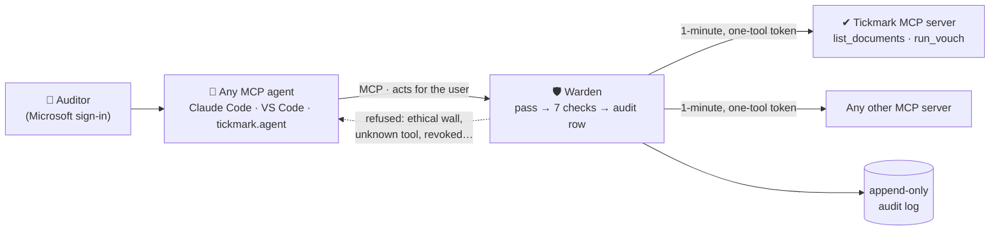

<div align="center">

# 🛡 Warden · ✔︎ Tickmark

**Identity and access for AI agents, and an audit agent that runs behind it.**

[](https://github.com/musishere/Warden-tickmark/actions/workflows/warden.yml)
[](https://github.com/musishere/Warden-tickmark/actions/workflows/tickmark.yml)
[](LICENSE)

[](warden/brag-output/brag.mp4)

*▶ Watch the 54-second overview*

</div>

---

Professional firms want their people to use AI agents on client work. An agent with access to the
firm's systems can be tricked by a document it reads, can cross an ethical wall a person never
would, and leaves no proof of what it did. This repository holds two projects that address that:

| | Project | What it is | Stack |
|---|---|---|---|
| 🛡 | **[Warden](warden/README.md)** | An open-source MCP gateway. It checks **every** tool call an AI agent makes against the firm's rules (who the agent acts for, the engagement, ethical walls, roles) and records every decision in an append-only audit log. Works with any MCP agent and any MCP tool server. | .NET 10 · PostgreSQL · Microsoft Entra ID · React admin console · Azure Container Apps |
| ✔︎ | **[Tickmark](tickmark/README.md)** | An audit agent that vouches an Excel sample against invoice PDFs: ✅ matched · ⚠️ difference · 👀 needs review · ❓ no evidence. AI reads, code decides. Its tools run behind Warden as the end-to-end demo. | Python 3.12 · FastAPI · Azure Document Intelligence · PostgreSQL · Excel add-in |

**Start with Warden**; Tickmark is just one example of an agent and tool server behind it.

## How they fit together



## Quick start

```bash
git clone https://github.com/musishere/Warden-tickmark.git
cd Warden-tickmark
```

- **Warden** (.NET 10 SDK + Docker): [warden/README.md → Quick start](warden/README.md#quick-start)
- **Tickmark** (Python 3.12, uv + Docker): [tickmark/README.md → Quick start](tickmark/README.md#quick-start)
- **Both together**, an agent vouching invoices through Warden with an ethical wall refusing it:
  [tickmark/README.md → Behind Warden](tickmark/README.md#tickmark-behind-warden)

## Documentation

| | Warden | Tickmark |
|---|---|---|
| Overview | [README](warden/README.md) | [README](tickmark/README.md) |
| Complete guide | [how-it-works.md](warden/docs/how-it-works.md) | [how-it-works.md](tickmark/docs/how-it-works.md) |
| Scope and progress | [MVP.md](warden/MVP.md) | [MVP.md](tickmark/docs/MVP.md) |
| Deployment | [deployment.md](warden/docs/deployment.md) | — |

[Contributing](CONTRIBUTING.md) · [Security policy](SECURITY.md) · [License (Apache-2.0)](LICENSE)
