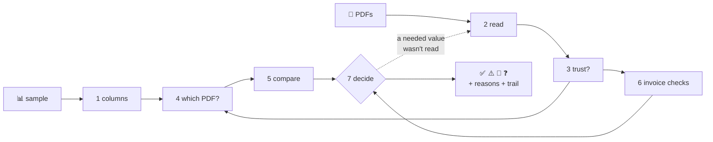
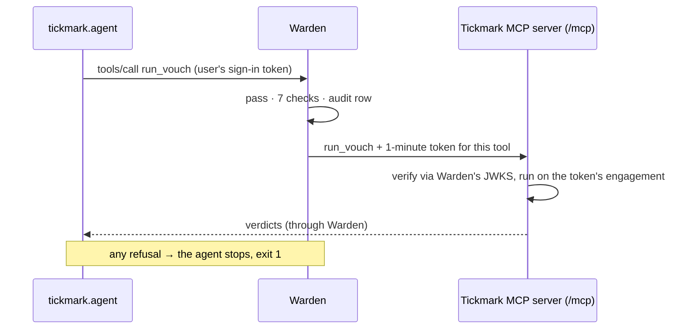

<div align="center">

# ✔︎ Tickmark

**Invoice vouching for auditors. AI reads, code decides.**
Checks every row of an audit sample against its invoice PDF and gives each one a mark, a reason and
the full trail of how it decided.

[](https://github.com/musishere/Warden-tickmark/actions/workflows/tickmark.yml)
[](../LICENSE)


[What it does](#what-it-does) · [Features](#features) · [How it decides](#how-it-decides) ·
[Quick start](#quick-start) · [Behind Warden](#tickmark-behind-warden) · [Accuracy](#accuracy) ·
[Configuration](#configuration) · [Layout](#repository-layout)

</div>

---

## What it does

Auditors take a **sample** from a company's books, for example 40 invoices the company says it
received. Each row is a claim: *"We got invoice 73459321 from Hernandez, English and Yoder on
19 Nov 2013 for 495.30 USD."* Checking each claim against the real invoice is called **vouching**.
Tickmark does it for the whole sample:

| Mark | Name | Meaning |
|---|---|---|
| ✅ | matched | the invoice backs up the row |
| ⚠️ | difference | the invoice contradicts the row (`row 571.04, PDF 406.82`), or the invoice itself is broken |
| 👀 | needs review | Tickmark couldn't decide, so a person should look |
| ❓ | no evidence | no invoice found for this row |

**The rule above all others: a ✅ must never be wrong.** A wrong ✅ hides a real problem; a 👀 that
turns out fine costs someone a minute. When unsure, Tickmark says 👀. All pass/fail logic is
plain code with fixed rules, never a language model's opinion.

Tickmark is also the demo agent and MCP tool server for [Warden](../warden/README.md): every tool
call it makes on client files goes through Warden's checks and audit log.

## Features

| | |
|---|---|
| 📊 **Any sample sheet** | Reads `.xlsx` or an Excel range, finds the header under title blocks, and maps columns to fields by name and value patterns. Optional LLM suggestions for unfamiliar layouts. |
| 📄 **Digital, scanned or photographed PDFs** | Reads each PDF's own text first; sends only the hard ones (scans, broken or rotated text) to Azure Document Intelligence. |
| 🔗 **Careful linking** | Links each row to one PDF by invoice number, vendor, amount and date, and holds up against typo'd numbers, reused numbers and look-alike invoices. |
| 🧮 **Invoice checks** | Net + VAT = total, allowed VAT rates, date in the audit period, duplicates, and line-item sums (optional). |
| 🧾 **Evidence for every value** | Each value read keeps a snip (page, bounding box, text), so every verdict can be traced to the page. |
| 🗄 **Append-only audit trail** | Runs, documents (by hash), verdicts and human reviews are stored in multi-tenant Postgres with row-level security. Rows can't be changed after they're written. |
| 🖥 **Three front ends** | A web page, an Excel add-in (Office.js) and a command-line agent that works through Warden. |
| 🛡 **Built to run behind a gateway** | Its MCP tools accept only Warden's one-minute, one-tool tokens; the engagement always comes from the token. |

## How it decides



1. **Columns.** Work out which column holds the invoice number, vendor, amount, date and so on.
2. **Read.** Extract every PDF, 8 at a time: local text first, Azure only where needed.
3. **Trust.** A value counts only if the invoice confirms it, by arithmetic or by literal printing.
   Azure's confidence score on its own is not enough.
4. **Link.** Pick each row's PDF, or none.
5. **Compare.** Compare the row's fields with the invoice's.
6. **Check.** Run checks on the invoice by itself (VAT, period, duplicates, totals).
7. **Decide.** Give the mark and its reasons. If a needed value wasn't read clearly, that PDF is
   re-read once with Azure and the row is decided again.

What gets checked comes from a **definition** (`definitions/INVOICE_VOUCHING`), so a new kind of
audit test means new data rather than new code.

## Quick start

Requirements: Python 3.12, [uv](https://docs.astral.sh/uv/) and Docker.

```bash
cd tickmark
make setup        # .venv, install, .env from .env.example
make db           # Postgres on :5435 + migrations
make demo         # generate demo datasets into data/
make run          # web app on http://localhost:8000
make test         # the test suite
make eval         # verdicts vs hand-written labels (no Azure)
```

Other ways to use it:

```bash
make certs && make run-https            # Excel add-in over https (addin/manifest.xml)
make logs                               # follow the step-by-step decision log

# The command line, with a saved, re-checkable audit trail
python -m tools.vouch_sample <sample.xlsx> <invoices/> --trace --out data/output/run.xlsx --save
python -m tools.show_run <run id> --trace
python -m tools.verify_run <run id>     # re-hash the evidence: files unchanged?
```

Azure Document Intelligence is optional: with `TICKMARK_AZURE=off`, rows Tickmark can't read with
its own reader become 👀 or ❓, and the reason says why.

## Tickmark behind Warden

As an agent, Tickmark never gets the auditor's full powers. It connects to Warden's MCP address for
one engagement with the user's sign-in token, the same way Claude Code or any other MCP client
does. Warden checks every call against the firm's rules and logs it.



- **MCP server** (`api/mcp.py`): `POST /mcp` offers `list_documents`, `read_document` and
  `run_vouch`. Every message needs a Warden-signed token (RS256, `aud=tickmark-tools`) for that one
  tool. The engagement is always taken from the token, never from the arguments.
- **Agent** (`agent.py`, `mcp_client.py`): a plain MCP client. It fails closed: a 401/403, an
  error result or an unreachable server stops the run.

Try it with Warden running (see the [Warden quick start](../warden/README.md#quick-start)):

```bash
make warden-demo                                   # files for Warden's demo engagements (Coke, Pepsi)
make run                                           # Tickmark's MCP server on :8000
TOKEN=$(cd ../warden && dotnet run --project src/Warden.Api --no-launch-profile -- dev-token sara tickmark)
make agent TOKEN=$TOKEN                            # vouches Coke: allowed
make agent TOKEN=$TOKEN ENG=e0000000-0000-0000-0000-000000000002   # Pepsi: refused by Sara's ethical wall
```

## Accuracy

The test labels are written by a person reading each rendered invoice, never taken from Tickmark's
own reading or from the data embedded in e-invoices. Sample sheets contain planted mistakes: wrong
amounts, wrong dates, wrong vendors and missing invoices. Two numbers must always be zero, and the
eval scripts fail CI otherwise: **wrong links** and **false ✅**.

| Set | Mode | Result | Wrong links / false ✅ |
|---|---|---|---|
| generated · external · hard | perfect reading | 16/16 · 7/7 · 11/11 | 0 |
| real/facturx (30 ZUGFeRD e-invoices) | own reader + Azure | 30/30 | 0 |
| variety/originals (images, other layouts, stray pages) | own reader + Azure | 34/40 | 0 |

Some rules were tuned while looking at these sets, so treat the scores as optimistic. A held-out set
is on the roadmap.

## Configuration

Settings come from `.env` (copied from [`.env.example`](.env.example), every setting commented),
all prefixed `TICKMARK_`:

| Setting | Purpose |
|---|---|
| `DATABASE_URL`, `ADMIN_DATABASE_URL` | Postgres as the app role (row-level security) / as owner (migrations) |
| `AZURE` | `auto` (only where the PDF's own text isn't reliable) · `off` · `always` |
| `DOCINT_ENDPOINT`, `DOCINT_KEY`, `DOCINT_MODEL` | Azure Document Intelligence (`prebuilt-invoice`) |
| `VAT_RATES`, `CONFIDENCE_MIN` | allowed VAT rates when the engagement sets none; Azure confidence floor |
| `WARDEN_URL`, `TOOLS_AUDIENCE`, `ENGAGEMENTS_DIR` | where Warden is, the token audience the tools accept, engagement files |
| `LLM_MAPPING`, `LLM_MAPPING_VALUES`, `LLM_*` | optional column-mapping suggestions from any OpenAI-compatible API (off by default) |
| `LOG_LEVEL`, `LOG_DIR` | step-by-step decision log (contains client values: local use) |

## Repository layout

```
src/tickmark/
  api/          FastAPI app, MCP server (mcp.py), tools behind Warden, web page + Excel add-in
  fields/       raw cells, value types, column → field mapping (optional LLM)
  definitions/  what an audit test needs: INVOICE_VOUCHING
  sample/       load and clean the sample
  extract/      PDF readers: local text, Azure Document Intelligence, a fake for tests
  match/        which PDF is each row about
  vouch/        compare, invoice checks, verdict, policy
  store/        append-only, multi-tenant audit trail
  pipeline.py   the whole run · agent.py + mcp_client.py: the agent through Warden
tools/          CLI: data generation, step-by-step runs, evals, audit trail
migrations/     Alembic
tests/          pytest, one file per area
```

## Learn more

- **[docs/how-it-works.md](docs/how-it-works.md)**: the complete guide, each step in plain words,
  technically and as a diagram
- [docs/MVP.md](docs/MVP.md): scope and progress
- Known gaps: [how-it-works §20](docs/how-it-works.md#20-what-it-cant-do-yet)

## License

[Apache License 2.0](../LICENSE). Contributing: [CONTRIBUTING.md](../CONTRIBUTING.md) · Security:
[SECURITY.md](../SECURITY.md).
