# Tickmark: technical architecture

How Tickmark turns an audit sample and a folder of invoice PDFs into one verdict per row, and the design decisions behind the accuracy work. Every module, function and constant named here exists in `src/tickmark/` as of this writing.

For the plain-language version see [HOW-IT-WORKS.md](HOW-IT-WORKS.md).

---

## 1. Stack

| Layer | Technology |
|---|---|
| Language | Python 3.12, Pydantic models, `Decimal` for all money |
| PDF text | `pdfplumber` (words with coordinates), `pypdfium2` (rendering) |
| OCR / field extraction | Azure Document Intelligence, model `prebuilt-invoice` (`azure-ai-documentintelligence` SDK) |
| Spreadsheets | `openpyxl` |
| Fuzzy matching | `rapidfuzz` (vendor similarity only) |
| API | FastAPI + uvicorn; background runs in threads (`api/jobs.py`) |
| Front ends | Plain-JS web page (`api/static/app.js`), Excel add-in on Office.js (`api/static/addin/`) |
| Audit store | Postgres via SQLAlchemy Core, append-only tables, row-level security, content-addressed evidence files |
| Evaluation | `tools/eval_*.py`, hand-labelled datasets in `data/real/` |

---

## 2. Module map

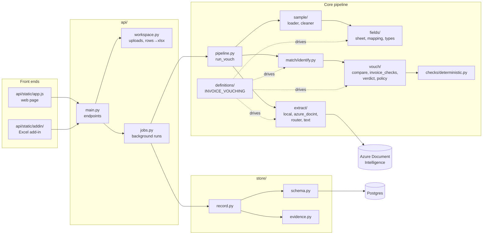

**The definition drives the engine.** `definitions/INVOICE_VOUCHING` is data: a tuple of `FieldSpec(name, type, role, label, evidence_field, aliases, pdf_labels, …)`. The roles decide how each field is used:

| Role | Fields | Used for |
|---|---|---|
| `key` | invoice number (`reference` → `invoice_number`) | Strongest identifier for linking |
| `party` | vendor | Who the claim is with |
| `corroborating` | amount (→ `total`), invoice date | Support a link |
| `attribute` | currency, net, VAT, due date, PO, **amount_due**, **charges**, **allowances** | Compared or read, never used to link |
| `label` | row id | Never compared |

A new audit test is a new `Definition`, not new code. Client layouts can add their own meanings (`Definition.with_meanings`).

---

## 3. Data model

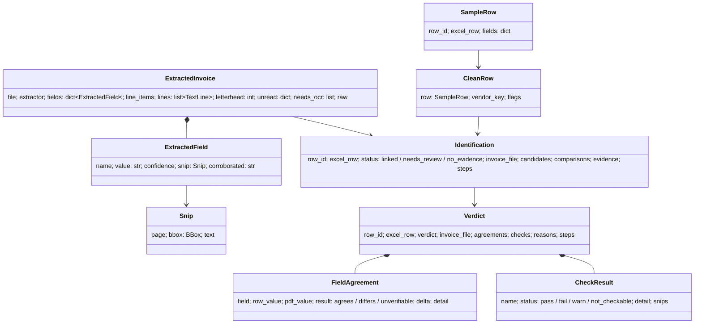

Key properties:
- **Every extracted value carries its evidence:** the page and bounding box (`Snip`), the reader's confidence, and `corroborated`, the reason an independent source confirms it.
- **Every decision carries its trail:** `Identification.steps`, `Verdict.steps`, `Comparison`/`FieldCheck` per PDF. Nothing has to be recomputed to explain a result.

---

## 4. Pipeline

`pipeline.run_vouch(sample, invoice_dir, extractor, policy, mapping)`:

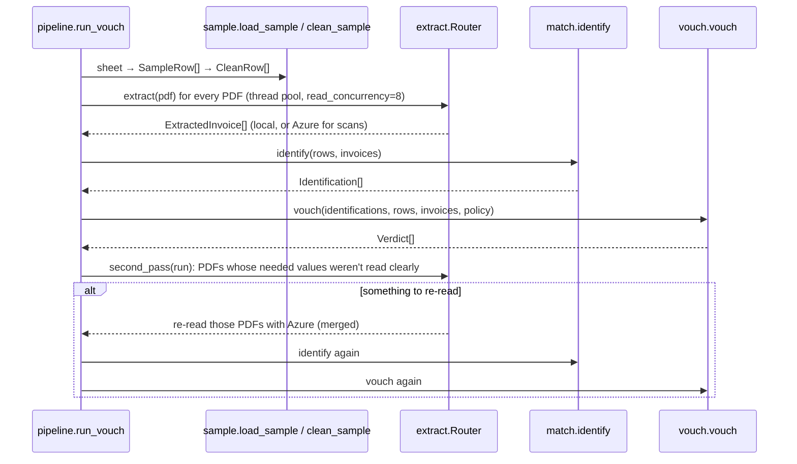

The second pass runs **once**. It exists so that clean digital PDFs cost nothing, and Azure is only paid for where a value the verdict depends on is missing.

---

## 5. The sample: sheet → rows

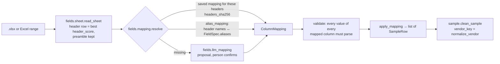

- **`normalize_vendor`:** NFKC/NFKD, strip accents, casefold, `&`→`and`, drop dots and punctuation, strip trailing legal forms (GmbH, Ltd, SARL, B.V., "GmbH & Co. KG"…). "Acme B.V." and "ACME BV" both become `acme`.
- **Excel add-in input** (`api/workspace.sheet_from_rows`): Office.js sends `values` and `numberFormat` per cell. A number in a cell whose format contains a d or y token (ignoring quoted text and `[...]`) is turned back from an Excel serial into a date: `datetime(1899,12,30) + days`.

---

## 6. Reading PDFs

### 6.1 Our own reader: `extract/local.py` · `LocalExtractor`

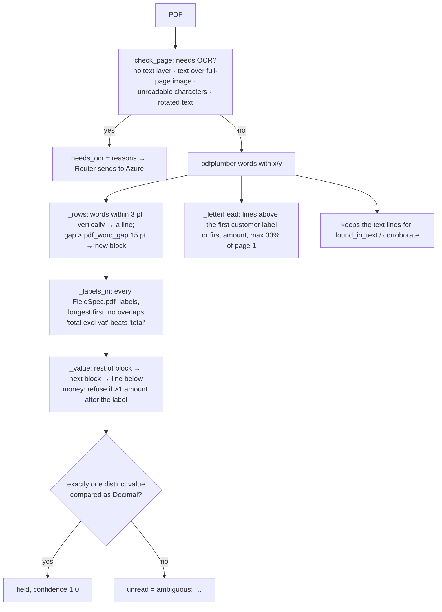

Rules added during the accuracy work:

| Rule | Where | Why |
|---|---|---|
| Amounts compared as `Decimal` ("0" = "0.00" = "-0.00") | `_number_or_text` | Removed false "ambiguous" readings |
| The letterhead stops at an amount, **not a date** (`\d[.,]\d{2}\b(?![.,]\d)`) | `_letterhead` | `03.10.2018` was cutting the letterhead to one line |
| Labelled currency is printed as a code or symbol only | `_parse("currency")` | "der" would otherwise parse as `DER` |
| Currency labels: invoice currency, rechnungswährung, devise, valuta, but **not** a bare "Währung" | `definitions` | "Währung der Umsatzsteuerbuchung" is the VAT's currency |
| `amount_due`, `charges`, `allowances` as their own meanings | `definitions` (v4) | "Zahlbetrag" and "Gesamtbetrag der Zuschläge" were read as the total |
| Only "amount due" printed: it becomes the total if net + tax equals it | `_find_values` | Dutch "Te betalen" invoices |

### 6.2 Azure: `extract/azure_docint.py` · `DocIntExtractor`

- `begin_analyze_document("prebuilt-invoice", bytes)`. The raw result is **cached** at `data/cache/docint/<sha256(pdf)>.json`, so the same bytes are never billed twice and offline re-runs are deterministic.
- `FIELD_MAP`: VendorName, InvoiceId, InvoiceDate, InvoiceTotal, SubTotal, TotalTax, CustomerName, DueDate, PurchaseOrder. Currency comes from InvoiceTotal's `currencyCode`. TaxDetails gives the VAT breakdown per rate.
- `ocr_words` converts Azure's page words (in inches) into the local reader's coordinates, so **label reading also runs on scans**.

### 6.3 Merging the two: `extract/router.py` · `Router`

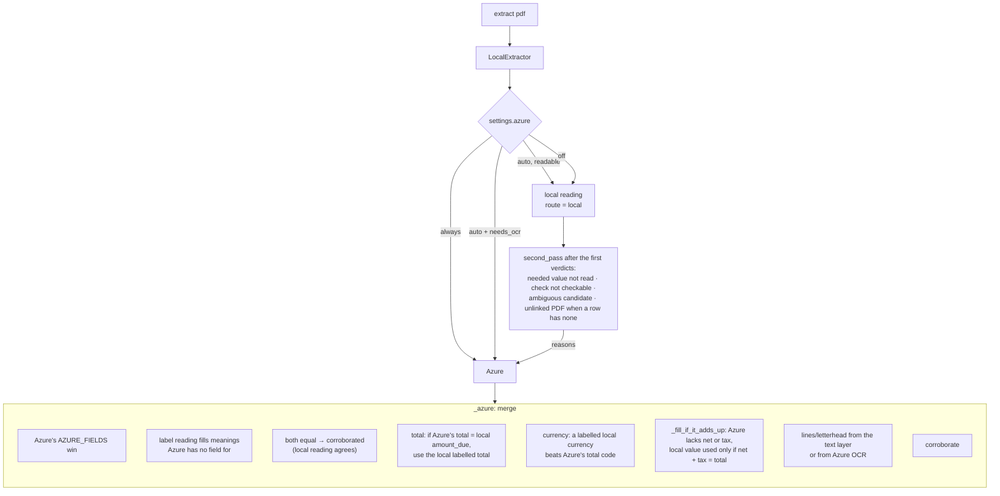

---

## 7. Trust: `extract/text.py`

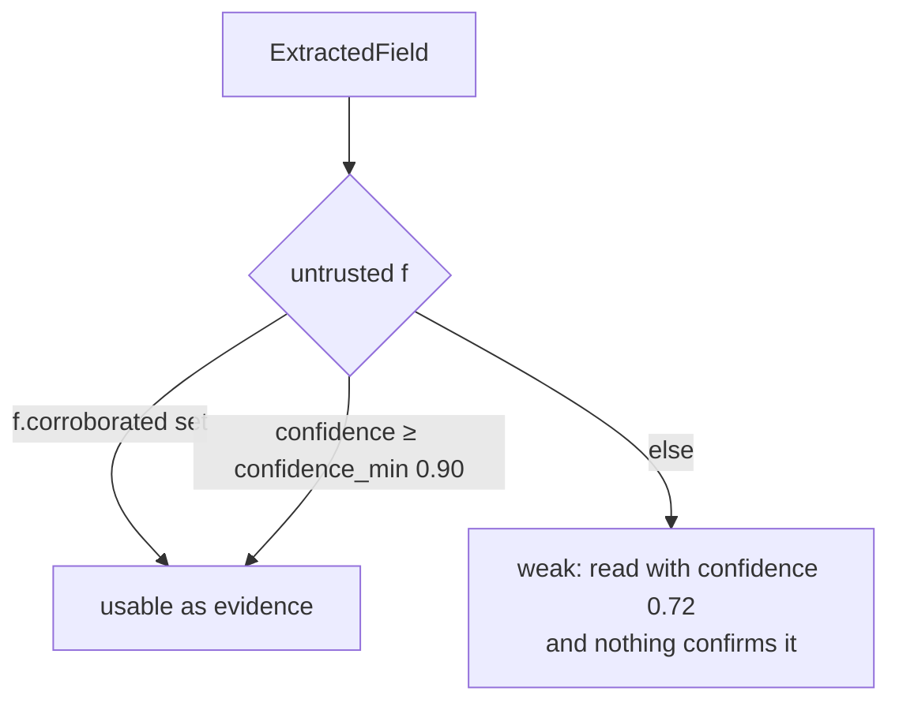

`corroborate(inv)` sets `corroborated` from independent evidence, in this order:

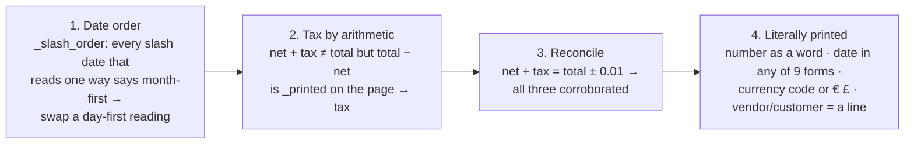

- **`_printed(amount, text)`** accepts `1234.50`, `1234,50`, `1,234.50`, `1.234,50` and `1 234,50`, bounded by non-digits.
- **`found_in_text(inv, type, role, value)`** works from the claim side. Is the row's own value printed?
  - An identifier counts if it's one exact word, after `normalize_number` (no spaces, dashes or slashes, uppercase).
  - A vendor counts if it's a **whole block** in the letterhead: a whole line, a part of a line between separators (`:`, ` - `, `|`, `•`, `●`), or two consecutive lines. It never counts if it equals the invoice's customer.

**Invariant:** nothing in `extract/` ever reads the sample row. Corrections come from the page only.

---

## 8. Linking rows to PDFs: `match/identify.py`

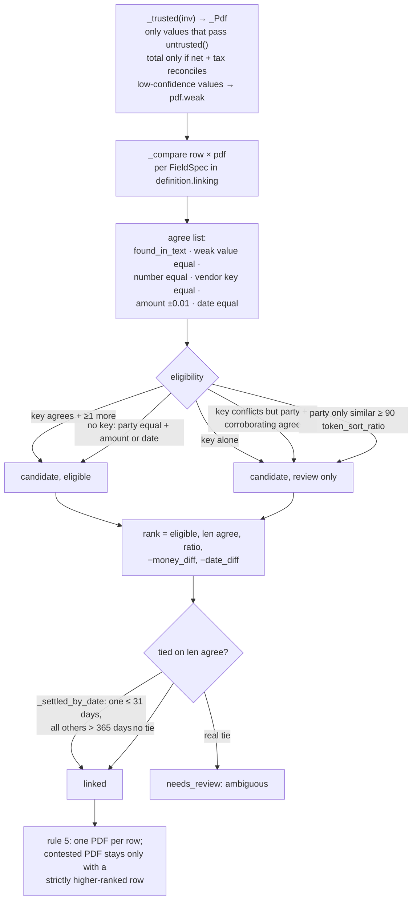

All thresholds are recorded with every stored run (`THRESHOLDS`: `confidence_min`, `vendor_similar` 90, `amount_tol` 0.01, `date_near` 31, `date_far` 365), so an old result can still be explained after a rule changes.

---

## 9. Vouching: `vouch/`

### 9.1 Field comparison: `compare.compare`

| Type | Agrees | Differs | Unverifiable |
|---|---|---|---|
| money | `abs(row − pdf) ≤ amount_tol` | with delta `+164.22 (row − PDF)` | value untrusted and not equal |
| date | equal | with `±N days` | day and month swapped and the page is ambiguous; untrusted |
| name | `normalize_vendor` keys equal, or `found_in_text` | keys differ | one key is part of the other (`_part_of`); untrusted |
| identifier | `normalize_number` equal | differ | untrusted |
| currency | code equal (row empty → `policy.currency`) | differ | neither row nor engagement says |

Untrusted values follow an asymmetric rule: one that equals the row may **agree** (`_weak_equal`), but it can never produce **differs**.

### 9.2 Invoice checks: `invoice_checks.check_invoice`

| Check | Logic |
|---|---|
| `totals_reconcile` | net + tax = total ± tol |
| `lines_sum` (policy.line_items) | Σ line amounts = net, and qty × price = amount per line |
| `vat_rate` | Breakdown: every rate in `policy.vat_rates` and Σ parts = tax. Otherwise tax/net is an allowed rate; a share between two rates → not_checkable |
| `in_period` | `period_start ≤ date ≤ period_end` |
| `duplicate` | `checks.deterministic.duplicates`: same number + same vendor → fail; other vendor → warn; vendor unknown → not_checkable |

### 9.3 The verdict: `verdict._verdict`

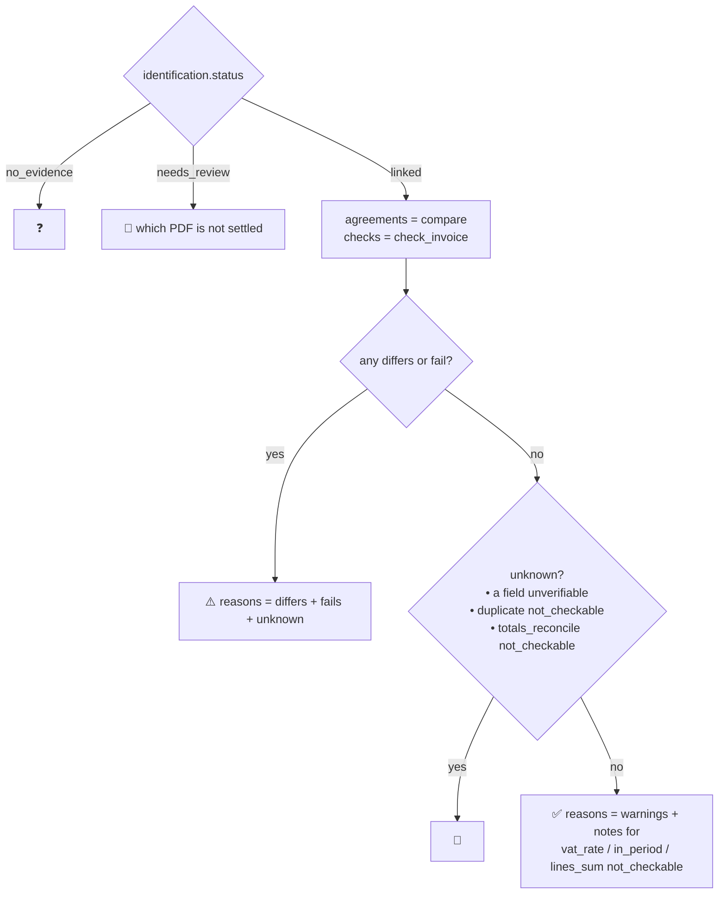

**Why totals are in the blocking set:** an invoice whose lines add up to 2,112 under a printed total of 9,312 was passed when "totals not checkable" was only a note. A total nothing shows to add up proves nothing, even when it equals the row.

---

## 10. API and front ends

| Endpoint | Purpose |
|---|---|
| `POST /api/workspaces` | Upload: `sample` (.xlsx) **or** `rows` (JSON `{values, formats, sheet}` from Excel) + `invoices` (.pdf) |
| `GET /api/workspaces/{id}` | Columns, mapping, problems, PDFs |
| `POST /api/workspaces/{id}/suggest` | LLM column proposal |
| `PUT /api/workspaces/{id}/mapping` | Validate and confirm the mapping |
| `POST /api/workspaces/{id}/runs` | Start a run (period, currency, vat_rates, azure, line_items, save) |
| `GET /api/jobs/{id}?since=n` | Log lines since n, then the result |
| `GET /api/workspaces/{id}/pdf/{name}` | Serve a PDF |
| `/api/tenants`, `/api/engagements/…`, `/api/runs/{id}`, `POST /api/runs/{id}/reviews` | Audit trail and reviewer decisions |

- **Workspaces** are kept in memory. `workspace.get` re-creates one from `data/uploads/<id>/` after a restart (the id must match `[0-9a-f]{12}`, so it can't be used as a path).
- **Jobs** run in a daemon thread with their own log capture (`log.capture`), which the client polls.

### Excel add-in

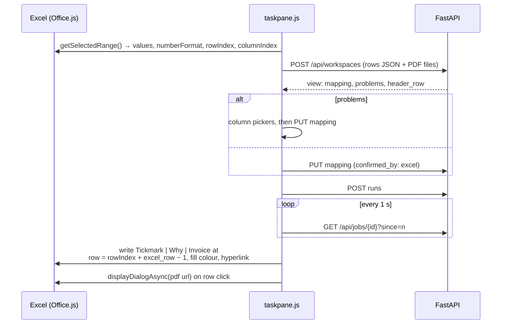

- **Manifest:** `addin/manifest.xml` (XML, TaskPaneApp, ExcelApi 1.7, a ribbon button on the Home tab). It was validated with `office-addin-manifest`.
- **Local HTTPS:** `make certs` (office-addin-dev-certs) and `make run-https` (uvicorn with the localhost certificate). The add-in is served from `/static/addin/`, the same origin as the API, so no CORS is needed.

---

## 11. Audit store: `store/`

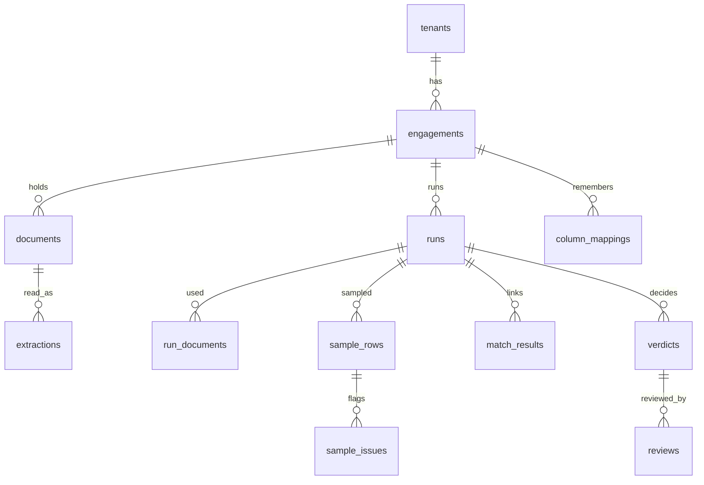

- **Append-only:** a database trigger rejects UPDATE and DELETE. A re-run is a new run, and a human decision is a new `reviews` row.
- **Multi-tenant:** every row carries `tenant_id` and `engagement_id`. Row-level security limits each session to its own rows, and composite foreign keys stop links across engagements.
- **Evidence files** (`evidence.put`) are content-addressed by SHA-256 per engagement and never overwritten.
- Each run records `matcher_version()`, the definition snapshot (with its sha256) and the thresholds.

---

## 12. Evaluation harness

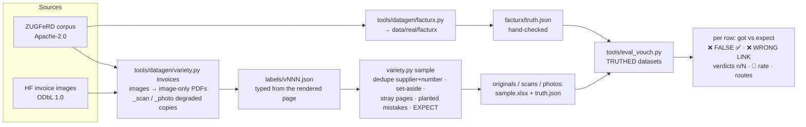

- **`truth.json` format:** `{period, currency, vat_rates, rows: {row_id: {expect: verdict | [acceptable…], field?, note}}}`. Stray pages are entries `"stray vNNN.pdf": {expect: "unlinked"}`; a row linked to one counts as a wrong link.
- **Labels are typed from the rendered page, never from the embedded XML.** In the corpus, the XML disagreed with the visible invoice for 3 of 30 PDFs (r018, r020, r021).
- **Commands:** `make eval-real`, `make eval-variety`, `make eval` (synthetic sets), `make test`.
- **The run exits 1 on any false ✅ or wrong link.** That is the hard gate.

| Set | Rows | Correct | False ✅ |
|---|---|---|---|
| `real/facturx` | 30 | 30 | 0 |
| `variety/originals` | 40 + 6 stray | 34 | 0 |
| `variety/scans`, `photos` | 13 each | not run yet | |
| synthetic `generated` / `hard` | 16 / 11 | 16 / 9 | 0 |

---

## 13. Invariants

1. **No false ✅.** Every relaxation is measured against it, and one was rolled back when it produced one (totals).
2. **Corrections only from the invoice.** `extract/` and `corroborate` never see the sample row.
3. **Untrusted values can agree but never contradict.**
4. **Arithmetic or literal printing is the only "independent confirmation".** Reader confidence alone was measured not to separate right from wrong.
5. **One PDF per row, one row per PDF.** Ambiguity goes to 👀, never to a guess.
6. **Every decision is explainable after the fact:** steps, snips, thresholds, definition snapshot, matcher version.

---

## 14. What changed during the accuracy work

| Phase | Change | Files |
|---|---|---|
| 0 | Hand-checked truth, scoreboard for real sets | `data/real/facturx/truth.json`, `tools/eval_vouch.py`, `Makefile` |
| 1 | Side checks that can't run are notes (except duplicate and totals) | `vouch/verdict.py` |
| 2 | Date tie-break for equally agreeing PDFs | `match/identify.py` |
| 3 | Letterhead fix, vendor blocks, page date order, labelled currency, amount due / charges / allowances, Decimal ambiguity, tax by arithmetic, net/tax fill only if it adds up | `extract/local.py`, `extract/text.py`, `extract/router.py`, `definitions/` |
| Data | Variety set: images, unseen layouts, scans, photos, answers | `tools/datagen/variety.py`, `data/real/variety/` |
| Excel | Rows upload, add-in, manifest, HTTPS targets, restart-safe uploads | `api/workspace.py`, `api/main.py`, `api/static/addin/`, `addin/` |

---

## 15. Known limitations

| Limitation | Location | Direction |
|---|---|---|
| The local reader rarely reads unlabelled dates and numbers ("Nr. X vom DATE") | `extract/local.py` | Heading patterns, so Azure is needed less |
| Azure fields not used: VendorAddressRecipient, VendorTaxId, AmountDue | `extract/azure_docint.py` | Map them, trusted only if printed on the page |
| No claim-first search for amounts and dates | `extract/text.py` | Same-page, labelled-line constraint |
| `lines_sum` ignores line discounts | `vouch/invoice_checks.py` | Must stay off until fixed |
| Uploads and jobs live in process memory | `api/workspace.py`, `api/jobs.py` | Not multi-worker safe |
| Scores are partly on sets seen while tuning | `data/real/` | Fresh held-out set, run only at milestones |
