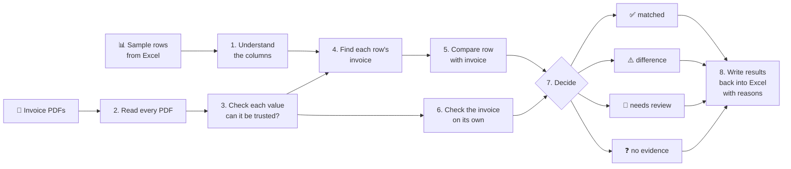
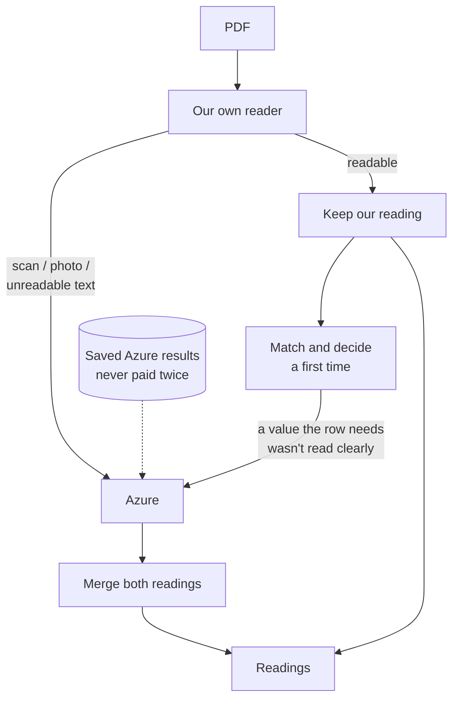
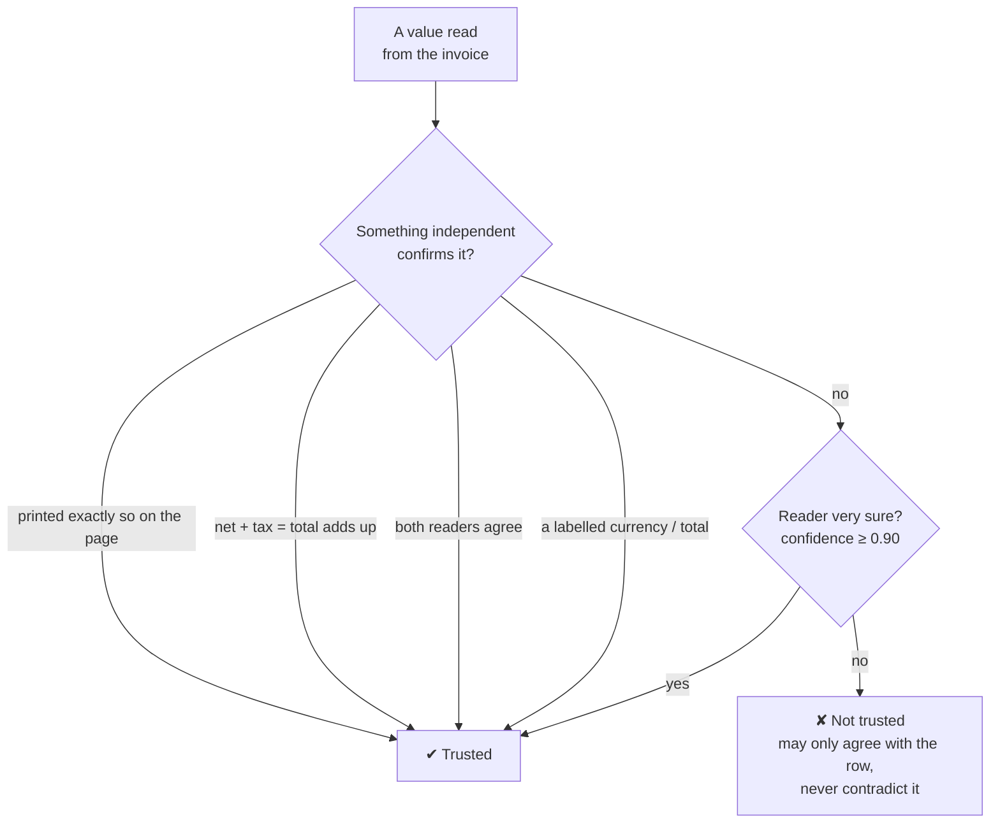
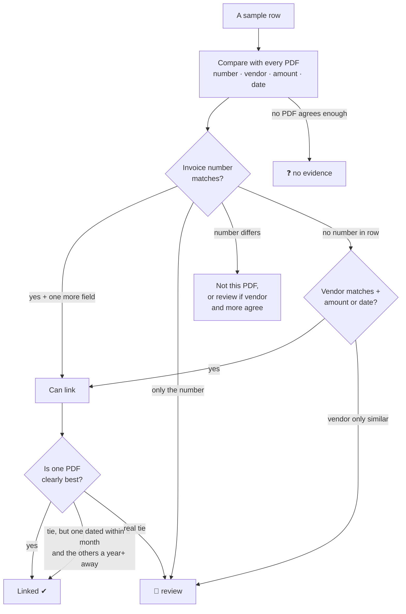
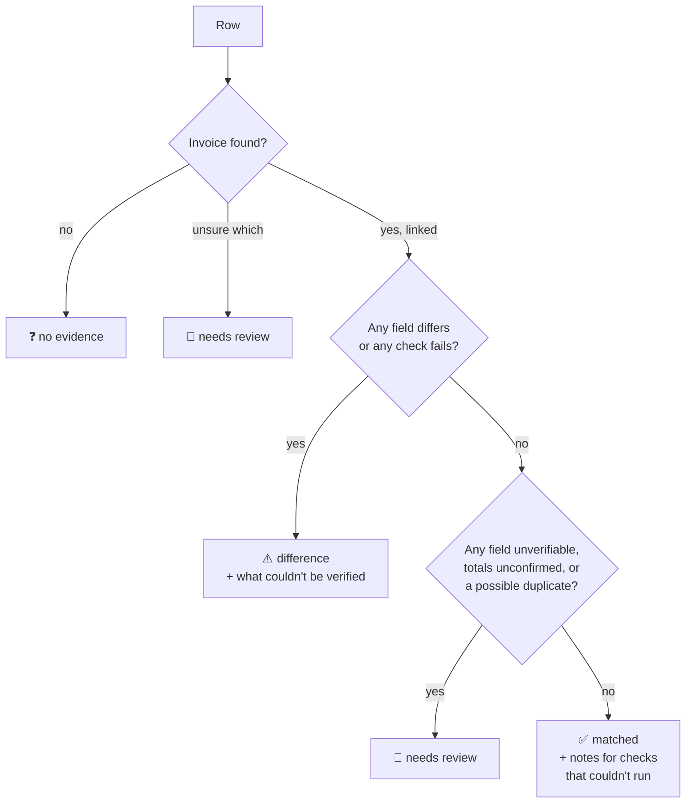
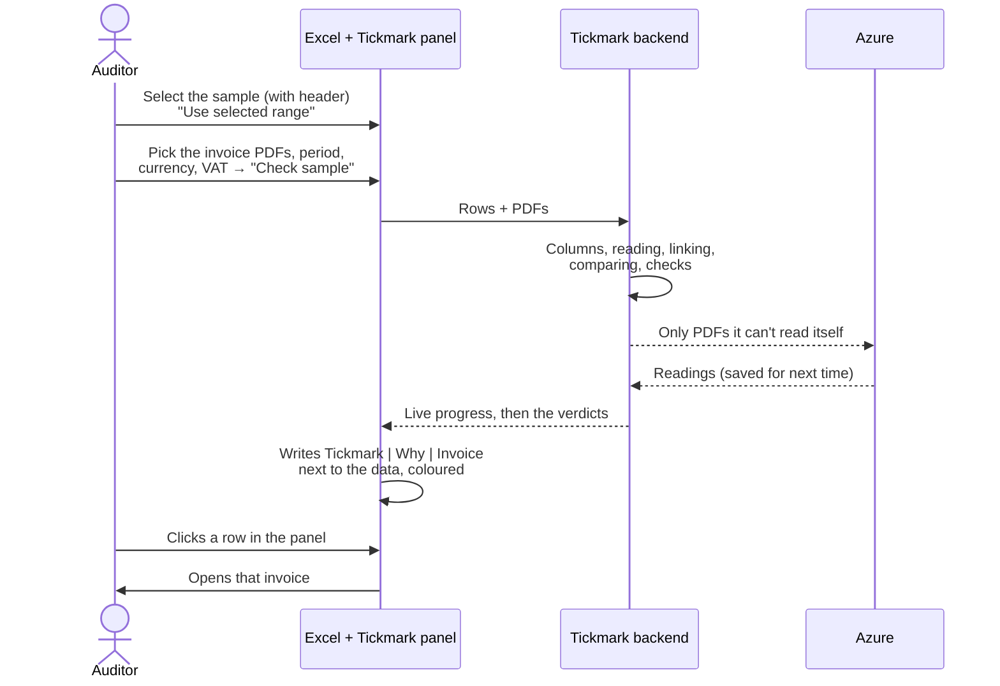
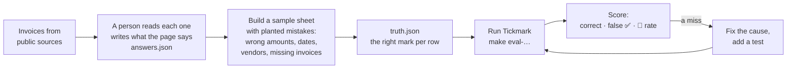

# How Tickmark works

A plain-language guide from start to end: what Tickmark does, every step it takes, how it decides, how to use it in Excel, and how we test that it's right.

---

## 1. What Tickmark is for

Auditors take a **sample** from a company's books, for example 40 invoices the company says it received. Each row in the sample is a claim:

> "We got invoice **73459321** from **Hernandez, English and Yoder** on **19 Nov 2013** for **495.30 USD**."

The auditor has to check every claim against the **real invoice** (a PDF). This is called **vouching**. Tickmark does it automatically and gives every row one of four marks:

| Mark | Name | Meaning |
|---|---|---|
| ✅ | matched | The invoice backs up the row |
| ⚠️ | difference | The invoice contradicts the row (wrong amount, wrong date, a broken invoice…) |
| 👀 | needs review | Tickmark couldn't decide. A person should look. |
| ❓ | no evidence | No invoice was found for this row |

**The most important rule: a ✅ must never be wrong.** A wrong ✅ means the auditor misses a real problem. A 👀 that turns out fine only costs someone a minute. So whenever Tickmark is unsure, it chooses 👀, never ✅.

Every mark comes with a **reason** ("amount differs: row 571.04, invoice 406.82") and a **step-by-step trail** of how Tickmark got there.

---

## 2. The whole journey at a glance



The sections below go through each step.

---

## 3. What you give Tickmark

| Input | What it is | Example |
|---|---|---|
| **Sample** | Rows from the books: vendor, invoice number, date, amount, currency | `O-001, Hernandez…, 73459321, 2013-11-19, 495.30, USD` |
| **Invoices** | The PDF of each invoice: digital, scanned or photographed | `v001.pdf` … `v042.pdf` |
| **Period** | The audit period. An invoice dated outside it is flagged. | 2012-02-24 → 2023-11-03 |
| **Currency** | Used only when a row doesn't state its own currency | EUR |
| **VAT rates** | The tax rates that are legal for this client's countries. Any other rate is suspicious. | `0,5.5,7,19,20` |
| **Azure** | Whether Microsoft's paid reader may be used: `auto` (when needed), `off`, `always` | auto |

---

## 4. Step 1: understanding the sample

Tickmark finds the **header row** (even if there are title rows above it) and works out which column means what, by its name: "Invoice No" → invoice number, "Amount" → amount, and so on.

If a column has an unusual name, Tickmark asks you which column holds what. Optionally, an AI can make a suggestion, which a person always confirms. The confirmed mapping is saved for next time.

---

## 5. Step 2: reading the PDFs

This is the hardest step. Tickmark has **two readers**:

| Reader | Cost | Good at | Weak at |
|---|---|---|---|
| **Our own reader** | Free, instant | Digital PDFs: it reads the text and looks for **labels** like "Invoice No", "Total", "Bruttosumme", "Total TTC" and takes the value next to them | Scans and photos (no text to read); unfamiliar layouts |
| **Azure** (Microsoft's AI reader) | About $10 per 1,000 pages, ~15 s per PDF | Scans, photos, any layout | Sometimes picks the wrong thing: a watermark as the vendor, "amount due" as the total, the wrong currency |



**How the two readings are merged**
- Azure's values normally win, because on most fields it's better.
- **Except where the page proves otherwise:**
  - A currency printed next to "Invoice currency" / "Rechnungswährung" beats Azure's guess.
  - If Azure's "total" is the number the page labels as **amount due** ("Zahlbetrag"), the number labelled as the **total** is used.
  - If Azure missed the net or the tax, our reader's value is used, **but only if net + tax = total then adds up.**
- When both readers agree on a value, that agreement counts as confirmation.

Every Azure result is saved by a fingerprint of the file, so the same PDF is never paid for twice.

---

## 6. Step 3: can a value be trusted?

Reading a value isn't enough; Tickmark has to **trust** it. A value is trusted only if one of these is true:



**Corrections, only when the page proves them:**
- **Amount due vs total:** "440 is labelled as the amount due, 220 as the total", so the total is 220.
- **Day/month order:** "11/03/2017" is read as 3 November if another date on the same page (11/17/2017) can only be month-first.
- **Wrong tax:** if net + tax doesn't add up, but *total − net* is printed on the page (e.g. the tax in the invoice currency instead of the booking currency), that printed number is the tax.

**The rule that is never broken:** Tickmark never "fixes" a reading by copying the value from the row being tested. That would let a wrong row prove itself.

---

## 7. Step 4: finding each row's invoice

Before comparing anything, Tickmark has to know **which PDF belongs to which row**. It only links when the evidence is strong and points to one PDF:



- **One PDF backs one row.** If two rows want the same PDF, only a clearly better row keeps it; the other goes to 👀.
- **Vendor names are compared loosely:** "Acme B.V." = "ACME BV", and legal forms like GmbH or Ltd are ignored. The name may also be found in the invoice's letterhead, or in a line like "Name: Physiotherapeutin". But the **customer's** name never counts as the vendor.

---

## 8. Step 5: comparing the row with its invoice

For the linked PDF, each field of the row is compared:

| Field | Rule | Result if different |
|---|---|---|
| Amount | Equal within 0.01 | ⚠️ with the gap, e.g. "+164.22" |
| Date | Exactly equal | ⚠️ with the days, e.g. "−365 days". 👀 if the page's date could mean either order. |
| Invoice number | Equal, ignoring spaces, dashes and case | ⚠️ |
| Vendor | Same normalised name | ⚠️, or 👀 if one name is part of the other |
| Currency | Same code (the default currency if the row has none) | ⚠️ |

If the invoice value **isn't trusted**, it can still *agree* with the row when it's exactly equal, but it can **never** produce a ⚠️ on its own. Then the field is "unverifiable" → 👀.

---

## 9. Step 6: checking the invoice on its own

Even when the row and the invoice agree, the invoice itself might be wrong. Tickmark runs these checks:

| Check | Question | If it fails | If it can't run |
|---|---|---|---|
| **Totals** | Does net + tax = total? | ⚠️ | **👀**: a total nobody can show adds up is never passed |
| **VAT rate** | Is the tax a legal rate (from your VAT list)? | ⚠️ | Note only |
| **Period** | Is the invoice dated inside the audit period? | ⚠️ | Note only |
| **Duplicate** | Is the same number used on another invoice? | Same vendor: ⚠️. Other vendor: a warning only. | **👀**: a possible double payment |
| **Item lines** *(optional, off by default)* | Do quantity × price and the lines add up? | ⚠️ | Note only |

---

## 10. Step 7: the decision



Every verdict lists its reasons, and the full trail is kept: which reader read what, every comparison, every check.

---

## 11. Using it in Excel



**Running it locally**
```bash
make certs        # once: a trusted https certificate for localhost
make run-https    # the backend at https://localhost:8000 (keep it running)
```
Then load `addin/manifest.xml` into Excel: **Add-ins → My Add-ins → Upload My Add-in**. The steps for Excel on the web, Mac and Windows are in [`addin/README.md`](../addin/README.md).

**What you see:** three new columns to the right of your data:

| Tickmark | Why | Invoice |
|---|---|---|
| ✅ matched *(green)* | every field agrees | v001.pdf |
| ⚠️ difference *(red)* | amount differs: row 571.04, PDF 406.82, +164.22 | v020.pdf |
| 👀 needs review *(amber)* | vendor unverifiable: … | v042.pdf |
| ❓ no evidence *(grey)* | no PDF agrees on two or more fields | |

The web page at `https://localhost:8000` uses the same backend and gives the same verdicts.

---

## 12. How we know it's accurate

We test Tickmark against **answers written by a person** who read each invoice, never against Tickmark's own reading, and never against the hidden data inside e-invoices (which sometimes disagrees with the printed page).



**The test sets** (in `data/real/`)

| Set | What's in it | Command |
|---|---|---|
| `facturx` | 30 German/French e-invoices from the ZUGFeRD sample collection | `make eval-real` |
| `variety/originals` | 40 rows: invoice images in 3 layouts (US formats, missing vendors, invoices that don't add up) + 12 unseen e-invoices + 6 stray pages that must match nothing | `make eval-variety` |
| `variety/scans` | Scanned copies (tilted, grey, speckled) | `make eval-variety` |
| `variety/photos` | Phone-photo copies (skewed, uneven light) | `make eval-variety` |

Where they came from, the licences, and why some PDFs were set aside are in `data/real/variety/answers.json` and `set-aside/why.json`.

**Results so far (no false ✅ on any set)**

| Set | Correct | False ✅ |
|---|---|---|
| facturx | 30 / 30 | 0 |
| variety originals | 34 / 40 | 0 |
| variety scans / photos | not run yet (needs one Azure run) | |

**Honest caveats**
- Some rules were tuned while looking at these sets, so these scores are optimistic. A fresh **held-out** set, run only at milestones, gives the honest number.
- About half the invoices are samples or generated. Real proof comes from using it next to auditors on **real engagements**.

**Every fix comes with an automatic test** (`make test`, currently 146 passing).

---

## 13. What it can't do yet

| Gap | Effect | Planned fix |
|---|---|---|
| Our own reader misses many dates and numbers (e.g. "Nr. 471102 vom 05.06.2018") | Most PDFs still go to Azure (cost, time) | Teach it those headings |
| Vendor sometimes not read from images | 👀 instead of ✅ | Use the seller name and VAT ID Azure already returns, when printed on the page |
| Doesn't yet search the page for the row's own values | Some "which number is the total?" misses | Search for the claim, counting a hit only on the same page and a labelled line |
| Item-line check flags discounted lines wrongly | Must stay off | Account for line discounts |
| No highlight of the value on the PDF | Reviewer has to find it themselves | Highlight from the stored positions |

---

## 14. Words used in this guide

| Word | Meaning |
|---|---|
| **Sample** | The rows from the books the auditor has to check |
| **Vouching** | Checking each row against its source document |
| **Our own reader** | Tickmark's free reader for the text inside digital PDFs |
| **Azure** | Microsoft's paid AI reader, used for scans and hard cases |
| **Trusted value** | A value something independent confirms (printed on the page, the sums add up, both readers agree) |
| **Letterhead** | The top of the invoice, where the issuer's name usually is |
| **Amount due** | What's left to pay (total minus prepayments, plus arrears); not the same as the invoice total |
| **False ✅** | Tickmark says matched, but the row is wrong. The one mistake that must never happen. |
| **Held-out set** | Test invoices nobody looks at while fixing, so the score stays honest |
| **Add-in** | The Tickmark panel inside Excel |
