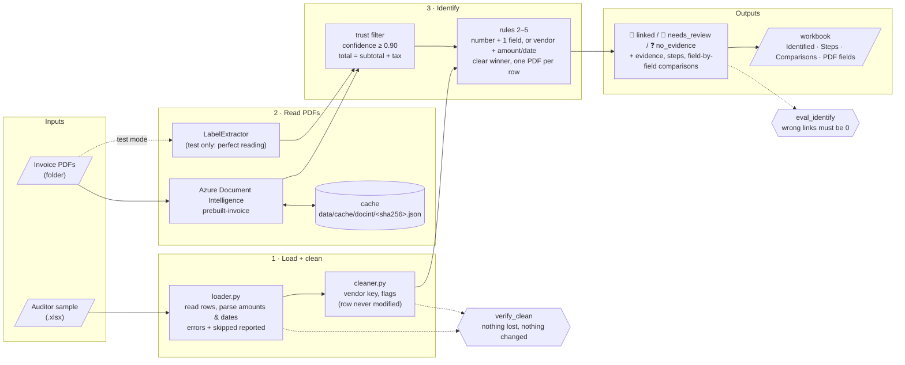

# Tickmark: progress and pipeline

What is built so far, how the pieces fit together, and how to check the results yourself.
Scope and goals: [MVP.md](MVP.md).

## Pipeline



Azure only **reads** the PDF (values, confidence, position). Every decision is made by plain code in
`tickmark.match.identify`: the same rules whichever reader is used, with a trace for every decision.

The same flow as plain text:

```
sample.xlsx ─► load ─► clean ─────────────────────────────┐
                 │        (vendor key, flags)             │
                 └─► errors / skipped rows (reported)     ▼
invoice PDFs ─► Azure DI ⇄ cache ─► trust filter ─► identify (rules) ─► linked / review / none
            └─(test) LabelExtractor ─┘                      │
                                                            └─► trace: steps + comparisons ─► workbook
```

## What is covered

### 1. Loading the auditor's sample: `src/tickmark/sample/loader.py`
- Finds the header row and maps columns by alias, ignoring case, punctuation and suffixes like
  `(EUR)`: `Row ID`, `Vendor`/`Supplier`, `Amount`/`Total`, `Date`/`Invoice Date`,
  `Invoice No`/`Reference`.
- Row ids are kept exactly as written (`S-01`). The Excel row number is used only when the id is empty.
- Amounts: `1.234,50`, `€ 2,904.10`, `(50.00)` and `123.45-` are all read correctly, as exact decimals.
- Dates: Excel dates, `YYYY-MM-DD` and `DD.MM.YYYY`. Ambiguous `03/04/2025` is rejected, not guessed.
- Text: removes zero-width characters, turns non-breaking spaces into spaces, collapses whitespace.
- Blank rows are ignored. Footer rows (`Total`, `Subtotal`, `Notes`, …) are skipped and reported.
  Bad rows are reported as errors with a reason. Nothing disappears silently.

### 2. Cleaning: `src/tickmark/sample/cleaner.py`
- Never changes a row. It only adds derived values:
  - `vendor_key`: `Acme B.V.`, `ACME BV` and `acme  b.v` all become `acme`, and
    `Müller Büro GmbH` becomes `muller buro`.
  - flags (each with a note): `duplicate_of:<row>`, `negative_amount`, `zero_amount`,
    `date_outside_period`.

### 3. Proving nothing was lost or changed: `tools/verify_clean.py`
Compares the output directly with the raw Excel cells, without using the loader's own logic:
- **completeness**: every non-blank row ends up exactly once as loaded, an error or skipped
- **fidelity**: vendor differs only in whitespace; amount has the same digits, decimals and sign;
  date and row id are equal
- **untouched**: the cleaner returns every row unmodified and in order
- **control total**: the sum of numeric amounts before and after
- **round trip**: the written workbook holds exactly the loaded rows and issues

Tests deliberately tamper with the output (drop a row, shift an amount, change a vendor or date,
count a row twice) and check that the verifier catches every one.

### 4. Reading PDFs: `src/tickmark/extract/`
- `DocIntExtractor` (`azure_docint.py`): Azure `prebuilt-invoice`. It reads vendor, invoice number,
  date, total, subtotal and tax, each with a confidence and a snip (page, position in points, text).
  - Record/replay cache: each PDF is sent to Azure **once**, the raw result is stored under its
    SHA-256, and later runs work offline.
  - Without credentials it fails with a clear message. It never guesses.
- `LabelExtractor` (`fake.py`): reads the ground-truth label JSON. "Perfect reading", used to test
  the matching rules on their own. Never use it as evidence.

### 5. Identifying which PDF a row is about: `src/tickmark/match/identify.py`
Precision over coverage: **a wrong link is the one outcome that must never happen**.

| # | Rule |
|---|------|
| 1 | Only **trusted** values count: confidence ≥ 0.90 and parseable. The total counts only if subtotal + tax = total. |
| 2 | **Invoice number** equal **+ at least one more field** → can link. Number alone, or a different number → review. |
| 3 | No usable number: **vendor equal + (amount or date equal)** → can link. A vendor that is only *similar* → review, never a link. |
| 4 | **Clear winner**: the best PDF agrees on more fields than any other, otherwise review. |
| 5 | **One PDF backs one row**: rows contending for a PDF → only a strictly better row keeps it. |

Field comparison: number ignores spaces, `-`, `/`, `.` and case; vendor uses the normalised key;
amount is within 0.01; date is the same day.

Outcome per row: 🔗 `linked` (with evidence and snips), 👀 `needs_review` (with the candidates and
why), ❓ `no_evidence`.

### 6. Seeing the whole process: `tools/identify_sample.py`
- `--trace` prints what was read from each PDF (and what is not trusted, and why), each row compared
  field by field with every PDF that agrees on anything, and the numbered decision steps.
- `--out file.xlsx` writes four sheets, with links that open each PDF:

| Sheet | Contents |
|---|---|
| Identified | one line per row: status, PDF, evidence or reason |
| Steps | how each row was decided, step by step, with the rule that decided |
| Comparisons | every row × every PDF, field by field: row value, PDF value, result |
| PDF fields | everything read from each PDF: confidence, used or why not, page and position |

### 7. Measuring accuracy: `tools/eval_identify.py`, `tools/datagen/hard.py`
Three datasets:
- **generated**: 16 rows, 20 PDFs, no invoice numbers, decoy vendors
- **external**: the 7-row sample pack, with invoice numbers
- **hard**: 11 rows built to fool a matcher: typo'd number, number reused by two vendors, same
  vendor and amount on two dates, same vendor and date with two amounts, spelling variant,
  lookalike vendor, decoy vendor with the same amount and date, duplicate rows

Current results with **perfect reading (`--labels`)**, which tests the rules only:

| Dataset | Rows | Correct links | Review | No evidence | **Wrong links** | Safe outcome |
|---|---|---|---|---|---|---|
| generated | 16 | 12 | 0 | 4 | **0** | 16/16 |
| external | 7 | 6 | 0 | 1 | **0** | 7/7 |
| hard | 11 | 4 | 6 | 1 | **0** | 11/11 |

In the hard set, the one "missed" row is H-04 (a typo'd invoice number), which goes to review by design.
The eval exits with an error on any wrong link, so it can gate CI.

### 8. Project layout
```
src/tickmark/   app: api/, sample/ (loader, cleaner), extract/, match/, checks/, models.py
tools/          datagen/, clean_sample, compare_sample, verify_clean, identify_sample, eval_identify
tests/          51 tests, all offline
data/           external/ (given), generated/, output/, cache/   (gitignored)
docs/           MVP.md, PROGRESS.md
```

## How to run

```bash
cd tickmark
source .venv/bin/activate          # once per terminal; the prompt shows (.venv)

pytest                                               # all tests, offline
python -m tools.verify_clean  data/external/tickmark-sample/sample.xlsx
python -m tools.eval_identify --labels               # rules only (perfect reading)
python -m tools.eval_identify                        # with Azure (needs .env)
python -m tools.identify_sample data/external/tickmark-sample/sample.xlsx \
    data/external/tickmark-sample/invoices --trace --out data/output/identified.xlsx
```

Azure credentials go in `tickmark/.env`:
```
TICKMARK_DOCINT_ENDPOINT=https://<resource>.cognitiveservices.azure.com/
TICKMARK_DOCINT_KEY=<key>
```

## How to check results by hand
Two separate questions:
1. **Was the PDF read correctly?** Compare the *PDF fields* sheet with the PDF (click the link).
2. **Was the decision right?** For a row, read *Steps*, then filter *Comparisons* by that row and
   `Result = equal` to confirm that no other PDF matched as well.

## Not done yet

| Item | Status |
|---|---|
| Live Azure run | Needs credentials. Then measure reading accuracy and replace the hand-written test fixture `tests/fixtures/docint_inv_2026_1222.json` with a real cached result. |
| Comparing a linked PDF with its row | Next step: report differences (e.g. amount +250.00, date +3 days) and run the checks in `src/tickmark/checks/deterministic.py` (line items sum, VAT, period, duplicate number). |
| ✅ / ⚠️ / ❓ verdict | Built on top of the comparison step. |
| Warden | PDF reads are not yet routed through `WardenClient` (fail closed). |
| API | `POST /engagements/{id}/vouch` and `GET …/runs/{runId}` are not built yet. |
| Larger eval set | 34 rows is too few to trust a "100%". Grow it towards the 50–100 invoices planned in MVP.md. |
