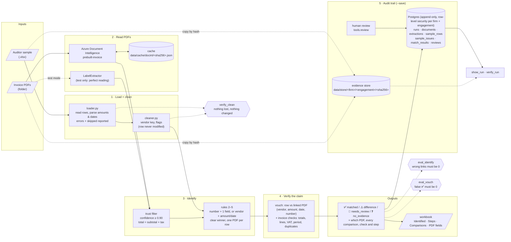

# Tickmark: progress and pipeline

What is built so far, how the pieces fit together, and how to check the results yourself.
Scope and goals: [MVP.md](MVP.md).

## Pipeline



Azure only **reads** the PDF (values, confidence, position). Every decision is made by plain code in
`tickmark.match.identify`: the same rules whichever reader is used, with a trace for every decision.

The same flow as plain text:

```
sample.xlsx ─► load ─► clean ─────────────────────────────┐
                 │        (vendor key, flags)             │
                 └─► errors / skipped rows (reported)     ▼
invoice PDFs ─► Azure DI ⇄ cache ─► trust filter ─► identify (rules) ─► vouch (row vs PDF + checks)
                                                                         ─► ✅ / ⚠️ / 👀 / ❓
            └─(test) LabelExtractor ─┘                      │
                                                            └─► trace: steps + comparisons ─► workbook
                                                            │
                                    --save ─► Postgres (append-only) + evidence store (files by SHA-256)
                                                 ▲                         │
                                       tools.review (human)       show_run · verify_run
```

## What is covered

### 1. Loading the auditor's sample: `src/tickmark/sample/loader.py`
- Finds the header row and maps columns by alias, ignoring case, punctuation and suffixes like
  `(EUR)`: `Row ID`, `Vendor`/`Supplier`, `Amount`/`Total`, `Date`/`Invoice Date`,
  `Invoice No`/`Reference`.
- Row ids are kept exactly as written (`S-01`). The Excel row number is used only when the id is empty.
- Amounts: `1.234,50`, `€ 2,904.10`, `(50.00)` and `123.45-` are all read correctly, as exact decimals.
- Dates: Excel dates, `YYYY-MM-DD` and `DD.MM.YYYY`. Ambiguous `03/04/2025` is rejected, not guessed.
- Text: removes zero-width characters, turns non-breaking spaces into spaces, collapses whitespace.
- Blank rows are ignored. Footer rows (`Total`, `Subtotal`, `Notes`, …) are skipped and reported.
  Bad rows are reported as errors with a reason. Nothing disappears silently.

### 2. Cleaning: `src/tickmark/sample/cleaner.py`
- Never changes a row. It only adds derived values:
  - `vendor_key`: `Acme B.V.`, `ACME BV` and `acme  b.v` all become `acme`, and
    `Müller Büro GmbH` becomes `muller buro`.
  - flags (each with a note): `duplicate_of:<row>`, `negative_amount`, `zero_amount`,
    `date_outside_period`.

### 3. Proving nothing was lost or changed: `tools/verify_clean.py`
Compares the output directly with the raw Excel cells, without using the loader's own logic:
- **completeness**: every non-blank row ends up exactly once as loaded, an error or skipped
- **fidelity**: vendor differs only in whitespace; amount has the same digits, decimals and sign;
  date and row id are equal
- **untouched**: the cleaner returns every row unmodified and in order
- **control total**: the sum of numeric amounts before and after
- **round trip**: the written workbook holds exactly the loaded rows and issues

Tests deliberately tamper with the output (drop a row, shift an amount, change a vendor or date,
count a row twice) and check that the verifier catches every one.

### 4. Reading PDFs: `src/tickmark/extract/`
- `DocIntExtractor` (`azure_docint.py`): Azure `prebuilt-invoice`. It reads vendor, invoice number,
  date, total, subtotal and tax, each with a confidence and a snip (page, position in points, text).
  - Record/replay cache: each PDF is sent to Azure **once**, the raw result is stored under its
    SHA-256, and later runs work offline.
  - Without credentials it fails with a clear message. It never guesses.
- `LabelExtractor` (`fake.py`): reads the ground-truth label JSON. "Perfect reading", used to test
  the matching rules on their own. Never use it as evidence.

### 5. Identifying which PDF a row is about: `src/tickmark/match/identify.py`
Precision over coverage: **a wrong link is the one outcome that must never happen**.

| # | Rule |
|---|------|
| 1 | Only **trusted** values count: confidence ≥ 0.90 and parseable. The total counts only if subtotal + tax = total. |
| 2 | **Invoice number** equal **+ at least one more field** → can link. Number alone, or a different number → review. |
| 3 | No usable number: **vendor equal + (amount or date equal)** → can link. A vendor that is only *similar* → review, never a link. |
| 4 | **Clear winner**: the best PDF agrees on more fields than any other, otherwise review. |
| 5 | **One PDF backs one row**: rows contending for a PDF → only a strictly better row keeps it. |

Field comparison: number ignores spaces, `-`, `/`, `.` and case; vendor uses the normalised key;
amount is within 0.01; date is the same day.

Outcome per row: 🔗 `linked` (with evidence and snips), 👀 `needs_review` (with the candidates and
why), ❓ `no_evidence`.

### 6. Seeing the whole process: `tools/identify_sample.py`
- `--trace` prints what was read from each PDF (and what is not trusted, and why), each row compared
  field by field with every PDF that agrees on anything, and the numbered decision steps.
- `--out file.xlsx` writes four sheets, with links that open each PDF:

| Sheet | Contents |
|---|---|
| Identified | one line per row: status, PDF, evidence or reason |
| Steps | how each row was decided, step by step, with the rule that decided |
| Comparisons | every row × every PDF, field by field: row value, PDF value, result |
| PDF fields | everything read from each PDF: confidence, used or why not, page and position |

### 7. Measuring accuracy: `tools/eval_identify.py`, `tools/datagen/hard.py`
Three datasets:
- **generated**: 16 rows, 20 PDFs, no invoice numbers, decoy vendors
- **external**: the 7-row sample pack, with invoice numbers
- **hard**: 11 rows built to fool a matcher: typo'd number, number reused by two vendors, same
  vendor and amount on two dates, same vendor and date with two amounts, spelling variant,
  lookalike vendor, decoy vendor with the same amount and date, duplicate rows

Current results with **perfect reading (`--labels`)**, which tests the rules only:

| Dataset | Rows | Correct links | Review | No evidence | **Wrong links** | Safe outcome |
|---|---|---|---|---|---|---|
| generated | 16 | 12 | 0 | 4 | **0** | 16/16 |
| external | 7 | 6 | 0 | 1 | **0** | 7/7 |
| hard | 11 | 4 | 6 | 1 | **0** | 11/11 |

In the hard set, the one "missed" row is H-04 (a typo'd invoice number), which goes to review by design.
The eval exits with an error on any wrong link, so it can gate CI.

### 8. Verifying the claim: `src/tickmark/vouch/`, `tools/vouch_sample.py`
Each Excel row is a claim: "there is an invoice from vendor X, number N, dated D, for amount Y".
Once the row's PDF is known, code checks whether the PDF backs that claim and whether the invoice
itself is sound:

| Part | What is checked | Result per item |
|---|---|---|
| **Row vs PDF** | vendor (normalised name), amount (vs the **printed** total), date, invoice number (if the row has one) | agrees / differs (with the exact difference, e.g. `+250.00`, `+3 days`) / unverifiable (not read, or confidence < 0.90) |
| **totals_reconcile** | subtotal + tax = total | pass / fail / not_checkable |
| **lines_sum** | line amounts sum to the subtotal, and each line's qty × unit price = amount | pass / fail / not_checkable |
| **vat_rate** | tax is an allowed rate of the subtotal (0 / 9 / 21 %) | pass / fail / not_checkable |
| **in_period** | invoice date inside the engagement's audit period | pass / fail / not_checkable |
| **duplicate** | same vendor + number on another PDF → fail; same number from another vendor → warn | pass / fail / warn |

Verdict per row:

| Verdict | When |
|---|---|
| ✅ **matched** | every field agrees and every check passes (warnings are shown, not blocking) |
| ⚠️ **difference** | any field differs or any check fails: each one listed with its amount or reason |
| 👀 **needs_review** | which PDF is not settled, or something could not be verified (never ✅ on missing evidence) |
| ❓ **no_evidence** | no PDF for this row |

Any difference over 0.01 is ⚠️; the auditor judges materiality. The audit period comes from the
engagement (`tools.tenants set-period`), or `--period` without the database.

Results with perfect reading (`python -m tools.eval_vouch --labels`):

| Dataset | Verdicts as labelled | False ✅ | Notes |
|---|---|---|---|
| external | 7/7 | 0 | equal to the pack's `expected_results.json`: S-02 +250.00, S-03 +3 days, S-06 totals don't add up |
| generated | 16/16 | 0 | rows 1 and 13 +25.00; rows 4 / 11 / 14 from their invoice's defect (lines / VAT / period) |
| hard | 11/11 | 0 | the 4 linked rows ✅, the rest stay 👀 / ❓ |

Over all 20 generated PDFs the checks find every labelled defect (lines 2, VAT 3, period 2,
duplicate 2) with no false alarms. With a deliberately loose 1000 tolerance the eval reports
false ✅ and fails, so it does catch a weakened rule.

### 9. Any spreadsheet layout: `src/tickmark/fields/`, `src/tickmark/definitions/`, `tools/map_columns.py`
Clients name their columns freely ("Inv Amt", "Payee", "Factuurdatum"). Tickmark no longer needs
fixed headers: **which fields an audit needs is data (a definition), how values are read is fixed
code (field types), and which column holds which field is a mapping, decided once per client.**

| Layer | Fixed or flexible | What it is |
|---|---|---|
| Raw capture (`fields/sheet.py`) | no schema | every row kept as a list of cells `{col, header, value}`: duplicate or odd headers survive |
| Field types (`fields/types.py`) | fixed, tested once | `money` (exact decimal, stored as a string), `date`, `name`, `identifier`, `text` |
| Definition (`definitions/`) | data, versioned | `invoice_vouching` v1: the fields, their types, roles (key / party / corroborating / label), which document field each is compared with, and the checks |
| Mapping (`fields/mapping.py`) | per client + header layout | their column → our field; saved, append-only, with who confirmed it |
| Engine (`match/`, `vouch/`, `sample/cleaner.py`) | fixed code | runs on the definition by role and type, not on hard-coded column names |

Which mapping a run uses, in order:
1. a confirmed mapping saved for this client and **this exact header layout** → used automatically;
2. the known header names (aliases) cover every required field → used automatically;
3. otherwise the run **does not start**: "needs mapping: vendor, amount, invoice_date" and the command to fix it.

`tools.map_columns` shows each field next to its candidate column and that column's value pattern,
accepts `--set FIELD=COL`, checks every value of each mapped column (at least 80 % must read as the
field's type; no column used twice), and saves only on `--confirm`.

**Claude suggestions** (`--suggest`, model `claude-opus-5-5`, structured output) — **off by default**:
- `TICKMARK_LLM_MAPPING=on` sends the headers and a **value pattern per column, never values**:
  formats (`dd.mm.yyyy`, `comma decimal`), magnitudes in words ("tens to thousands"), word counts,
  identifier shapes (`INV-2026-1037` → `AAA-9999-9999`). A test checks that no cell value appears in
  what is sent.
- Real example values (up to 5 per column) are a **separate setting**, `TICKMARK_LLM_MAPPING_VALUES=on`.
- Header text is untrusted: it is fenced as data, and the answer must fit a schema built for this
  sheet, which allows only its real column letters and our field names. Validation against all values
  then catches a wrong or injected proposal, and a person still confirms.

Proof it changed nothing: on all 34 test rows, every identification and verdict is identical to
before the change, trace included (one trace line reworded). An unfamiliar copy of the generated sample
(`tools.datagen.unfamiliar`: Dutch headers, European number text, extra columns, a duplicate header,
an injection note) is refused until mapped, and once mapped gives exactly the standard verdicts.

Found on the way: the amount parser read `"S-01"` as −1 (it dropped letters). It now refuses any
value with letters other than a currency code.

### 10. Audit trail in Postgres: `src/tickmark/store/`, `migrations/`
In audit the result is half of it: you must also show, months later, **what was decided, from
which exact files, under which rules, and what a human did with it**. With `--save`, a run is
stored completely (one transaction) in Tickmark's own Postgres database. Warden keeps its own
database; tenant and engagement ids are Warden's.

| Table | Holds |
|---|---|
| `tenants` | audit firms (Warden's id, name, Entra tenant id). Registry only, written by the owner role |
| `engagements` | the clients each firm audits (Warden's id, firm, client name, audit period). Registry only |
| `runs` | when, who, engagement, matcher version (git commit), thresholds, extractor + model, completed/failed + error |
| `documents` | every file by **SHA-256** (sample and PDFs), size, pages, path in the evidence store |
| `run_documents` | which PDFs this run compared against, and under which file name |
| `extractions` | what the extractor read: raw result (Azure JSON) + parsed fields with confidence and snips |
| `sample_rows` | each row: `raw` cells as received (column, header, value) + `fields` (typed, mapped; money as a string), party key, flags. Rows recorded before 0004 keep their original fixed columns, untouched |
| `column_mappings` | which column held which field for a client's header layout: source (aliases / Claude / person), who confirmed it, Claude's proposal as sent and answered |
| `sample_issues` | rows that errored or were skipped, with their raw cells, so no row disappears |
| `verdicts` | one per row: ✅ / ⚠️ / 👀 / ❓, the PDF checked, every field agreement, every invoice check, reasons, steps |
| `match_results` | one per row: status, linked PDF and page, evidence, candidates, reason, **full trace** (comparisons + steps) |
| `reviews` | human decisions (accept, choose_candidate + PDF, reject, requested_from_client), who, when, note |

Rules:
- **Append-only, enforced by Postgres**: a trigger rejects UPDATE, DELETE and TRUNCATE on every
  table. A re-run is a new run. A human decision is a new review, and the latest one is current.
- **Linked by hash and id, not by file name**: the same bytes under two names are one document.
- **Evidence store**: each file used is copied once to
  `data/store/<tenant>/<engagement>/<sha[:2]>/<sha256>.<ext>` and never overwritten. `verify_run`
  re-hashes it. (It stands in for Azure Blob Storage.)
- **The rules stay in code**: the database records what happened; `tickmark.match` decides.
- The schema is managed by Alembic (`migrations/`); `alembic check` confirms the code and the
  migrations agree.

#### Multi-tenant: many audit firms, many clients
**Tenant = audit firm** (from the verified Entra token in production). **Engagement = one client
company** the firm audits. Every audit row carries `tenant_id` + `engagement_id`, and Postgres
enforces the separation, not just the code:

| Layer | What it does |
|---|---|
| **Row-level security** on all 12 tables | A session sees and can insert only rows of the tenant **and** engagement it set (`app.tenant_id`, `app.engagement_id`, transaction-local). **Fail closed**: nothing set → nothing visible, nothing writable. |
| **Composite foreign keys** `(tenant_id, engagement_id, id)` | A result, review or file link can only point at rows of the same engagement, even with forged ids. |
| **Two database roles** | `tickmark` (owner) runs migrations and registers firms and engagements. The app connects as **`tickmark_app`**: `SELECT` + `INSERT` only, not the owner, so it cannot update, delete, truncate, drop triggers or switch off row-level security. |
| **Per-engagement files** | The same PDF in two engagements is stored twice (separate documents, separate evidence folders), so an ethical wall (Coke vs Pepsi in one firm) also holds for storage. |
| **"No run", not "forbidden"** | A run of another firm or engagement looks like it does not exist. |

In code, every store call takes a `TenantContext(tenant_id, engagement_id, user)`
(`src/tickmark/store/context.py`); `scoped()` sets it at the start of the transaction. The
tests (`tests/test_tenancy.py`) include `tenant_a_cannot_read_tenant_b`, the ethical wall,
fail-closed, forged ids, cross-engagement links, and everything the app role must not be able to do.

### 10b. Dynamic meanings and local-first PDF reading
**No column is required.** `definitions/__init__.py` is a catalogue of meanings a column can have
(invoice number, vendor, customer, amount, net, VAT, date, due date, PO, currency, row id), each with
a type, a role (key / party / corroborating / attribute / label), header aliases and the labels printed
next to it on an invoice. A client layout may add its own meanings (`ColumnMapping.meanings`, stored
in `column_mappings.meanings`, migration 0006); an LLM may propose them, code validates them, a person
confirms. A run needs only enough to identify an invoice (`fields/mapping.cannot_run`): the invoice
number plus one more linking column, or the vendor plus the amount or date. A meaning two columns
could hold blocks the run until it is settled. Everything mapped is compared; how each type is
compared and how a verdict is decided stay fixed in code.

**PDFs are read from their own text first** (`extract/local.py`, pdfplumber):
- File check (settings `TICKMARK_PDF_*`): a page with little text but an image (scan/photo), text over
  a full-page image (a scanner's OCR), unreadable `(cid:)` characters, rotated text → `needs_ocr`.
- Values next to labels: per line the longest label of any meaning wins ("Total excl. VAT" is net);
  the value is the rest of the block, the next block, or the line below; one distinct value → read,
  more → `unread` with both, none → absent. Amounts follow the document's decimal mark.
- Without a label (`extract/text.found_in_text`): an invoice number as an exact word; the vendor only
  in the letterhead (above the first "Bill to" or amount). Not found never means "differs".

**Azure only where needed** (`extract/router.py`, `TICKMARK_AZURE=auto|off|always`): a PDF that
needs OCR; after matching and vouching, a linked PDF where a value the row needs was not read, a
needs-review candidate missing a linking value, or the PDFs sharing an invoice number whose vendor
is unknown; then the run is matched and vouched again, once. Local and Azure readings are merged; a
field read differently by both is not trusted. Item lines (only Azure reads the table) are checked
only when the engagement turns it on. Each run stores how every PDF was read and why
(`run_documents.read_by`, `read_reason`).

Measured on the test sets (`eval_vouch --azure auto|off --no-line-items`, Azure faked from labels):
generated 20/20 PDFs read locally with item lines off, verdicts identical to the labels; with auto,
2 PDFs go to Azure (a duplicated invoice number needs both vendors). Hard set: 12 of 14 locally;
one look-alike-vendor row is ❓ instead of 👀 locally (a similar name needs a vendor that was read).
No false ✅ in any mode. Real scans and layouts still need `tools.compare_readers` with the Azure key.

### 11. Project layout
```
src/tickmark/   app: api/, fields/ (sheet, types, mapping, profile, llm_mapping), definitions/, sample/, extract/,
                match/, vouch/, store/, checks/, pipeline.py, models.py
tools/          datagen/, clean_sample, compare_sample, verify_clean, identify_sample, eval_identify,
                vouch_sample, eval_vouch, map_columns, show_run, review, verify_run, tenants (register firms + engagements)
migrations/     Alembic: 0001 audit tables + append-only triggers, 0002 multi-tenant (RLS, roles), 0003 verdicts,
                0004 flexible input (additive: no stored row rewritten, no trigger disabled), 0005 engagement
                currency, 0006 dynamic meanings + how each PDF was read
docker/initdb/  creates the tickmark_app login role on a fresh dev database
tests/          122 tests (35 need Postgres and skip cleanly without it)
data/           external/ (given), generated/, output/, cache/, store/   (gitignored)
docs/           MVP.md, PROGRESS.md
```

## How to run

```bash
cd tickmark
source .venv/bin/activate          # once per terminal; the prompt shows (.venv)

pytest                                               # all tests, offline
python -m tools.verify_clean  data/external/tickmark-sample/sample.xlsx
python -m tools.eval_identify --labels               # rules only (perfect reading)
python -m tools.eval_vouch --labels                  # verdicts: false ✅ must be 0
python -m tools.vouch_sample data/external/tickmark-sample/sample.xlsx data/external/tickmark-sample/invoices \
    --labels data/external/tickmark-sample/labels --period 2026-01-01:2026-12-31 --trace --out data/output/vouched.xlsx
python -m tools.eval_identify                        # with Azure (needs .env)
python -m tools.identify_sample data/external/tickmark-sample/sample.xlsx \
    data/external/tickmark-sample/invoices --trace --out data/output/identified.xlsx
```

Audit database (Tickmark's own Postgres, host port 5435):

```bash
docker compose up -d                 # start Postgres
alembic upgrade head                 # create / upgrade the tables

# register an audit firm and a client engagement (owner role); prints their ids
python -m tools.tenants add-tenant "Firm A"
python -m tools.tenants add-engagement <tenant id> "Coke" --period 2026-01-01:2026-12-31
python -m tools.tenants list

# act inside one firm + engagement (or pass --tenant / --engagement each time)
export TICKMARK_TENANT=<tenant id> TICKMARK_ENGAGEMENT=<engagement id>
python -m tools.vouch_sample data/external/tickmark-sample/sample.xlsx \
    data/external/tickmark-sample/invoices --save                        # prints the run id
python -m tools.show_run                                 # this engagement's runs
python -m tools.show_run RUN_ID --trace --out data/output/run.xlsx       # rebuilt from the DB only
python -m tools.review RUN_ID S-02 --decision accept --note "checked"    # reviewer = --user (OS user)
python -m tools.verify_run RUN_ID                        # files unchanged, every row accounted for
```

Azure credentials go in `tickmark/.env`:
```
TICKMARK_DOCINT_ENDPOINT=https://<resource>.cognitiveservices.azure.com/
TICKMARK_DOCINT_KEY=<key>
```

## How to check results by hand
Two separate questions:
1. **Was the PDF read correctly?** Compare the *PDF fields* sheet with the PDF (click the link).
2. **Was the decision right?** For a row, read *Steps*, then filter *Comparisons* by that row and
   `Result = equal` to confirm that no other PDF matched as well.
3. **Months later:** `show_run RUN_ID --trace` shows the same thing from the database, with the
   reviews. `verify_run RUN_ID` proves the files behind it are the same bytes.

## Not done yet

| Item | Status |
|---|---|
| Live Azure run | Needs credentials. Then run `tools.compare_readers` on real invoices (local must never contradict Azure), tune `TICKMARK_PDF_*` and the labels, and replace the hand-written fixture `tests/fixtures/docint_inv_2026_1222.json` with a real cached result. |
| Several invoices in one PDF | Detected as ambiguous (two numbers/totals → Azure or 👀), not split. |
| Look-alike vendors read locally | A vendor printed without a label is only matched exactly; "similar name → review" needs a read vendor (Azure). |
| Materiality | A per-engagement "clearly trivial" threshold; today any difference over 0.01 is ⚠️. |
| VAT rates | Per-country rate tables; today 0 / 9 / 21 % for every engagement. |
| Duplicates across runs | Duplicates are checked within one run, not yet against the engagement's earlier runs. |
| Live LLM mapping | Through OpenRouter; `pytest -m llm` ran one real call (sonnet) on the unfamiliar sheet and passed. |
| LLM policy per firm | The Claude settings are global; they should become a per-firm Warden policy. |
| New audit types | The definition format supports them; only `invoice_vouching` ships. A second type (e.g. expense receipts) proves it end to end. |
| Reviewing verdicts | Reviews are recorded on the identification; a review step for verdicts is next. |
| Warden | PDF reads are not yet routed through `WardenClient` (fail closed). |
| API | `POST /engagements/{id}/vouch` and `GET …/runs/{runId}` are not built yet. They will read from the audit store. |
| Review UI | Reviews are recorded with `tools.review`; no screen yet. |
| Tenant from the token | The API must take tenant and engagement from the Warden-verified token, never from the request. The CLI flags are stand-ins. |
| Registry sync | `tenants` / `engagements` are registered by hand; sync them from Warden. |
| Retention / deletion | Append-only plus per-firm deletion requests need a legal-hold design. |
| Evidence storage | Move the evidence store to Azure Blob Storage, a container per tenant, with immutability. |
| Larger eval set | 34 rows is too few to trust a "100%". Grow it towards the 50–100 invoices planned in MVP.md. |
