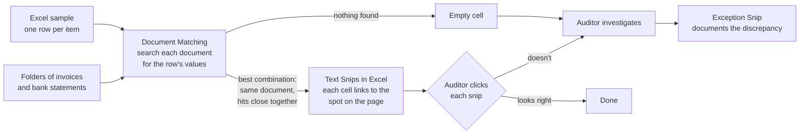
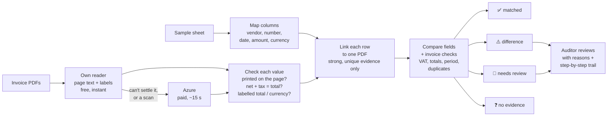
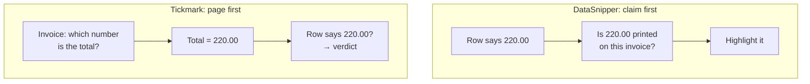
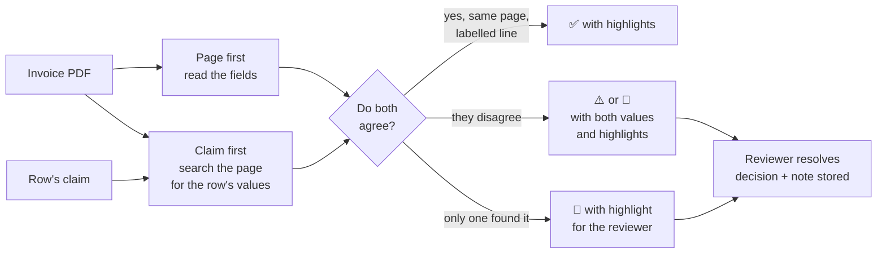

# Tickmark vs DataSnipper

What DataSnipper does, how Tickmark differs, what Tickmark does better, and what is worth copying.

DataSnipper's side is based on its public knowledge base and product pages (sources at the end), read in October 2026. We have not used the product ourselves, so anything the knowledge base does not say is marked as unknown.

---

## 1. The short version

| | DataSnipper | Tickmark |
|---|---|---|
| **What it is** | An Excel add-in for auditors | A web app that vouches an audit sample against invoices |
| **Core idea** | Find the row's values on the document and link them as evidence | Read the invoice, compare it with the row, and give a verdict |
| **Output** | A clickable highlight ("snip") per value; the auditor decides | One verdict per row: ✅ matched · ⚠️ difference · 👀 needs review · ❓ no evidence, with reasons |
| **Who concludes** | Always the auditor | Tickmark proposes; the auditor reviews 👀 and ⚠️ |
| **Default strictness** | Exact match; fuzzy matching and tolerances are opt-in | Exact amounts (±0.01); vendor by normalised name; "never ✅ on missing evidence" |
| **Unmatched rows** | Auditor investigates and documents with an "Exception Snip" | Tickmark classifies them as difference, review or no evidence, and says why |

In one sentence: **DataSnipper finds evidence. Tickmark gives a conclusion.** That is Tickmark's main advantage, and it is also why Tickmark has to be stricter about never giving a wrong ✅.

---

## 2. How DataSnipper works

**Document Matching**
- You select the Excel sample and the document folders, then click "Match all rows". It *"finds the correct text, date and/or number in a source document"* and links it to the cell.
- When a value appears more than once, it picks the *"best collective combination"*: all hits **on the same document**, and **as close together on the page as possible**. It also searches later pages.
- It is *"strict by default"*, because *"exact matches give the highest confidence"*. Optional settings: partial matching, fuzzy text (typos and abbreviations), a tolerance per column (an amount or a percentage), a required field, and "force match on the same page or row".
- There are **no confidence scores**. Every match is a Text Snip the reviewer clicks to check.

**AI Extractions** (newer): you define the fields and their types (text, number, date, list, table), optionally add a short description to steer the AI, preview, then export to Excel. *"Every extracted value is traceable back to its source document."* Setups are saved as templates.

**AI agents:** prebuilt procedures (revenue testing, payment testing and so on). *"Prebuilt Agents document the facts, the conclusions remain yours."* Every agent action is logged as a row in an `Agent_Activity_Log` sheet.

**Unknown from the knowledge base:** how it reads scans (OCR details), how it handles number and date formats, accuracy figures, and how unmatched rows are shown in the sheet.

---

## 3. How Tickmark works

**The steps**
1. **Read the sample** and map its columns.
2. **Read every PDF** with our own reader. Send scans, and anything our reader can't settle, to Azure.
3. **Trust a value only if something confirms it**: it's printed on the page, net + tax = total, or a labelled total or currency agrees. Correct a value only when the page proves it (for example, "440 is labelled as the amount due"). Never correct it using the row being tested.
4. **Link each row to one PDF**, only when the evidence is strong and unique.
5. **Compare and decide**, with every reason and step recorded.

---

## 4. The key difference, side by side

DataSnipper starts from the claim and looks for it on the page. Tickmark starts from the page and reads what it says.

| | Claim first (DataSnipper) | Page first (Tickmark) |
|---|---|---|
| **Strength** | Doesn't need to work out which number is "the total". Works on any layout. | Knows what each number *means*, so it can say *what* differs ("row 571.04, invoice 406.82"). |
| **Weakness** | Can find "220.00" somewhere by coincidence (an item line, the VAT base). Fine when a person checks every snip; risky for automatic verdicts. | Has to pick the right number. "Amount due" vs total, watermark as vendor, and day/month order all caused our misses. |
| **Missing value** | Just "not found": the auditor investigates | Says what was read instead, which makes the ⚠️ useful |

---

## 5. What Tickmark does better

1. **It gives a conclusion, not just evidence.** Every row ends as ✅ / ⚠️ / 👀 / ❓ with the reason. DataSnipper leaves every row for the auditor to judge.
2. **It explains differences.** "Amount differs: row 571.04, PDF 406.82, +164.22", or "date differs by −365 days". A missing snip only says "not found".
3. **It checks the invoice itself:** net + VAT = total, legal VAT rates, invoice inside the audit period, duplicate invoice numbers. Our tests caught invoices that don't add up and duplicate numbers from one supplier.
4. **Safety by design: "never ✅ on missing evidence."** A value counts only if something independent confirms it. On the 30 real invoices: 0 wrong ✅, 30/30 correct.
5. **It picks the right invoice.** One PDF per row, ties broken by date, contested PDFs left for a person. DataSnipper ranks by "same document, close together", but doesn't decide between two plausible invoices.
6. **A full decision trail for every row:** each comparison, each reason, which reader read what. Kept with the run, along with the rule versions, so old results can be explained later.
7. **It understands invoices:** total vs amount due, prepayments, credit notes, labelled invoice currency, day/month order taken from the page.
8. **It's cost-aware:** free local reading first, Azure only when needed, cached by file so it's never paid twice.

---

## 6. What's worth copying

In order of value:

### 1. Search for the claim, as a second reader (high value)
Add DataSnipper's direction *alongside* ours. For each row, search the page for the row's own amount, date, number and vendor, in every common format: `220,00`, `220.00`, `1.234,56`, `1 234,56`, `$220`, `05.06.2018`, `2018-06-05`, `June 5, 2018`.
- It would have settled R-008 (220 vs 440) without guessing.
- It works on unfamiliar layouts, so fewer PDFs go to Azure.
- It extends what we already do for vendor and number (`found_in_text` in `src/tickmark/extract/text.py`).

**Our safety rule:** a search hit confirms the row only if it is **on the same page as the other matches, close to them, and on a line labelled as a total** (or date, or number). Otherwise it is a hint, and the row goes to 👀. We don't have a person clicking every hit, so we can't accept coincidences.

### 2. A highlight for every field (high value)
Tickmark already stores where each value was found: a page and a box (`Snip` in `src/tickmark/models.py`). The web app should open the PDF with that spot highlighted for each field. Checking a 👀 row then takes seconds. This is DataSnipper's main selling point, and we already have the data for it.

### 3. Matching options per engagement (medium)
- An amount tolerance per column (e.g. ±0.05 for rounding)
- Optional fuzzy vendor matching
- A "required field" setting

Keep strict defaults, store the choices with the engagement, and record them in each run.

### 4. Exception workflow (medium)
When a reviewer resolves a 👀 or ⚠️, store the decision, a note, who and when. That completes the audit trail, and every resolved row becomes a labelled example for our test sets.

### 5. Templates per client (low; partly done)
Tickmark already has engagements and saved column mappings. Saving the matching options with them as well gives the same reuse as DataSnipper's templates.

---

## 7. What not to copy

- **Leaving every conclusion to the auditor.** That would throw away Tickmark's main advantage. Better: decide when the evidence is solid, and otherwise show the highlights and let a person decide.
- **No confidence at all.** Fine when a human checks every snip. Tickmark decides automatically, so it needs its own "is this confirmed?" logic.
- **Fuzzy matching on by default.** DataSnipper keeps it opt-in for good reason: fuzzy vendor matching is how a look-alike supplier gets through.

---

## 8. How the two would combine

Two independent ways of reading the same invoice, page first and claim first, that must agree before a ✅. Every value is highlighted for the reviewer, and every reviewer decision is stored.

---

## Sources
- [DataSnipper knowledge base](https://knowledge.datasnipper.com/en/)
- [FAQs for Document Matching](https://knowledge.datasnipper.com/en/articles/676049-faqs-for-document-matching)
- [How to use Document Matching with multiple document types](https://knowledge.datasnipper.com/en/articles/676043-how-to-use-document-matching-with-multiple-document-types)
- [How to document a Test of Detail](https://knowledge.datasnipper.com/how-to-document-a-test-of-detail)
- [VAT testing on invoices with DataSnipper](https://knowledge.datasnipper.com/en/articles/694268-how-to-perform-vat-testing-on-invoices-for-government-audits-using-datasnipper)
- [How to extract data using AI Extractions](https://knowledge.datasnipper.com/en/articles/694240-how-to-extract-data-using-ai-extractions)
- [Excel Agents collection](https://knowledge.datasnipper.com/en/collections/1438343-excel-agents)
- [Best practices for using Prebuilt Agents](https://knowledge.datasnipper.com/en/articles/771453-best-practices-for-using-prebuilt-agents)
- [Excel Agents Audit/Activity Log](https://knowledge.datasnipper.com/en/articles/819773-excel-agents-audit-activity-log)
- [Feature spotlight: Document Matching](https://www.datasnipper.com/resources/feature-spotlight-document-matching)
