# Tickmark: how it works

Everything about Tickmark in one place. Every section explains the same thing three ways:

- 🗣️ **In plain words**: what it does and why, with no jargon
- 🔧 **Technically**: how it's built: modules, functions, rules, numbers
- 🖼️ **Picture**: a diagram

Diagrams are [Mermaid](https://mermaid.js.org); GitHub and VS Code (with a Mermaid extension)
draw them. Scope and progress: [MVP.md](MVP.md). The security layer in front of Tickmark is
[Warden](../../warden/docs/how-it-works.md).

**Contents**
1. [What Tickmark is](#1-what-tickmark-is) · 2. [What you give it](#2-what-you-give-tickmark) ·
3. [The whole pipeline](#3-the-whole-pipeline) · 4. [Stack and modules](#4-stack-and-modules) ·
5. [Step 1: the sample](#5-step-1-understanding-the-sample) · 6. [Step 2: reading PDFs](#6-step-2-reading-the-pdfs) ·
7. [Step 3: trust](#7-step-3-can-a-value-be-trusted) · 8. [Step 4: which PDF](#8-step-4-which-pdf-is-each-row-about) ·
9. [Step 5: compare](#9-step-5-comparing-the-row-with-its-invoice) · 10. [Step 6: invoice checks](#10-step-6-checking-the-invoice-on-its-own) ·
11. [Step 7: the verdict](#11-step-7-the-verdict) · 12. [The data shapes](#12-the-data-shapes) ·
13. [The audit trail](#13-the-audit-trail-postgres) · 14. [Web app and API](#14-web-app-api-and-logs) ·
15. [Excel add-in](#15-the-excel-add-in) · 16. [Behind Warden](#16-tickmark-behind-warden) ·
17. [Accuracy](#17-how-we-know-its-accurate) · 18. [Tools](#18-developer-tools) ·
19. [Run it](#19-run-it-yourself) · 20. [Compared with DataSnipper](#20-compared-with-datasnipper) ·
21. [Limits](#21-what-it-cant-do-yet) · 22. [Glossary](#22-glossary)

---

## 1. What Tickmark is

🗣️ **In plain words**

Auditors take a **sample** from a company's books, for example 40 invoices the company says it
received. Each row is a claim: *"We got invoice 73459321 from Hernandez, English and Yoder on
19 Nov 2013 for 495.30 USD."* The auditor must check every claim against the real invoice PDF.
That's called **vouching**. Tickmark does it automatically and gives each row one mark, with a
reason and the full trail of how it decided:

| Mark | Name | Meaning |
|---|---|---|
| ✅ | matched | the invoice backs up the row |
| ⚠️ | difference | the invoice contradicts the row, or the invoice itself is broken |
| 👀 | needs review | Tickmark couldn't decide: a person should look |
| ❓ | no evidence | no invoice found for this row |

**The rule above all others: a ✅ must never be wrong.** A wrong ✅ hides a real problem; a 👀 that
turns out fine costs someone a minute. When unsure, Tickmark says 👀. And **AI reads, code decides**:
the pass/fail logic is plain code with fixed rules, never a language model's opinion.

🔧 **Technically**

Python 3.12 service (FastAPI) plus a CLI toolset. Pipeline: load + map the sample → read PDFs
(local text first, Azure Document Intelligence only where needed) → corroborate values → identify
each row's PDF → compare fields + invoice checks → verdict. Results can be stored in an
append-only, multi-tenant Postgres audit trail. Front ends: a web page and an Excel add-in. As an
agent, it runs its tools behind Warden.

🖼️ **Picture**

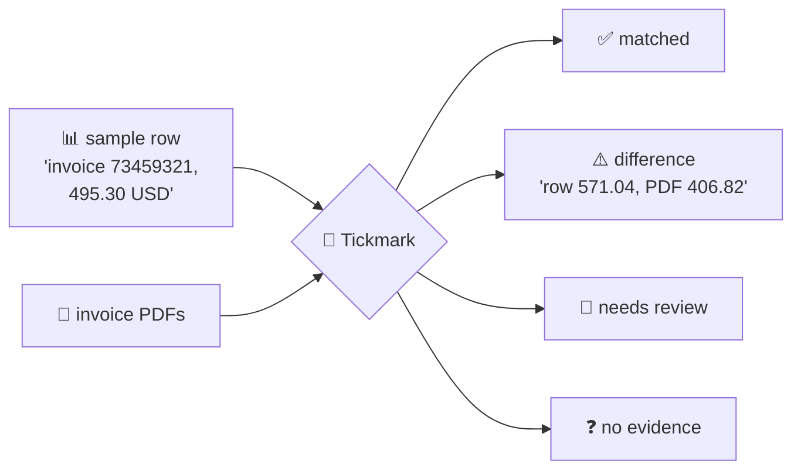

---

## 2. What you give Tickmark

🗣️ **In plain words**

The sample, the invoices, and a few engagement settings: the audit period, the default currency,
which VAT rates are legal, and whether Microsoft's paid reader may be used.

🔧 **Technically**

| Input | Form | Example |
|---|---|---|
| Sample | `.xlsx`, or an Excel range sent by the add-in (`values` + `numberFormat`) | `O-001, Hernandez…, 73459321, 2013-11-19, 495.30, USD` |
| Invoices | PDFs: digital, scanned or photographed | `v001.pdf` … |
| Period | `YYYY-MM-DD:YYYY-MM-DD` (`VouchPolicy.period_start/end`) | `2012-02-24:2023-11-03` |
| Currency | for rows that don't state one (`VouchPolicy.currency`) | `EUR` |
| VAT rates | allowed rates in % (`TICKMARK_VAT_RATES`, engagement, or run) | `0,5.5,7,19,20` |
| Azure | `auto` (when needed) / `off` / `always` (`TICKMARK_AZURE`) | `auto` |
| Item lines | check line sums (off by default; needs Azure's table reading) | off |

With an engagement, its saved period, currency, VAT rates and line-item setting are used when the
run leaves them empty.

🖼️ **Picture**

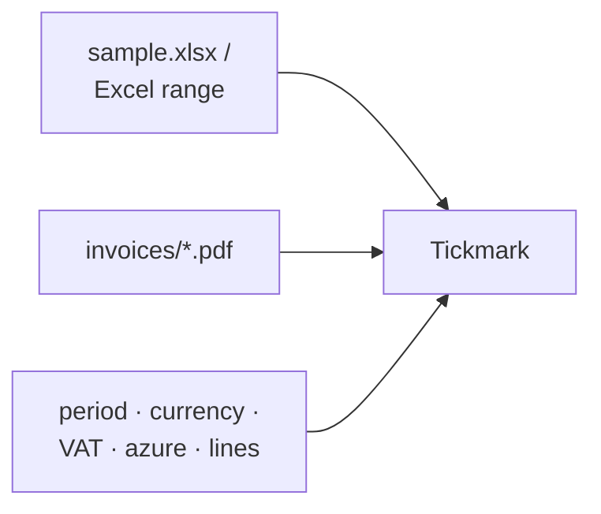

---

## 3. The whole pipeline

🗣️ **In plain words**

Understand the columns; read every PDF; decide which values can be trusted; find each row's
invoice; compare them; check the invoice on its own; decide. If a value that matters couldn't be
read clearly, read that PDF once more with Microsoft's reader and decide again.

🔧 **Technically** (`pipeline.run_vouch(sample, invoice_dir, extractor, policy, mapping)`)

1. `sample.load_sample` / `clean_sample`: sheet → `SampleRow[]` → `CleanRow[]`
2. `extract.Router.extract(pdf)` for every PDF in a thread pool (`read_concurrency=8`), each task
   keeping the caller's log context
3. `match.identify(rows, invoices)` → `Identification[]`
4. `vouch.vouch(...)` → `Verdict[]`
5. `Router.second_pass(run)`: PDFs whose needed values weren't read clearly → Azure → merged →
   identify + vouch **once** more
6. PDFs that needed OCR while Azure was off are named in the affected rows' reasons

Azure only **reads**; every decision is code in `match/` and `vouch/`, the same rules whichever
reader was used.

🖼️ **Picture**

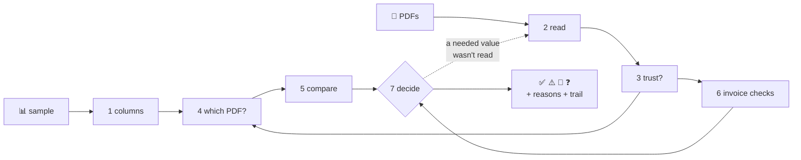

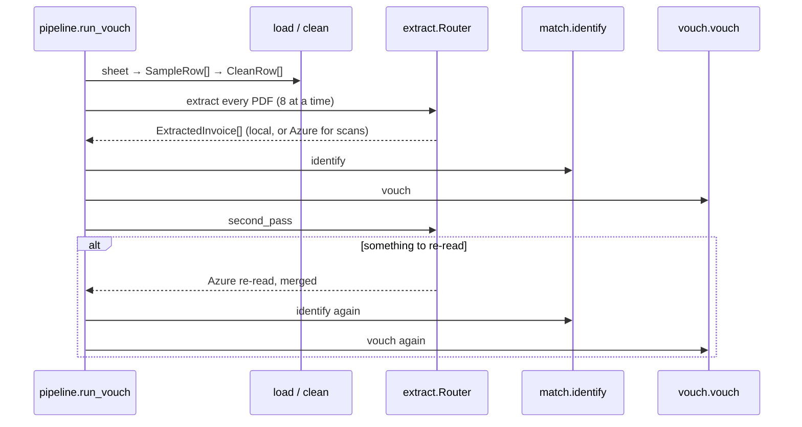

---

## 4. Stack and modules

🗣️ **In plain words**

A Python app. Small, separate parts: one reads the spreadsheet, one reads PDFs, one links rows to
PDFs, one judges, one stores. A "definition" file says which fields an audit test needs, so a new
kind of audit test is new data, not new code.

🔧 **Technically**

| Layer | Technology |
|---|---|
| Language | Python 3.12, Pydantic models, `Decimal` for all money |
| PDF text | `pdfplumber` (words with coordinates), `pypdfium2` (rendering) |
| OCR / fields | Azure Document Intelligence `prebuilt-invoice` |
| Spreadsheets | `openpyxl` |
| Fuzzy matching | `rapidfuzz` (vendor similarity only) |
| API | FastAPI + uvicorn; runs in background threads (`api/jobs.py`) |
| Front ends | plain-JS page (`api/static/`), Excel add-in on Office.js (`api/static/addin/`, `addin/manifest.xml`) |
| Audit store | Postgres via SQLAlchemy Core + Alembic; append-only; row-level security |
| Warden link | `pyjwt[crypto]` (tool tokens), `httpx` (`warden_client.py`) |
| Tests / evals | pytest; `tools/eval_*.py` |

**The definition drives the engine.** `definitions/INVOICE_VOUCHING` is data: `FieldSpec(name,
type, role, label, evidence_field, aliases, pdf_labels, …)`.

| Role | Fields | Used for |
|---|---|---|
| `key` | invoice number | strongest identifier for linking |
| `party` | vendor | who the claim is with |
| `corroborating` | amount (→ total), invoice date | support a link |
| `attribute` | currency, net, VAT, due date, PO, amount due, charges, allowances | compared or read, never used to link |
| `label` | row id | never compared |

```
src/tickmark/
  api/         main.py (endpoints) · workspace.py (uploads) · jobs.py (background runs) ·
               tools.py (tools behind Warden) · static/ (page + add-in)
  fields/      sheet.py (raw cells) · types.py (money, date, name, identifier, text) ·
               mapping.py (column → field) · profile.py (value patterns) · llm_mapping.py
  definitions/ the catalogue of meanings + INVOICE_VOUCHING
  sample/      loader.py · cleaner.py
  extract/     local.py · azure_docint.py · router.py · text.py · fake.py
  match/       identify.py
  vouch/       compare.py · invoice_checks.py · verdict.py · policy.py
  checks/      deterministic.py (duplicates etc.)
  store/       schema.py · record.py · queries.py · evidence.py · context.py · provision.py · verify.py
  pipeline.py · models.py · config.py · log.py · warden_client.py · agent.py
tools/         CLI: datagen, cleaning, identify/vouch, evals, audit trail (section 18)
migrations/    Alembic 0001–0007
tests/         pytest, one file per area
data/          local only, gitignored
```

🖼️ **Picture**

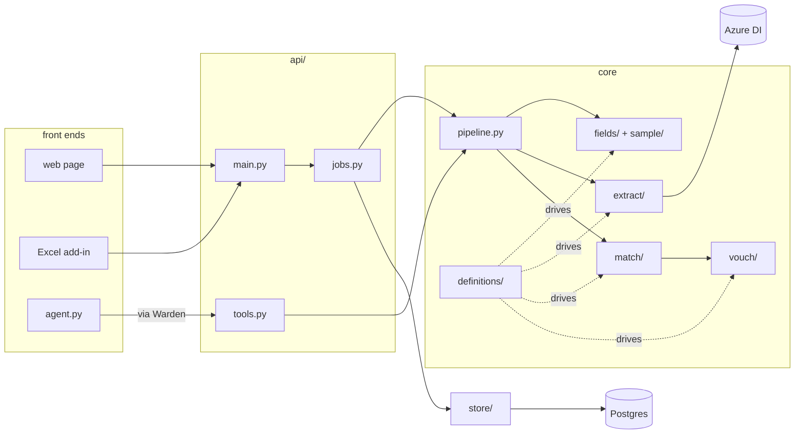

---

## 5. Step 1: understanding the sample

🗣️ **In plain words**

Tickmark finds the header row, even under title rows, and works out which column means what from
its name ("Invoice No", "Amount", "Factuurdatum"). If it can't, it asks you; optionally an AI
suggests, and a person always confirms. The confirmed answer is saved for that client's layout. It
reads messy numbers and dates carefully, refuses to guess an ambiguous date, never drops a row
silently, and never changes a row.

🔧 **Technically**

- **Raw capture** (`fields/sheet.read_sheet`): every row as cells `{col, header, value}`; header row
  = best `header_score` within `TICKMARK_HEADER_SCAN_ROWS` (20); preamble kept; odd/duplicate
  headers survive.
- **Field types** (`fields/types.py`, fixed and tested once): `money` (exact `Decimal`, stored as a
  string; `1.234,50`, `€ 2,904.10`, `(50.00)`, `123.45-` all read; refuses values with letters other
  than a currency code), `date` (Excel serials, `YYYY-MM-DD`, `DD.MM.YYYY`; `03/04/2025` is
  rejected), `name`, `identifier`, `text` (zero-width characters removed, non-breaking spaces fixed).
- **Mapping** (`fields/mapping.resolve`), in order:
  1. a confirmed mapping saved for this client **and this exact header layout** (`headers_sha256`)
  2. header aliases cover what's needed (`alias_mapping`)
  3. otherwise the run does not start: "needs mapping: …"
  `validate`: each mapped column's values must read as the field's type (≥ 80 %), no column used
  twice. **No column is required**; a run needs enough to identify an invoice
  (`cannot_run`): number + one more linking column, or vendor + amount or date. Client layouts can
  add their own meanings (`Definition.with_meanings`).
- **LLM suggestions** (`fields/llm_mapping.py`, off by default): `TICKMARK_LLM_MAPPING=on` sends
  headers and **value patterns only** (`dd.mm.yyyy`, "tens to thousands", `AAA-9999-9999`), never
  values (a test checks this); real examples are a separate switch `TICKMARK_LLM_MAPPING_VALUES`.
  Any OpenAI-compatible endpoint (`TICKMARK_LLM_BASE_URL`, model `TICKMARK_LLM_MAPPING_MODEL`).
  Headers are fenced as untrusted data; the answer must fit a schema of this sheet's real columns
  and our field names; validation and a person still confirm.
- **Cleaning** (`sample/cleaner.py`): never changes a row; adds `vendor_key` (`normalize_vendor`:
  accents stripped, casefold, `&`→`and`, punctuation and legal forms dropped: "Acme B.V." = "ACME BV"
  = `acme`, "Müller Büro GmbH" = `muller buro`) and flags (`duplicate_of:<row>`, `negative_amount`,
  `zero_amount`, `date_outside_period`). Footer rows (Total, Notes…) are skipped and reported; bad
  rows are errors with a reason.
- **Proof nothing was lost** (`tools/verify_clean.py`, independent of the loader): completeness,
  fidelity, untouched rows, control total, round trip. Tests tamper with output to prove it catches it.
- **Excel input** (`api/workspace.sheet_from_rows`): a number in a cell whose format has a d/y token
  is turned back into a date (`1899-12-30 + days`).

🖼️ **Picture**

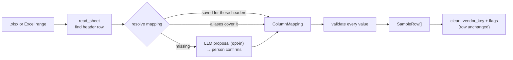

---

## 6. Step 2: reading the PDFs

🗣️ **In plain words**

The hardest step. Two readers. **Our own reader** is free and instant: it reads the text inside
digital PDFs and finds labels like "Invoice No", "Total", "Bruttosumme", "Total TTC" and takes the
value next to them. **Azure** (Microsoft's AI reader, about $10 per 1,000 pages, ~15 s each) reads
scans and photos and any layout, but sometimes picks the wrong thing. Our reader goes first; Azure
only gets the PDFs our reader can't handle, or where a value the decision needs wasn't clear. Azure
results are saved by the file's fingerprint, so a PDF is never paid for twice.

🔧 **Technically**

**Local reader** (`extract/local.py`, `LocalExtractor`):
- `check_page` → `needs_ocr` when: little text but an image (scan/photo), text over a full-page image
  (a scanner's OCR), unreadable `(cid:)` characters, rotated text. Thresholds `TICKMARK_PDF_*`
  (`MIN_CHARS 30`, `IMAGE_COVER 0.7`, `BAD_CHARS 0.02`, `ROTATED 0.2`).
- Words with coordinates → lines (within 3 pt) → blocks (gap > `PDF_WORD_GAP` 15 pt).
- Labels: every `FieldSpec.pdf_labels`, longest first, no overlaps ("total excl vat" beats "total").
- Value: rest of the block → next block → line below; money refuses if >1 amount follows a label;
  exactly one distinct value (compared as `Decimal`) → read with confidence 1.0, else
  `unread = ambiguous`.
- Letterhead: lines above the first customer label or first amount, at most 33 % of page 1
  (`PDF_LETTERHEAD_SHARE`); stops at an amount, not a date.
- Only "amount due" printed → becomes the total if net + tax equals it.

**Azure** (`extract/azure_docint.py`, `DocIntExtractor`): `prebuilt-invoice`; raw result cached at
`data/cache/docint/<sha256>.json`; fields VendorName, InvoiceId, InvoiceDate, InvoiceTotal,
SubTotal, TotalTax, CustomerName, DueDate, PurchaseOrder; currency from InvoiceTotal; VAT breakdown
from TaxDetails; `ocr_words` converts Azure's words to local coordinates so label reading also works
on scans. No credentials → a clear error, never a guess.

**Router** (`extract/router.py`, `TICKMARK_AZURE`): `always` → Azure; `auto` + `needs_ocr` → Azure;
otherwise local. Merge rules: Azure's fields win, **except where the page proves otherwise**:
- a labelled local currency beats Azure's code
- if Azure's total = the local **amount due**, the labelled total is used
- Azure missing net or tax → local value only if net + tax = total then adds up
- both readers equal → `corroborated`
`second_pass` after the first verdicts: a needed value not read, a check not checkable, an ambiguous
candidate, or the PDFs sharing a number whose vendor is unknown. Each stored run records how each
PDF was read and why (`read_by`, `read_reason`).

**Test reader** (`extract/fake.py`, `LabelExtractor`): reads ground-truth labels, "perfect reading"
for testing the rules alone; never evidence.

🖼️ **Picture**

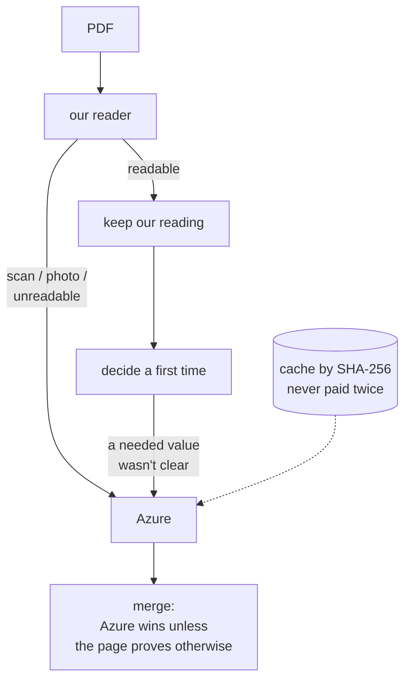

| Reader | Cost | Good at | Weak at |
|---|---|---|---|
| our own | free, instant | digital PDFs with labels | scans, unfamiliar layouts, unlabelled dates/numbers |
| Azure | ~$10 / 1,000 pages, ~15 s | scans, photos, any layout | watermark as vendor, amount due as total, wrong currency |

---

## 7. Step 3: can a value be trusted?

🗣️ **In plain words**

Reading a value isn't enough; Tickmark has to trust it. A value is trusted only if something
independent confirms it: it's printed exactly so on the page, the sums add up, both readers agree,
or the reader is very sure. Corrections happen only when the page itself proves them. **Never** is
a reading "fixed" by copying the row being tested; that would let a wrong row prove itself. An
untrusted value may agree with the row, but can never contradict it.

🔧 **Technically** (`extract/text.py`)

- `untrusted(f)`: usable if `f.corroborated` is set, or confidence ≥ `TICKMARK_CONFIDENCE_MIN` (0.90).
- `corroborate(inv)`, in order:
  1. **date order**: slash dates that only read one way on the page decide day/month for the rest
     (`_slash_order`)
  2. **tax by arithmetic**: net + tax ≠ total but total − net is printed on the page → that's the tax
  3. **reconcile**: net + tax = total ± 0.01 → all three corroborated
  4. **literally printed**: number as a word; date in any of 9 forms; currency code or symbol;
     vendor/customer as a line
- `_printed(amount, text)`: accepts `1234.50`, `1234,50`, `1,234.50`, `1.234,50`, `1 234,50`.
- `found_in_text(inv, type, role, value)` (claim side): an identifier as one exact word after
  `normalize_number`; a vendor as a **whole block** of the letterhead (line, part between `:` ` - `
  `|` `•`, or two consecutive lines), never if it equals the invoice's customer. Not found proves
  nothing.
- **Invariant:** nothing in `extract/` reads the sample row.

🖼️ **Picture**

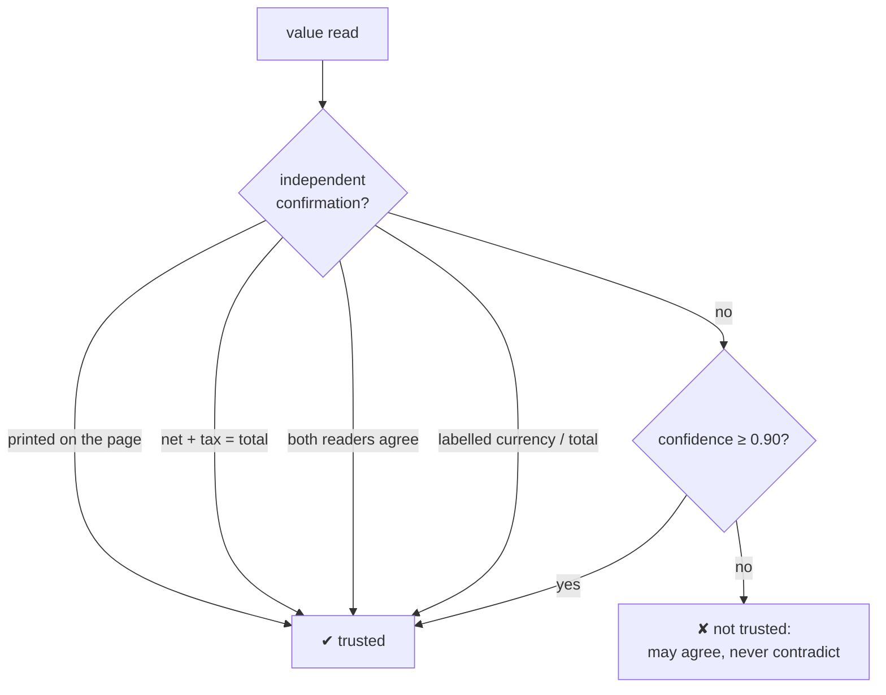

---

## 8. Step 4: which PDF is each row about?

🗣️ **In plain words**

Before comparing anything, Tickmark must know which PDF belongs to which row. It links only on
strong evidence that points to one PDF: the invoice number plus one more matching field, or (if
there's no number) the vendor plus the amount or date. A similar-looking vendor is never enough.
One PDF backs one row. Anything weaker goes to a person (👀) with the candidates listed; a wrong
link is the one outcome that must never happen.

🔧 **Technically** (`match/identify.py`)

| # | Rule |
|---|---|
| 1 | only **trusted** values count (`_trusted`); the total only if net + tax reconciles; low-confidence values become `pdf.weak` |
| 2 | **key** (number) equal **+ ≥ 1 more** → eligible; number alone → review; number conflicts but party + corroborating agree → review |
| 3 | no key: **party equal + (amount or date)** → eligible; party only similar (`token_sort_ratio ≥ 90`) → review, never a link |
| 4 | **clear winner**: rank = (eligible, agree count, ratio, −money diff, −date diff); a tie is settled only by date (one ≤ 31 days away, all others > 365) else review |
| 5 | **one PDF per row**: a contested PDF stays only with a strictly higher-ranked row |

Field comparison: number ignores spaces, `-`, `/`, `.`, case; vendor by `vendor_key`; amount ±0.01;
date same day. `found_in_text` and equal weak values may add agreement.
Outcome: 🔗 `linked` (evidence + snips), 👀 `needs_review` (candidates + why), ❓ `no_evidence`.
Thresholds recorded with every stored run (`confidence_min`, `vendor_similar` 90, `amount_tol` 0.01,
`date_near` 31, `date_far` 365).

🖼️ **Picture**

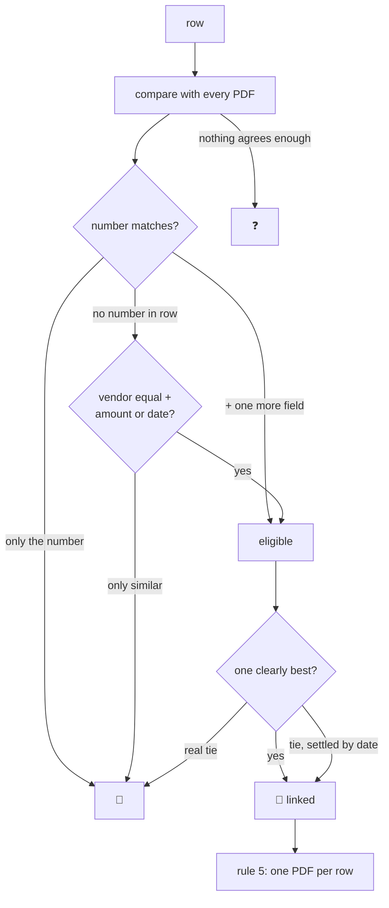

---

## 9. Step 5: comparing the row with its invoice

🗣️ **In plain words**

For the linked PDF, each field of the row is compared with what the invoice says. A difference is
reported with its size ("+164.22", "−365 days"). If the invoice's value isn't trusted, it can agree
but can't cause a ⚠️; the field is "unverifiable" instead.

🔧 **Technically** (`vouch/compare.compare`)

| Type | Agrees | Differs | Unverifiable |
|---|---|---|---|
| money | `abs(row − pdf) ≤ amount_tol` (0.01) | with delta `+164.22 (row − PDF)` | untrusted and not equal |
| date | equal | `±N days` | day/month swap possible and the page is ambiguous; untrusted |
| name | `normalize_vendor` keys equal, or `found_in_text` | keys differ | one key part of the other; untrusted |
| identifier | `normalize_number` equal | differ | untrusted |
| currency | code equal (row empty → `policy.currency`) | differ | neither row nor engagement says |

Amounts are compared with the **printed** total.

🖼️ **Picture**

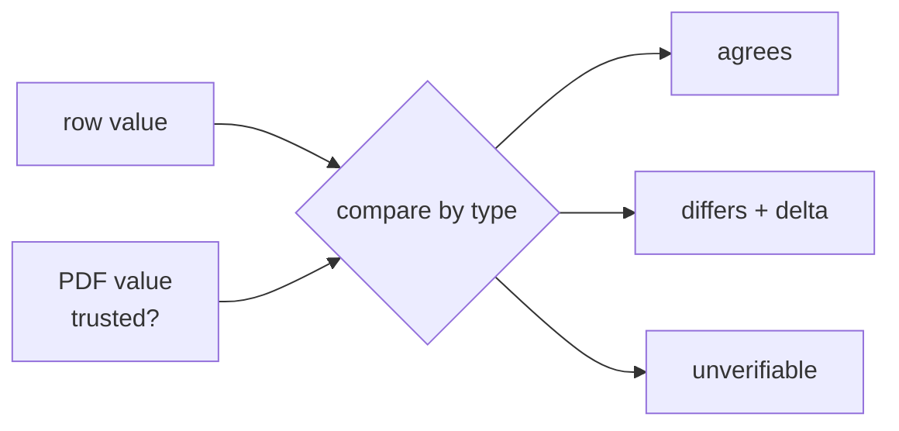

---

## 10. Step 6: checking the invoice on its own

🗣️ **In plain words**

Even if the row and the invoice agree, the invoice itself might be wrong: totals that don't add
up, an illegal VAT rate, a date outside the audit period, an invoice number used twice. A total
that nobody can show adds up is never passed.

🔧 **Technically** (`vouch/invoice_checks.check_invoice`, `checks/deterministic.py`)

| Check | Logic | Fails → | Can't run → |
|---|---|---|---|
| `totals_reconcile` | net + tax = total ± tol | ⚠️ | **👀** (blocking) |
| `vat_rate` | breakdown rates all allowed and parts sum to tax; else tax/net is an allowed rate | ⚠️ | note |
| `in_period` | `period_start ≤ date ≤ period_end` | ⚠️ | note |
| `duplicate` | same number + same vendor on another PDF → fail; other vendor → warn | ⚠️ / warning | **👀** (possible double payment) |
| `lines_sum` (opt-in) | Σ lines = net; qty × price = amount | ⚠️ | note |

Why totals block: an invoice whose lines added up to 2,112 under a printed total of 9,312 was once
passed when "totals not checkable" was only a note.

🖼️ **Picture**

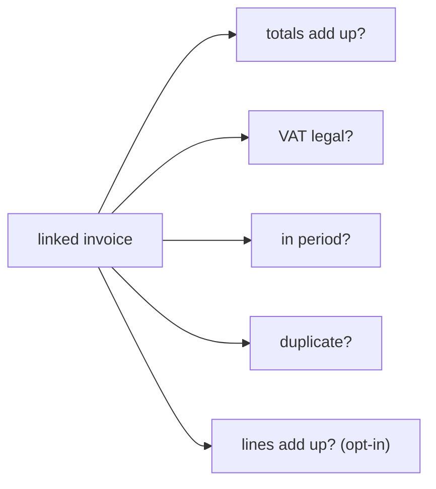

---

## 11. Step 7: the verdict

🗣️ **In plain words**

No invoice → ❓. Not sure which invoice → 👀. Anything differs or any check fails → ⚠️ with every
reason. Something couldn't be verified (a field, the totals, a possible duplicate) → 👀. Otherwise
→ ✅, with notes for checks that couldn't run. Any difference over 0.01 is ⚠️; the auditor judges
whether it matters.

🔧 **Technically** (`vouch/verdict._verdict`)

`no_evidence` → ❓; `needs_review` identification → 👀; linked → agreements + checks → any `differs`
or `fail` → ⚠️ (reasons = differs + fails + unknowns); else any unverifiable field, `duplicate`
not_checkable, or `totals_reconcile` not_checkable → 👀; else ✅ (reasons = warnings + notes).
`MARK = {"matched": "✅", "difference": "⚠️", "needs_review": "👀", "no_evidence": "❓"}`.

🖼️ **Picture**

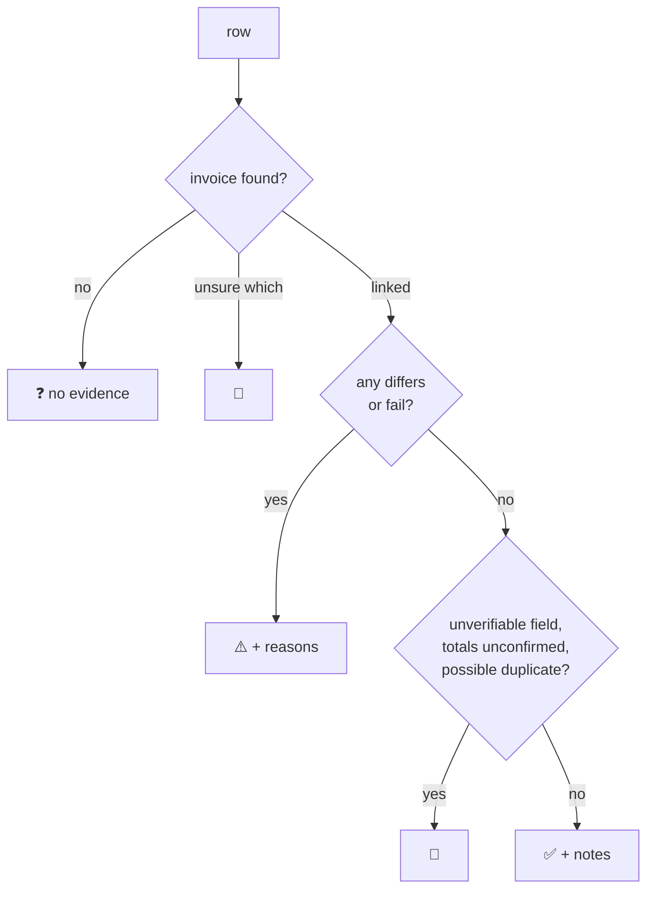

---

## 12. The data shapes

🗣️ **In plain words**

Every value read from a PDF carries where it was found (page and box) and why it's trusted. Every
decision carries its trail. Nothing has to be recomputed to explain a result later.

🔧 **Technically** (`models.py`, Pydantic)

🖼️ **Picture**

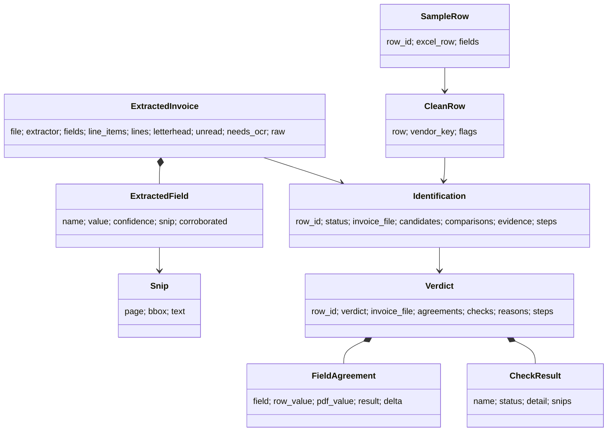

---

## 13. The audit trail (Postgres)

🗣️ **In plain words**

In audit, the result is only half of it: months later you must show what was decided, from which
exact files, under which rules, and what a person did about it. Tickmark can save a run completely
in its own database. Nothing can be changed or deleted afterwards; a re-run is a new run, and a
human decision is a new review. Each audit firm and each client job is walled off by the database
itself, not just by the code.

🔧 **Technically** (`store/`, `migrations/`)

| Table | Holds |
|---|---|
| `tenants` / `engagements` | firms and client jobs (Warden's ids; period, currency, VAT, line items); registry, owner-only |
| `runs` | when, who, engagement, matcher version (git commit), thresholds, extractor + model, definition snapshot, status |
| `documents` | every file by **SHA-256**, size, pages, evidence path |
| `run_documents` | which PDFs a run used, under which name, how each was read and why |
| `extractions` | raw reader result + parsed fields with confidence and snips |
| `sample_rows` | raw cells + typed fields + party key + flags |
| `sample_issues` | rows that errored or were skipped, with raw cells |
| `column_mappings` | column → field per client layout: source (aliases / LLM / person), who confirmed, LLM proposal |
| `match_results` | identification per row with the full trace |
| `verdicts` | one per row: mark, PDF, agreements, checks, reasons, steps |
| `reviews` | human decisions (accept, choose_candidate, reject, requested_from_client), who, when, note |

- **Append-only**: triggers reject UPDATE, DELETE, TRUNCATE on every table.
- **Multi-tenant**: every row has `tenant_id` + `engagement_id`; **row-level security** shows/accepts
  only the session's tenant + engagement (`app.tenant_id`, `app.engagement_id`, transaction-local,
  set by `store/context.scoped(TenantContext(...))`); nothing set → nothing visible (fail closed);
  composite foreign keys `(tenant_id, engagement_id, id)` stop cross-engagement links; another
  firm's run looks like it doesn't exist.
- **Two roles**: `tickmark` (owner: migrations, provisioning) and `tickmark_app` (the app:
  SELECT + INSERT only).
- **Evidence store** (`store/evidence.py`): `data/store/<tenant>/<engagement>/<sha[:2]>/<sha256>.<ext>`,
  never overwritten, per engagement (so walls hold for files too); `verify_run` re-hashes.
- Migrations: 0001 audit tables + triggers · 0002 multi-tenant (RLS, roles) · 0003 verdicts ·
  0004 flexible input · 0005 engagement currency · 0006 dynamic meanings + how each PDF was read ·
  0007 engagement VAT rates. Postgres on host port **5435**.

🖼️ **Picture**

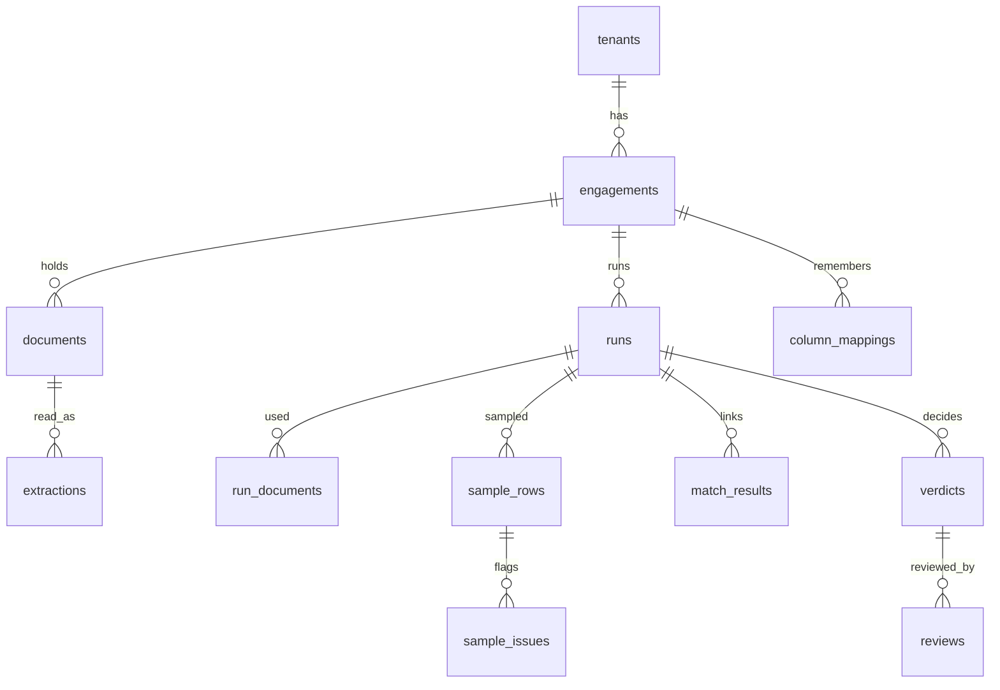

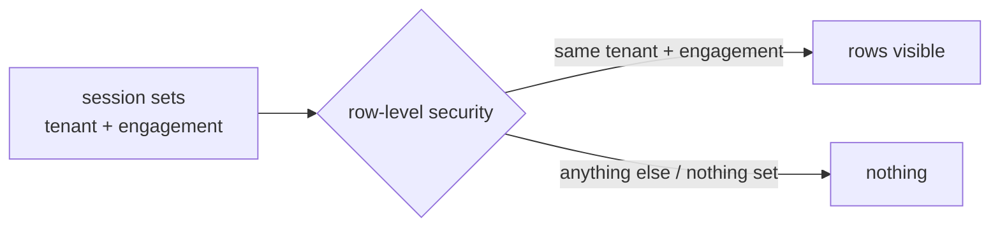

---

## 14. Web app, API and logs

🗣️ **In plain words**

A web page drives the whole flow: upload the sample and PDFs, settle the column meanings, run, and
watch every step live; then the verdicts, how each PDF was read, and the PDFs themselves. With a
firm and engagement chosen, runs are saved and reviews can be recorded. (The firm and engagement
come from the page here, a local stand-in; there's no login on the web app yet.)

🔧 **Technically** (`api/main.py`)

| Endpoint | Purpose |
|---|---|
| `POST /api/workspaces` | upload `sample` (.xlsx) **or** `rows` (Excel JSON) + `invoices` |
| `GET /api/workspaces/{id}` | columns, mapping, problems, PDFs |
| `POST /api/workspaces/{id}/suggest` | LLM column proposal |
| `PUT /api/workspaces/{id}/mapping` | validate + confirm the mapping |
| `POST /api/workspaces/{id}/runs` | start a run (period, currency, vat_rates, azure, line_items, save) |
| `GET /api/jobs/{id}?since=n` | log lines since n, then the result |
| `GET /api/workspaces/{id}/pdf/{name}` | serve a PDF |
| `/api/tenants`, `/api/engagements/…`, `/api/runs/{id}`, `POST /api/runs/{id}/reviews` | audit trail + reviews |
| `/tools/*` | the agent's tools, Warden-only (section 16) |

- Workspaces in memory, recreated from `data/uploads/<id>/` after a restart (id must be
  `[0-9a-f]{12}`).
- Jobs run in a daemon thread with their own log capture (contextvars).
- Logs per step (`tickmark.sheet`, `mapping`, `llm`, `read`, `azure`, `router`, `identify`, `vouch`,
  `store`, `api`, `tools`) to the console and `data/logs/tickmark.log` at `TICKMARK_LOG_LEVEL`.
- Database unreachable → 503 with a clear message.

🖼️ **Picture**

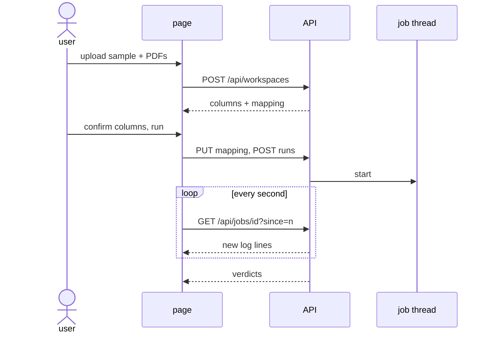

---

## 15. The Excel add-in

🗣️ **In plain words**

The same thing inside Excel. Select the sample, pick the invoice PDFs, press **Check sample**.
Tickmark writes three coloured columns next to your data (Tickmark, Why, Invoice), and clicking a
row opens its invoice. It's only a front end: same backend, same verdicts.

🔧 **Technically**

- `addin/manifest.xml` (TaskPaneApp, ExcelApi 1.7, ribbon button on Home), served from
  `/static/addin/` on the same origin as the API (no CORS). Needs HTTPS:
  `make certs` (once) then `make run-https`.
- `taskpane.js`: `getSelectedRange()` → values, numberFormat, row/column index → `POST
  /api/workspaces` with rows JSON + PDFs → column pickers if needed → `PUT mapping` → `POST runs` →
  poll the job → write results at `rowIndex + excel_row − 1`, fill colour, hyperlink →
  `displayDialogAsync(pdf url)` on click.
- **Sideload**: Excel on the web: Home → Add-ins → My Add-ins → Upload My Add-in →
  `addin/manifest.xml`. Mac: copy to `~/Library/Containers/com.microsoft.Excel/Data/Documents/wef/`,
  restart. Windows: shared folder + Trust Center → Trusted Add-in Catalogs.
- Test data: `data/real/facturx/` (2013-01-01 → 2020-12-31, EUR, VAT 0,5.5,7,19,20),
  `data/real/variety/originals|scans|photos/` (see each folder's `truth.json`).
- Not yet: highlight on the PDF, reviews from the sheet, saving runs from Excel, Microsoft sign-in,
  firm hosting (IT deploys the manifest via the Microsoft 365 admin center).

🖼️ **Picture**

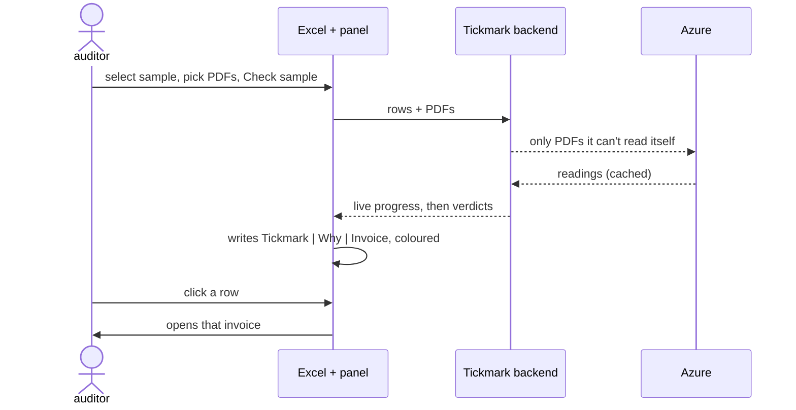

| Tickmark | Why | Invoice |
|---|---|---|
| ✅ matched *(green)* | every field agrees | v001.pdf |
| ⚠️ difference *(red)* | amount differs: row 571.04, PDF 406.82, +164.22 | v020.pdf |
| 👀 needs review *(amber)* | vendor unverifiable | v042.pdf |
| ❓ no evidence *(grey)* | no PDF agrees on two or more fields | |

---

## 16. Tickmark behind Warden

🗣️ **In plain words**

As an AI agent, Tickmark doesn't get the auditor's full powers. It asks Warden for a 15-minute pass
for one client and two actions (read, vouch), and every tool call goes through Warden, which
checks the firm's rules and writes everything down. Tickmark's tools only open for Warden's
one-minute slips, so even Tickmark's own agent can't skip Warden. The moment Warden says no, or
doesn't answer, the agent stops.

🔧 **Technically**

- `api/tools.py`: `/tools/list_documents`, `/tools/read_document`, `/tools/run_vouch`. Dependency
  `from_warden(tool)` verifies the forwarded token with PyJWT against Warden's JWKS
  (`<TICKMARK_WARDEN_URL>/.well-known/jwks.json`): RS256, `iss=warden`,
  `aud=TICKMARK_TOOLS_AUDIENCE` (`tickmark-tools`), required `exp sub act tid eng tool`; failure →
  401; wrong `tool` → 403. Engagement = token's `eng`; files in
  `TICKMARK_ENGAGEMENTS_DIR/<eng>/sample.xlsx` + `invoices/`; `Path(name).name` blocks `../`;
  `run_vouch` runs the pipeline with Azure off. No export endpoint.
- `warden_client.py`: `exchange_token(scope, resource)` (`POST /token/exchange` with the user's
  token and `agent_id = TICKMARK_AGENT_ID`), `invoke(tool, payload)` (`POST
  /tools/{tool}/invoke`); any non-200 or network error → `WardenDenied`.
- `agent.py`: `python -m tickmark.agent --engagement <id> --token <sign-in token> [--period]
  [--currency]` → exchange `documents.read vouch.run` → list → vouch → print; denied → exit 1.
  `make agent TOKEN=… [ENG=…]`; demo files `make warden-demo` (Warden's Coke and Pepsi ids).
- Not yet: the web app and the add-in don't go through Warden or Microsoft sign-in.

🖼️ **Picture**

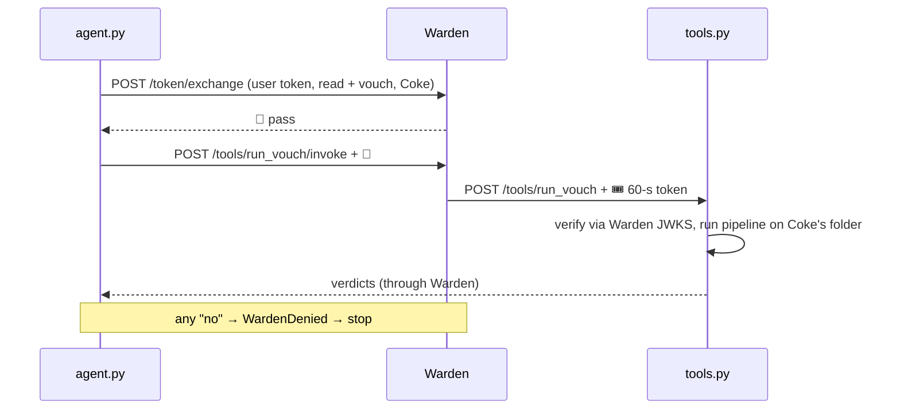

---

## 17. How we know it's accurate

🗣️ **In plain words**

We test against answers written by a person who read each invoice, never against Tickmark's own
reading, and never against the hidden data inside e-invoices (which sometimes disagrees with the
printed page). We plant mistakes in sample sheets (wrong amounts, dates, vendors, missing
invoices) and check Tickmark finds them. Two numbers must always be zero: **wrong links** and
**false ✅**. The test scripts fail the build if either isn't zero.

🔧 **Technically**

- Datasets: synthetic `generated` (16 rows, 20 PDFs, decoys), `external` (7-row sample pack),
  `hard` (11 rows built to fool a matcher: typo'd number, reused number, same vendor+amount on two
  dates, look-alikes…), `demo/easy|tough`; real `real/facturx` (30 ZUGFeRD e-invoices, Apache-2.0),
  `real/variety/originals|scans|photos` (invoice images in 3 layouts + unseen e-invoices + 6 stray
  pages that must match nothing; HF images ODbL 1.0).
- `truth.json`: `{period, currency, vat_rates, rows: {row_id: {expect: verdict | [acceptable…]}}}`;
  stray pages `{expect: "unlinked"}`. Labels typed from the rendered page (the embedded XML disagreed
  for 3 of 30 PDFs).
- Results:

| Set | Mode | Result | Wrong links / false ✅ |
|---|---|---|---|
| generated / external / hard | perfect reading (`--labels`) | 16/16 · 7/7 · 11/11 as labelled | 0 |
| real/facturx | own reader + Azure cache | 30 / 30 | 0 |
| variety/originals | own reader + Azure cache | 34 / 40 | 0 |
| variety/scans, photos | — | not run yet (needs one Azure run) | — |

  Over all 20 generated PDFs the checks find every labelled defect (lines 2, VAT 3, period 2,
  duplicate 2) with no false alarms; with a deliberately loose tolerance the eval reports false ✅
  and fails, so it does catch a weakened rule.
- **Invariants**: no false ✅ (one relaxation was rolled back for producing one); corrections only
  from the invoice; untrusted values can agree but never contradict; arithmetic or literal printing
  is the only independent confirmation (confidence alone was measured not to separate right from
  wrong); one PDF per row; every decision explainable after the fact.
- Caveat: some rules were tuned while looking at these sets, so the scores are optimistic; a fresh
  held-out set run only at milestones gives the honest number.
- Tests: **157 passed, 40 skipped** (the skipped need Tickmark's Postgres). CI
  (`.github/workflows/tickmark.yml`) runs tests and evals with Postgres.

🖼️ **Picture**

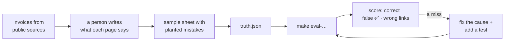

---

## 18. Developer tools

🗣️ **In plain words**

Command-line helpers for making test data, running the pipeline step by step with every decision
shown, measuring accuracy, and working with the saved audit trail.

🔧 **Technically** (`python -m tools.<name>`)

| Tool | Does |
|---|---|
| `datagen.generate` / `hard` / `demo` / `unfamiliar` / `variety` / `facturx` | synthetic, trick, demo, foreign-layout and real-derived datasets |
| `clean_sample`, `compare_sample`, `verify_clean` | cleaned workbook; raw vs cleaned; prove nothing lost |
| `identify_sample` | row → PDF with `--trace`, `--out` workbook (Identified · Steps · Comparisons · PDF fields), `--save` |
| `vouch_sample` | row → PDF → verdict, same options |
| `eval_identify`, `eval_vouch`, `eval_reader` | wrong links must be 0; false ✅ must be 0; reader accuracy |
| `compare_readers` | local vs Azure on the same PDFs (calibration) |
| `map_columns` | show/set/confirm a column mapping; `--suggest` asks the LLM |
| `tenants` | register firms and engagements, set period/currency/VAT |
| `show_run`, `review`, `verify_run` | read a stored run; add a human review; re-hash its evidence |

🖼️ **Picture**

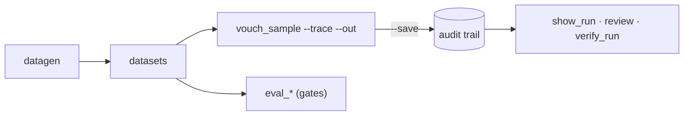

---

## 19. Run it yourself

🗣️ **In plain words**

Install once, start the database, then use the web page, Excel, the agent, or the command line.

🔧 **Technically**

```bash
cd tickmark
make setup                 # .venv + install + .env from .env.example
make db                    # Postgres (:5435) + migrations
make demo                  # demo datasets
make run                   # web app on http://localhost:8000
make logs                  # follow the step log
make test                  # pytest
make eval                  # synthetic sets, own text only
make eval-real             # real/facturx (Azure from cache)
make eval-variety          # variety sets
make certs && make run-https   # Excel add-in over https
make warden-demo           # files for Warden's demo engagements
make agent TOKEN=<sign-in token> [ENG=<engagement id>]   # vouch through Warden
```

Audit trail from the CLI:
```bash
python -m tools.tenants add-tenant "Firm A"
python -m tools.tenants add-engagement <tenant id> "Coke" --period 2026-01-01:2026-12-31
export TICKMARK_TENANT=<tenant id> TICKMARK_ENGAGEMENT=<engagement id>
python -m tools.vouch_sample <sample.xlsx> <invoices/> --save          # prints the run id
python -m tools.show_run RUN_ID --trace --out data/output/run.xlsx      # rebuilt from the DB
python -m tools.review RUN_ID S-02 --decision accept --note "checked"
python -m tools.verify_run RUN_ID                                       # files unchanged
```

Key settings (`.env`, prefix `TICKMARK_`): `WARDEN_URL`, `AGENT_ID`, `TOOLS_AUDIENCE`,
`ENGAGEMENTS_DIR`, `DOCINT_ENDPOINT`, `DOCINT_KEY`, `DOCINT_MODEL`, `DATABASE_URL` (app role),
`ADMIN_DATABASE_URL` (owner), `AZURE`, `VAT_RATES`, `CONFIDENCE_MIN`, `READ_CONCURRENCY`,
`PDF_*`, `HEADER_SCAN_ROWS`, `LLM_MAPPING`, `LLM_MAPPING_VALUES`, `LLM_BASE_URL`, `LLM_API_KEY`,
`LLM_MAPPING_MODEL`, `LOG_LEVEL`, `LOG_DIR`, `UPLOAD_DIR`, `EVIDENCE_DIR`.

**Checking a result by hand:** (1) was the PDF read right? compare the *PDF fields* sheet with the
PDF; (2) was the decision right? read *Steps*, then filter *Comparisons* by the row; (3) months
later: `show_run --trace` and `verify_run`.

🖼️ **Picture**

```mermaid
flowchart LR
    SETUP["make setup"] --> DB["make db"] --> USE{"use it"}
    USE --> WEB["make run → page"]
    USE --> XL["make run-https → Excel"]
    USE --> AG["make agent → via Warden"]
    USE --> CLI["tools.* → CLI"]
```

---

## 20. Compared with DataSnipper

🗣️ **In plain words**

DataSnipper (from its public knowledge base, October 2026) **finds evidence**: it searches each
document for the row's values and links them as clickable highlights; the auditor decides
everything. Tickmark **gives a conclusion**: it reads the invoice, compares, and marks each row,
with reasons. That's Tickmark's advantage, and why it must be so strict about never giving a wrong ✅.

🔧 **Technically**

| | DataSnipper | Tickmark |
|---|---|---|
| Core idea | claim first: is the row's value printed on the page? | page first: what does the invoice say? |
| Output | a snip per value; the auditor concludes | ✅ / ⚠️ / 👀 / ❓ with reasons and a trail |
| Strictness | exact by default; fuzzy and tolerances opt-in | ±0.01, normalised vendor, never ✅ on missing evidence |
| Strength | works on any layout | knows what each number means; explains differences |
| Weakness | coincidental hits (fine with a human checking each) | must pick the right number (amount due vs total, day/month) |

Worth copying, in order: (1) **search for the claim as a second reader**, counting a hit only on
the same page and a labelled line; (2) **highlight every field** on the PDF (the `Snip` data already
exists); (3) matching options per engagement (tolerance, fuzzy vendor opt-in, required field);
(4) an exception workflow (reviewer decision + note); (5) templates per client (partly done). Not to
copy: leaving every conclusion to the auditor; no confidence logic; fuzzy matching on by default.

🖼️ **Picture**

```mermaid
flowchart TB
    subgraph DS["DataSnipper: claim first"]
        direction LR
        d1["row says 220.00"] --> d2["is 220.00 printed?"] --> d3["highlight"]
    end
    subgraph TM["Tickmark: page first"]
        direction LR
        t1["which number is the total?"] --> t2["total = 220.00"] --> t3["row says 220.00? → verdict"]
    end
```

```mermaid
flowchart LR
    P["PDF"] --> R["page first"]
    S["row's claim"] --> Q["claim first"]
    P --> Q
    R --> C{"both agree?"}
    Q --> C
    C -->|"yes, same page,<br/>labelled line"| OK["✅ with highlights"]
    C -->|"no"| RV["⚠️ / 👀 with both values"]
```

---

## 21. What it can't do yet

🗣️ **In plain words**

Honest list of gaps and what would fix them.

🔧 **Technically**

| Gap | Effect | Direction |
|---|---|---|
| local reader misses unlabelled dates/numbers ("Nr. X vom DATE") | more PDFs go to Azure | heading patterns |
| vendor sometimes not read from images | 👀 instead of ✅ | use Azure's seller name / VAT id when printed |
| no claim-first search for amounts and dates | some "which number is the total?" misses | same-page, labelled-line search |
| `lines_sum` ignores line discounts | must stay off | account for discounts |
| no highlight on the PDF | reviewer must find the value | highlight from stored snips |
| several invoices in one PDF | ambiguous → Azure or 👀, not split | split documents |
| materiality, per-country VAT tables | any difference > 0.01 is ⚠️; one VAT list per engagement | per-engagement thresholds and tables |
| duplicates across runs | only within one run | check the engagement's history |
| uploads and jobs in process memory | not multi-worker safe | Blob storage + a queue |
| web app / add-in not behind Warden or sign-in | firm comes from the page | tenant from the Warden-verified token |
| evidence on local disk | — | Azure Blob, a container per tenant, immutable |
| small eval set, partly seen while tuning | optimistic scores | 50–100 invoices, held-out set |
| live Azure on scans/photos | not measured | one Azure run + `compare_readers` |

🖼️ **Picture**

```mermaid
flowchart LR
    NOW["now: local + Azure reading,<br/>strict rules, audit trail,<br/>agent via Warden"] --> NEXT["next: claim-first search,<br/>PDF highlights, held-out evals"] --> LATER["later: Blob, queue,<br/>sign-in everywhere, deploy"]
```

---

## 22. Glossary

| Word | Meaning |
|---|---|
| **Sample** | the rows from the books the auditor must check |
| **Vouching** | checking each row against its source document |
| **Engagement** | one client audit job |
| **Snip** | where a value was found: page, box, text |
| **Our own reader** | Tickmark's free reader for the text inside digital PDFs |
| **Azure** | Microsoft's paid AI reader (Document Intelligence) |
| **Trusted value** | one something independent confirms |
| **Letterhead** | the top of the invoice, where the issuer's name usually is |
| **Amount due** | what's left to pay; not the same as the invoice total |
| **False ✅** | Tickmark says matched but the row is wrong: must never happen |
| **Wrong link** | a row tied to the wrong PDF: must never happen |
| **Held-out set** | test invoices nobody looks at while fixing |
| **Add-in** | the Tickmark panel inside Excel |
| **Warden** | the security layer every agent tool call goes through |
