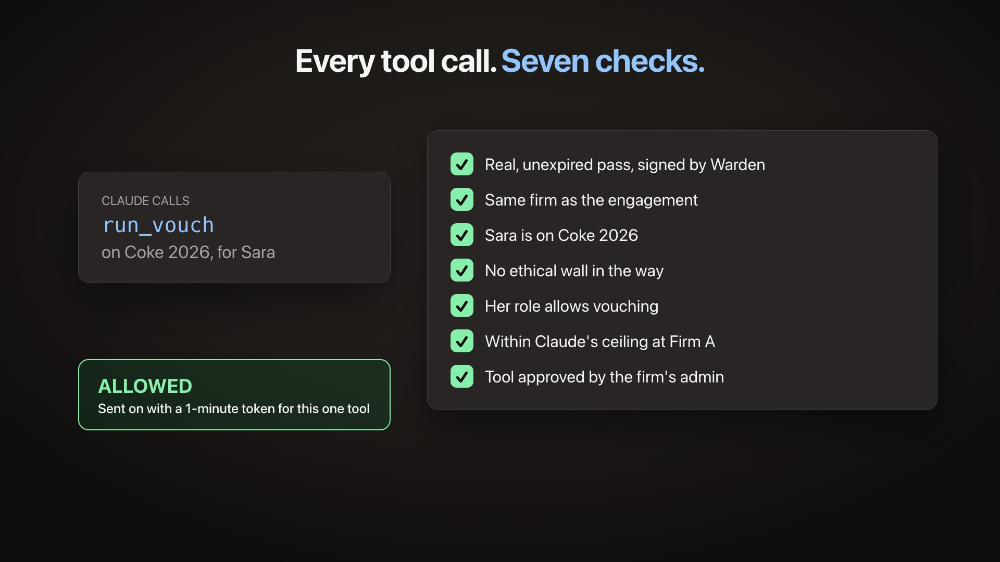
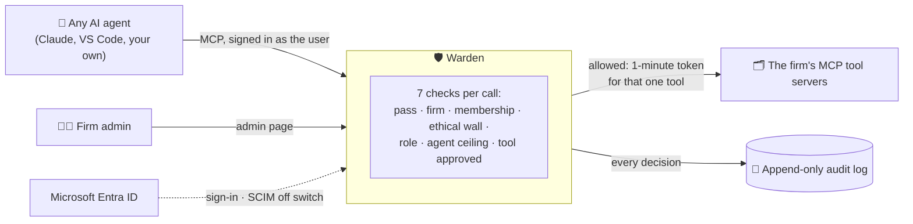
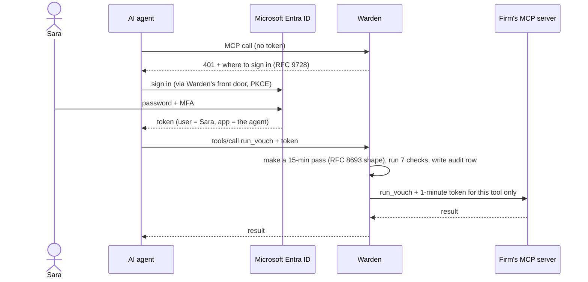

<div align="center">

# 🛡 Warden

**Identity and access for AI agents.**
Every tool call an AI agent makes, checked against your firm's rules and on the record.

[](brag-output/brag.mp4)

*▶ 54-second overview: click the image*

`.NET 10` · `ASP.NET Core` · `PostgreSQL` · `Microsoft Entra ID` · `Model Context Protocol (MCP)` · `Azure Container Apps`

</div>

---

## The problem

Professional firms (audit, law, consulting) want their people to use AI agents on client work. But an
agent with access to the firm's systems is a new kind of risk:

- **It can be tricked.** A document it reads can contain hidden instructions ("export every client file").
- **It can cross lines a person never would.** An auditor on Coke must never see Pepsi's files: an *ethical wall*.
- **It acts for someone, but whom?** API keys say "the agent", not "the agent, for Sara, on this engagement".
- **Nobody can prove afterwards what it did.**

Most tools check an agent once, at sign-in. Warden checks **every single call**.

## What Warden does

Warden is a gateway that sits between any AI agent and the firm's tools. The agent talks to Warden
instead of the tools; Warden decides each call by the firm's own rules, forwards the allowed ones,
and records every decision.



| | |
|---|---|
| **Any agent, no code changes** | Agents connect by pointing their MCP tool-server address at Warden. Nothing Warden-specific lives inside the agent. |
| **Acts for a real person** | The user signs in with Microsoft. The agent gets a 15-minute pass for one engagement, and never more than that user may do. |
| **Every call decided** | Seven checks on every tool call, re-evaluated with today's data, so changes apply at the next call. |
| **Ethical walls** | A walled person is refused, whatever their role (even Admin), with the reason shown. |
| **Prompt-injection resistant** | Tools an agent must never use are never on its menu; calling one anyway gets "unknown tool". |
| **Tool servers stay locked** | Tool servers accept only Warden's one-minute tokens; in Azure they have no public address at all. |
| **Evidence-grade audit log** | Every decision, allowed or refused, with the reason. The database refuses to change or delete a row. |
| **Off switch** | When someone leaves, their Microsoft account is disabled; SCIM tells Warden, which revokes all their agents' passes at once. |
| **Self-service admin** | The firm's admin manages people, engagements, walls, agents and tool servers on one page, signed in with Microsoft. |

---

## How it works for a client firm

Follow one firm, **Firm A**, from signing up to an audit question a year later.

### 1. Joining: about 15 minutes, once

| Who | Does | Where |
|---|---|---|
| **Warden's operator** | Creates the firm and its first admin: `add-firm "Firm A" "Omar" omar@firma.com <tenant> <object id>` | one command |
| **Firm A's IT team** | Gives Omar the **Warden Admin** role, and registers the AI agents the firm will allow (e.g. Claude) | Microsoft Entra admin center |

Nothing is installed at the firm. Warden is just another Microsoft-connected app.

### 2. Setting the rules: the admin, ongoing

Omar opens `https://warden…/admin/` and signs in with his normal work account.

| Tab | What Omar sets | Example |
|---|---|---|
| **People** | who works on which engagement, in which role | Sara: Staff on *Coke 2026* |
| **Engagements & walls** | engagements, and who is walled off | Sara is walled off *Pepsi 2026* (she audits a competitor) |
| **Agents** | which agents the firm allows, and the most each may do | Claude may read documents and run vouching; never export |
| **Tool servers** | which of the firm's MCP servers sit behind Warden, and which of their tools agents may use | `list_notes`, `read_note` allowed; `delete_all_notes` hidden |
| **Audit log** | everything that happened, newest first | filter by engagement |

Every change applies from the agent's next call and is itself recorded in the audit log.

### 3. Daily work: the auditor never sees Warden

Sara adds one tool-server address in her AI agent, signs in with Microsoft when asked, and works:

> *"List the Coke invoices and vouch them against the sample."*

- The agent only sees the tools Sara may use on Coke.
- Each call passes the seven checks in a fraction of a second, then reaches the tool server with a token valid for one minute and one tool.

When something goes wrong, Warden refuses and explains:

| What happens | What Warden says |
|---|---|
| A PDF tells the agent to "export every client file" | `unknown tool: export_documents` (it was never on the menu) |
| Sara's agent tries to open Pepsi | `ethical wall: Works on Coke 2026` |
| The agent tries to reach a tool server directly | no response: the server isn't reachable, and wouldn't accept the agent's credentials anyway |

### 4. When things change

| Event | Action | Effect |
|---|---|---|
| Sara moves to another client | Omar removes her from Coke | her agent is refused from its next call |
| A conflict of interest appears | Omar sets a wall | next call |
| The firm stops trusting an agent | Omar unticks its scopes | next call, for everyone at the firm |
| **Sara leaves the firm** | IT disables her Microsoft account | every agent pass she holds is revoked immediately |

No API keys to rotate: no agent ever had one.

### 5. A year later: "what did the AI do?"

A partner, regulator or insurer asks what agents did on Coke. Omar filters the audit log by Coke:
every call shows **who, which agent, what, when, allowed or refused, and why**, plus every rule
change and which admin made it. The log is append-only, enforced by the database itself.

---

## Under the hood



- **Identity:** Microsoft Entra ID tokens; the agent is known by the token's signed `azp` (never by an id it sends), mapped to a per-firm registration.
- **Passes:** Warden-signed RS256 JWTs (`sub` = user, `act` = agent, one engagement, scopes, `jti`), public key at `/.well-known/jwks.json`, logged and revocable.
- **Decision:** one function (`Auth/Decision.cs`): ethical wall → firm → membership → role → agent ceiling → tool scope. Fails closed: if Warden can't decide, the answer is no.
- **MCP gateway:** Warden speaks MCP (JSON-RPC over Streamable HTTP) at `/mcp/engagements/{id}`, and is itself an MCP client to each upstream server.
- **Audit log:** PostgreSQL triggers reject `UPDATE`, `DELETE` and `TRUNCATE`; each pass and its audit row commit in one transaction.
- **Admin:** `/admin/...` requires the `Warden.Admin` app role **and** a token issued to Warden's own page, so an admin's *agent* is never an admin.

Full detail, in plain words, technically and as diagrams: **[docs/how-it-works.md](docs/how-it-works.md)**.

---

## Quick start (local)

Requires the .NET 10 SDK and Docker.

```bash
docker compose up -d                                    # PostgreSQL on port 5433
dotnet run --project src/Warden.Api -- migrate          # create the tables
dotnet run --project src/Warden.Api -- seed             # demo firms, people, walls, agent
dotnet run --project src/Warden.Api                     # http://localhost:5000
dotnet test                                             # the test suite
```

- **Real Microsoft sign-in, the admin page and agents:** [docs/how-it-works.md §22](docs/how-it-works.md#22-real-microsoft-entra-id-setup) (an app registration, about 10 minutes).
- **Try it with a real agent:** [§26](docs/how-it-works.md#26-any-agent-no-code-changes-and-how-warden-compares).

## Deploy to Azure

One script creates Container Apps (Warden public, tool servers internal-only), PostgreSQL Flexible
Server, Key Vault and logging, generating secrets once and reusing them:

```bash
az login
ENTRA_TENANT_ID=… ENTRA_CLIENT_ID=… WARDEN_IMAGE=ghcr.io/<you>/warden:v1 \
NOTES_IMAGE=ghcr.io/<you>/warden-notes:v1 infra/deploy.sh
infra/check-lock.sh                                     # tool servers unreachable from outside
```

Fits the Azure free trial: Container Apps' free grant, a 12-month-free Postgres B1ms, ghcr.io images.
GitHub Actions can run the same deploy ([.github/workflows/warden-deploy.yml](../.github/workflows/warden-deploy.yml)).
Walkthrough: [§25](docs/how-it-works.md#25-going-live-in-azure-and-the-lock).

## Project layout

```
src/Warden.Core/            domain model (firms, people, engagements, walls, agents) and scopes
src/Warden.Api/
  Auth/                     sign-in, passes, the decision function, the tool gate, upstream MCP client
  Controllers/              MCP endpoint, OAuth front door, admin API, SCIM, audit, JWKS
  wwwroot/admin/            the admin page (plain JavaScript, no dependencies)
  Data/                     EF Core context, migrations, demo seed
tests/Warden.Tests/         xUnit tests, each named as a promise
infra/                      Azure (Bicep), deploy and lock-check scripts
examples/notes-server/      a second, non-Tickmark MCP server behind Warden
docs/how-it-works.md        everything, in depth
```

## Security, tested

Every guarantee is a test named as a promise, and each check was broken on purpose once to make sure
its test catches it. A few of the tests:

| Promise | Test |
|---|---|
| An agent can't exceed its user, or its firm's registration | `agent_cannot_exceed_user_permissions`, `agent_cannot_exceed_its_registration` |
| Ethical walls block everyone, even Admin | `ethical_wall_blocks_even_admin` |
| One firm can never read or change another | `tenant_a_cannot_read_tenant_b`, `only_a_firm_admin_can_change_its_own_firm` |
| Prompt injection can't trigger an export | `prompt_injection_cannot_trigger_export` |
| An admin's agent is not an admin | `only_a_warden_admin_signed_in_at_the_admin_page_gets_in` |
| The audit log can't be rewritten | `audit_log_is_append_only` |
| A leaver's agents stop | `scim_deactivation_revokes_agent_tokens` |

Threat model: [§16](docs/how-it-works.md#16-threats-and-defences).

## Status

A working MVP: 74 tests passing, real Microsoft Entra sign-in proven end to end with a stock agent
(Claude Code) and with the admin page. Progress: [MVP.md](MVP.md).

| Not yet built | |
|---|---|
| Multi-tenant Entra | each firm signing in from its own Microsoft tenant (today: one tenant) |
| SCIM user sync | users and groups created by the firm's identity system, not only deactivated |
| Egress lock | agents hosted in Azure restricted to reaching Warden only |
| Upstream credentials | tool servers that only accept their own API keys |
| Human approval, usage credits | approval steps for sensitive actions; per-agent spending limits |

How Warden compares with generic MCP gateways and Microsoft Entra Agent ID:
[§26](docs/how-it-works.md#26-any-agent-no-code-changes-and-how-warden-compares).
