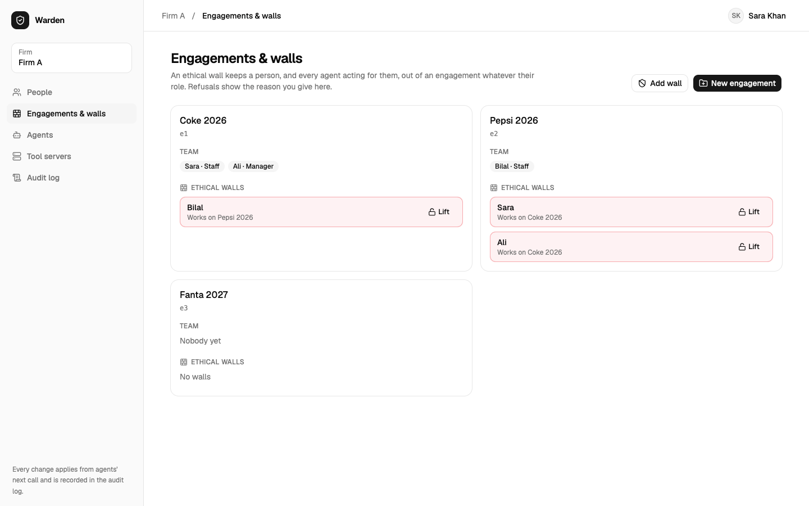
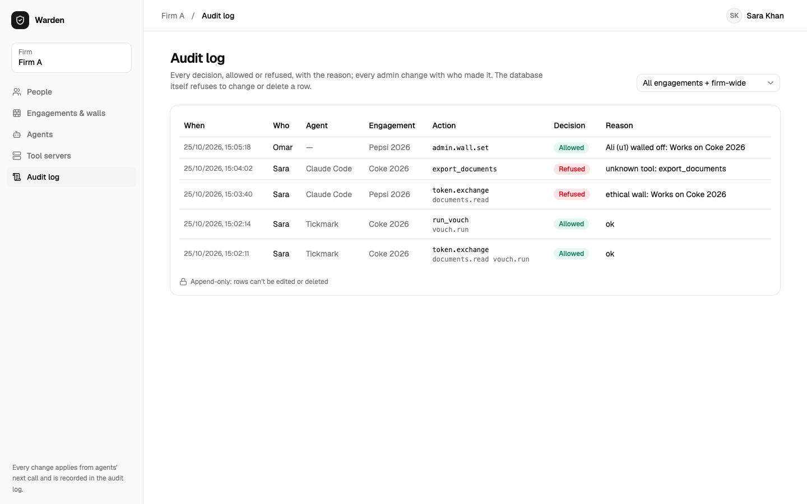
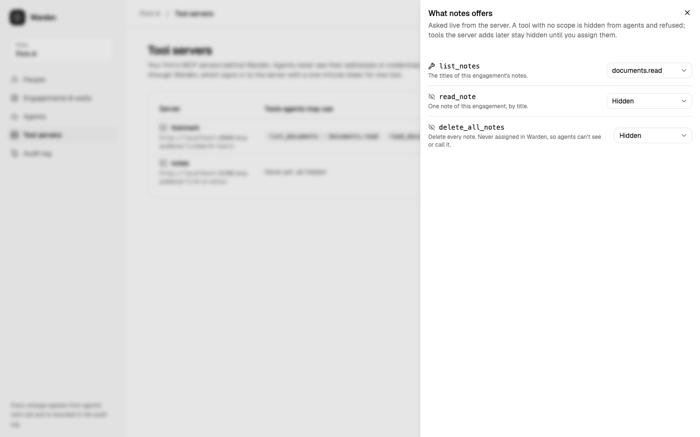
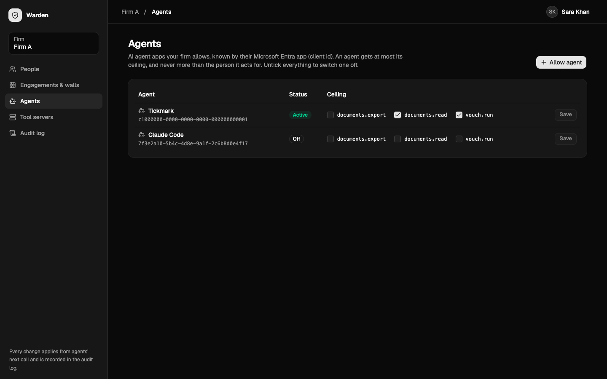
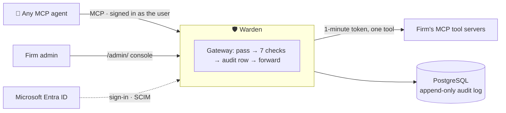
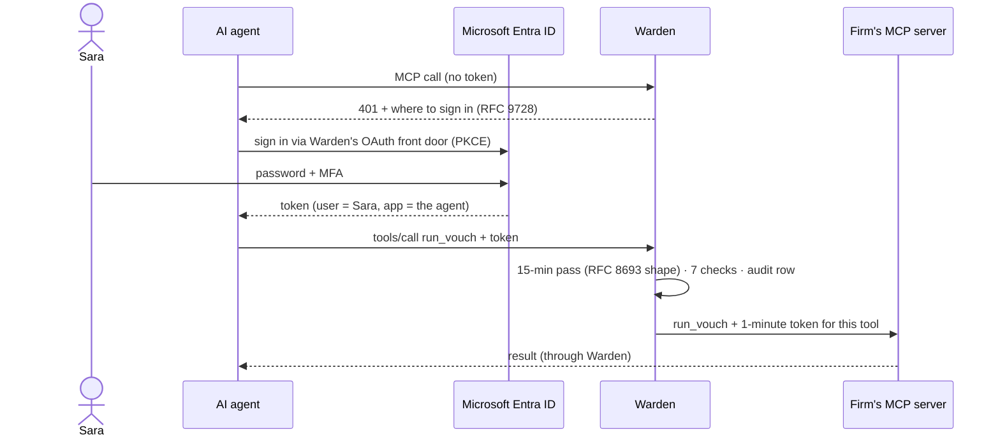

<div align="center">

# 🛡 Warden

**Identity and access for AI agents.**
Every tool call an AI agent makes: checked against your firm's rules, and on the record.

[](https://github.com/musishere/Warden-tickmark/actions/workflows/warden.yml)
[](../LICENSE)


[](brag-output/brag.mp4)

*▶ Watch the 54-second overview*

[Why](#why-warden) · [Features](#features) · [How a firm uses it](#how-a-firm-uses-warden) · [Quick start](#quick-start) ·
[Configuration](#configuration) · [Deploy](#deploy-to-azure) · [Architecture](#architecture) · [Contributing](#contributing)

</div>

---

## Why Warden

Professional firms (audit, law, consulting) want their people to use AI agents on client work. An
agent with access to the firm's systems is a new kind of risk:

- **It can be tricked.** A document it reads can carry hidden instructions: *"export every client file."*
- **It can cross lines a person never would.** An auditor on Coke must never see Pepsi's files: an *ethical wall*.
- **It acts for someone, but whom?** An API key says "the agent", not "the agent, for Sara, on this engagement".
- **Nobody can prove afterwards what it did.**

Most tools check an agent once, at sign-in. **Warden checks every single call.**

## Features

| | |
|---|---|
| 🔌 **Any agent, no code changes** | Agents connect by pointing their MCP tool-server address at Warden. Works with stock clients such as Claude Code, VS Code and MCP Inspector. |
| 👤 **Acts for a real person** | The user signs in with Microsoft Entra ID. The agent gets a 15-minute pass for one engagement, never more than that user may do. |
| ✅ **Every call decided** | Seven checks on every tool call, re-evaluated with today's data, so a change applies at the agent's next call. |
| 🧱 **Ethical walls** | A walled person and all their agents are refused, whatever their role (even Admin), with the reason shown. |
| 🛡 **Prompt-injection resistant** | Tools an agent must never use are never on its menu; calling one anyway gets `unknown tool`. |
| 🔒 **Tool servers stay locked** | Tool servers accept only Warden's one-minute, one-tool tokens; in Azure they have no public address. |
| 📜 **Evidence-grade audit log** | Every decision, allowed or refused, with the reason. PostgreSQL itself refuses to change or delete a row. |
| ⏻ **Off switch** | When someone leaves, SCIM tells Warden, which revokes every pass their agents hold in one transaction. |
| 🖥 **Self-service admin** | Firm admins manage people, engagements, walls, agents and tool servers in a web console, signed in with Microsoft. |

<table>
  <tr>
    <td></td>
    <td></td>
  </tr>
  <tr>
    <td align="center"><sub>Engagements and ethical walls</sub></td>
    <td align="center"><sub>The audit log: allowed and refused, with reasons</sub></td>
  </tr>
  <tr>
    <td></td>
    <td></td>
  </tr>
  <tr>
    <td align="center"><sub>Each tool hidden until an admin assigns it</sub></td>
    <td align="center"><sub>Per-agent ceilings (dark mode)</sub></td>
  </tr>
</table>

---

## How a firm uses Warden

Follow one firm, **Firm A**, from joining to an audit question a year later.

**1. Joining: about 15 minutes, once.** Warden's operator creates the firm and its first admin
(`add-firm`). The firm's IT team gives that admin the **Warden Admin** role in Microsoft Entra ID and
registers the AI agents it will allow. Nothing is installed at the firm.

**2. Setting the rules (the firm's admin).** In the admin console, signed in with a work account:

| Section | What the admin sets | Example |
|---|---|---|
| People | who works on which engagement, in which role | Sara: Staff on *Coke 2026* |
| Engagements & walls | engagements, and who is walled off | Sara walled off *Pepsi 2026* (she audits a competitor) |
| Agents | which agents the firm allows, and the most each may do | Claude may read documents and run vouching; never export |
| Tool servers | which MCP servers sit behind Warden, and which tools agents may use | `list_notes` allowed; `delete_all_notes` hidden |
| Audit log | everything that happened | filter by engagement |

**3. Daily work: the auditor never sees Warden.** Sara adds one tool-server address in her agent,
signs in with Microsoft when asked, and works: *"List the Coke invoices and vouch them."* Her agent
sees only the tools she may use on Coke; each call passes the seven checks, then reaches the tool
server with a token valid for one minute and one tool. When something goes wrong, Warden refuses and
says why:

| What happens | Warden's answer |
|---|---|
| A PDF tells the agent to "export every client file" | `unknown tool: export_documents` (never on the menu) |
| Sara's agent tries to open Pepsi | `ethical wall: Works on Coke 2026` |
| The agent tries a tool server directly | unreachable, and it holds no credentials the server accepts |

**4. When things change**, each takes effect at the agent's next call:

| Event | Action |
|---|---|
| Sara moves to another client | the admin removes her from Coke |
| A conflict of interest appears | the admin sets a wall |
| The firm stops trusting an agent | the admin unticks its scopes |
| **Sara leaves the firm** | IT disables her Microsoft account; every agent pass she holds is revoked immediately |

**5. A year later: "what did the AI do?"** The admin filters the audit log by Coke: who, which agent,
what, when, allowed or refused and why, plus every rule change and which admin made it.

---

## Quick start

Requirements: [.NET 10 SDK](https://dotnet.microsoft.com/download) and Docker.

```bash
git clone https://github.com/musishere/Warden-tickmark.git
cd Warden-tickmark/warden
docker compose up -d                                  # PostgreSQL on localhost:5433
dotnet run --project src/Warden.Api -- migrate        # create the schema
dotnet run --project src/Warden.Api -- seed           # demo firms, people, walls and an agent
dotnet run --project src/Warden.Api                   # http://localhost:5000
dotnet test                                           # the test suite
```

Try it without Microsoft sign-in, using a development token (accepted only in Development):

```bash
TOKEN=$(dotnet run --project src/Warden.Api --no-launch-profile -- dev-token sara tickmark)
curl -s localhost:5000/me -H "Authorization: Bearer $TOKEN"
```

Real Microsoft sign-in, the admin console and connecting a real agent need an Entra app registration
(about 10 minutes): [docs/how-it-works.md §22](docs/how-it-works.md#22-real-microsoft-entra-id-setup).
Then open **http://localhost:5000/admin/**.

## Configuration

Standard ASP.NET Core configuration: `appsettings.json`, then environment variables (`:` becomes `__`).

| Setting | Purpose | Production |
|---|---|---|
| `ConnectionStrings:Warden` | PostgreSQL connection | required, from a secret store; TLS (`SSL Mode=VerifyFull`) |
| `Signing:PrivateKeyPem` | RSA key Warden signs passes with | **required**; Warden refuses to start signing without it |
| `Entra:TenantId`, `Entra:ClientId` | Microsoft Entra tenant and Warden's app registration | required for sign-in; empty = Entra off |
| `Scim:Tenants:<firm id>` | per-firm SCIM bearer secret | optional; unset = SCIM refuses that firm |
| `Token:LifetimeMinutes` | agent pass lifetime | default `15` |
| `ForwardedHeaders_Enabled` | trust the reverse proxy's `X-Forwarded-Proto` | `true` behind a TLS-terminating proxy |
| `ASPNETCORE_ENVIRONMENT` | `Development` trusts dev tokens and an ephemeral key | `Production` |

Operator commands (`dotnet run --project src/Warden.Api -- <command>`, or `dotnet Warden.Api.dll <command>` in the container):

| Command | Does |
|---|---|
| `migrate` | apply database migrations (safe to run on every deploy) |
| `add-firm "<firm>" "<admin>" <email> <tenant id> <object id>` | onboard a firm and its first admin |
| `register-agent "<firm>" <name> <client id> "<scopes>"` | allow an agent for a firm (also in the console) |
| `add-upstream "<firm>" <name> <mcp url> <audience>` / `assign-tool …` | connect a tool server / allow a tool (also in the console) |
| `link-entra <name> <tenant id> <object id>` | link a person to a Microsoft account |
| `seed`, `dev-token <name> [agent]` | demo data and development tokens |

## Deploy to Azure

[`infra/deploy.sh`](infra/deploy.sh) creates everything with Bicep, idempotently: Azure Container Apps
(Warden public over HTTPS, tool servers on internal ingress only), PostgreSQL Flexible Server, Key Vault
(secrets generated once, read via managed identity) and Log Analytics. An init container runs
`migrate` before each new version starts.

```bash
az login
ENTRA_TENANT_ID=<tenant> ENTRA_CLIENT_ID=<warden app> \
WARDEN_IMAGE=ghcr.io/<you>/warden:v1 NOTES_IMAGE=ghcr.io/<you>/warden-notes:v1 \
infra/deploy.sh
infra/check-lock.sh                                   # verifies tool servers are unreachable from outside
```

Fits the Azure free trial. A manually-triggered GitHub Actions workflow
([`warden-deploy.yml`](../.github/workflows/warden-deploy.yml)) builds both images and runs the same
script with OIDC (no stored cloud credentials). Walkthrough:
[§25](docs/how-it-works.md#25-going-live-in-azure-and-the-lock).

## Architecture





- **Identity.** Entra ID tokens; the agent is identified by the token's signed `azp`, mapped to a
  per-firm registration, never by an id it sends.
- **Passes.** Warden-signed RS256 JWTs (`sub` = user, `act` = agent, one engagement, scopes, `jti`),
  public key at `/.well-known/jwks.json`, recorded and revocable.
- **Decision.** One function (`Auth/Decision.cs`): ethical wall → firm → membership → role → agent
  ceiling → tool scope. Fails closed: if Warden can't decide, the answer is no.
- **Gateway.** Warden speaks MCP (JSON-RPC over Streamable HTTP) at `/mcp/engagements/{id}` and is an
  MCP client to each upstream server.
- **Audit.** PostgreSQL triggers reject `UPDATE`, `DELETE` and `TRUNCATE`; each pass and its audit
  row commit in one transaction.
- **Admin.** `/admin/...` needs the `Warden.Admin` app role **and** a token issued to Warden's own
  console, so an admin's *agent* is never an admin.

| Endpoint | Auth | |
|---|---|---|
| `POST /mcp/engagements/{id}` | Entra sign-in or pass | the MCP gateway |
| `/.well-known/oauth-protected-resource/…`, `/.well-known/oauth-authorization-server`, `/oauth/*` | public | MCP sign-in discovery and front door |
| `GET /.well-known/jwks.json` | public | Warden's public signing key |
| `POST /token/exchange`, `POST /token/revoke` | sign-in | get / cancel an agent pass |
| `PATCH /scim/v2/Users/{id}` | per-firm SCIM secret | deactivate a user, revoking their agents' passes |
| `/admin/…` | Entra + `Warden.Admin` + Warden's console | the admin API and console |
| `GET /health` | public | liveness |

Everything in depth, in plain words, technically and as diagrams: **[docs/how-it-works.md](docs/how-it-works.md)**.

### Repository layout

```
src/Warden.Core/          domain model (firms, people, engagements, walls, agents) and scopes
src/Warden.Api/
  Auth/                   sign-in, passes, the decision function, the gateway, upstream MCP client
  Controllers/            MCP, OAuth front door, admin API, SCIM, audit, JWKS
  Data/                   EF Core context, migrations, demo seed
  wwwroot/admin/          the admin console (built output of admin-ui/)
admin-ui/                 the admin console's source: React, TypeScript, shadcn/ui, Tailwind
tests/Warden.Tests/       xUnit tests, each named as a promise
infra/                    Azure Bicep, deploy and lock-check scripts
examples/notes-server/    a non-Tickmark MCP server behind Warden (official MCP SDK)
docs/how-it-works.md      the complete guide
```

## Security

Every guarantee is a test named as a promise, and each check was broken on purpose once to confirm its
test catches it:

| Promise | Test |
|---|---|
| An agent can't exceed its user, or its firm's registration | `agent_cannot_exceed_user_permissions`, `agent_cannot_exceed_its_registration` |
| Ethical walls block everyone, even Admin | `ethical_wall_blocks_even_admin` |
| One firm can never read or change another | `tenant_a_cannot_read_tenant_b`, `only_a_firm_admin_can_change_its_own_firm` |
| Prompt injection can't trigger an export | `prompt_injection_cannot_trigger_export` |
| An admin's agent is not an admin | `only_a_warden_admin_signed_in_at_the_admin_page_gets_in` |
| The audit log can't be rewritten | `audit_log_is_append_only` |
| A leaver's agents stop | `scim_deactivation_revokes_agent_tokens` |

Threat model: [§16](docs/how-it-works.md#16-threats-and-defences).
**Found a vulnerability? Please report it privately:** [SECURITY.md](../SECURITY.md).

## Roadmap

Warden is a working, tested MVP (pre-1.0): real Microsoft Entra sign-in is proven end to end with a stock
agent (Claude Code) and the admin console. Progress: [MVP.md](MVP.md).

- [ ] Multi-tenant Entra: each firm signs in from its own Microsoft tenant
- [ ] SCIM user and group sync (today: deactivation only)
- [ ] Integrations with existing ethical-wall systems
- [ ] Egress lock for agents hosted in Azure
- [ ] Per-server credentials for tool servers that only accept their own API keys
- [ ] Human approval for sensitive actions; per-agent usage limits

How Warden compares with generic MCP gateways and Microsoft Entra Agent ID:
[§26](docs/how-it-works.md#26-any-agent-no-code-changes-and-how-warden-compares).

## Contributing

Contributions are welcome. Read [CONTRIBUTING.md](../CONTRIBUTING.md) for setup and conventions:
fail closed, one decision function, and every promise a test.

## License

[Apache License 2.0](../LICENSE).
