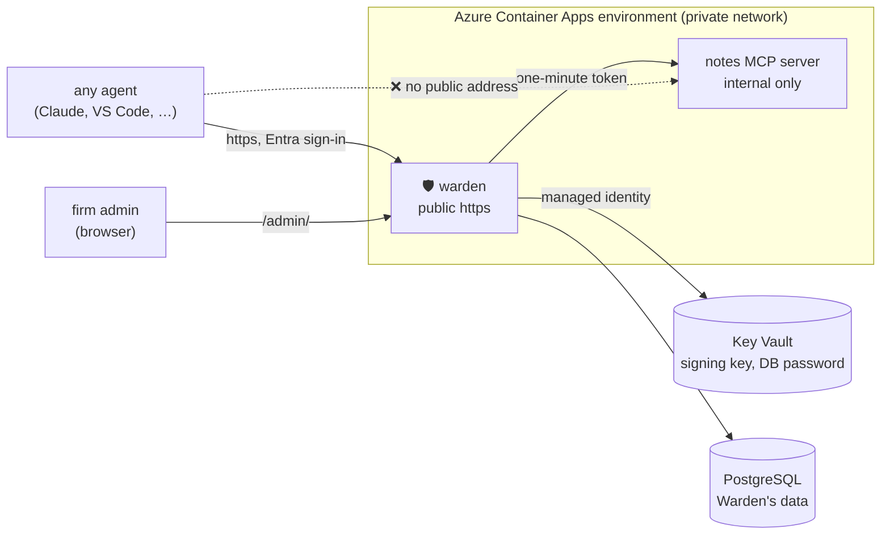
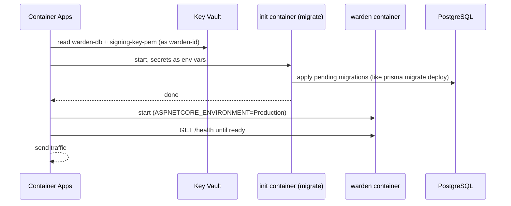

# Deploying Warden to Azure

How Warden goes from this repo to a public `https://` address, step by step. The short version
lives in [how-it-works §25](how-it-works.md#25-going-live-in-azure-and-the-lock); this page is the
whole story, including the first-time setup.

---

## 1. What ends up in Azure

🗣️ **In plain words**

Warden runs as a container with its own https address. Next to it, in the same private network,
runs the firm's tool server (the demo notes server), which has **no public address at all**: the
only way to it is through Warden. Warden keeps its data in a managed Postgres database and its
secrets in a vault that only Warden's own identity can open.

🖼️ **Picture**



🔧 **Technically** (all in `infra/main.bicep`)

| Resource | What it's for | Cost on a free account |
|---|---|---|
| Log Analytics | the containers' logs | 5 GB/month free |
| Managed identity `warden-id` | how Warden's container proves itself to Key Vault, no password | free |
| Key Vault | `signing-key-pem`, `postgres-password`, `warden-db` (connection string) | pennies |
| PostgreSQL Flexible Server, B1ms | Warden's database, TLS `VerifyFull` | free for 12 months |
| Container Apps environment | where the containers run, one shared internal network | free monthly grant |
| Container app `warden` | public https, port 8080, 0–1 copies | free monthly grant |
| Container app `notes` | demo tool server, **internal ingress only** (the lock, step 20) | free monthly grant |
| Images | GitHub Container Registry (`ghcr.io`), public | free |

Scale 0–1 means Warden sleeps when nobody uses it (stays inside the free grant). The first request
after a nap takes a few seconds while it wakes up.

---

## 2. The tools: Bicep, not clicking

🗣️ **In plain words**

Nothing is created by hand in the portal. `main.bicep` is a description of everything above, like a
Prisma schema but for cloud resources. Hand it to Azure and Azure makes reality match it: the first
time it creates everything, later times it changes only what's different. So deploying again is
always safe.

🔧 **Technically**

- **Bicep** is Azure's own infrastructure-as-code language (Terraform's role, Azure-only, no state
  file to store: Azure itself remembers what exists).
- `az deployment group create -f main.bicep` applies it to a resource group (`warden`).
- `infra/deploy.sh` wraps that call and handles the secrets (section 5).

---

## 3. One-time setup (done once per Azure account)

### 3a. Azure account + the `az` command

A free account from azure.microsoft.com/free. The Azure command line (`az`) doesn't have to be
installed: Microsoft publishes it as a Docker image, so every `az` command can run in a container.

```bash
# sign in once; the login is saved in ~/.azure on your Mac and reused by every later container
docker run --rm -it -v ~/.azure:/root/.azure mcr.microsoft.com/azure-cli az login --use-device-code
```

`--use-device-code`: the container has no browser, so it prints a code; you type it at
microsoft.com/devicelogin. (Docker can only see folders under your home folder, so keep anything
you mount there.)

Or install it: `brew install azure-cli` (`HOMEBREW_NO_AUTO_UPDATE=1` makes it much faster).

### 3b. Register Warden in Entra: `infra/entra.sh`

🗣️ Warden doesn't do passwords; Microsoft (Entra ID) signs people in and Warden checks the result.
For that, Microsoft has to know Warden exists. That's an "app registration".

```bash
cd warden
docker run --rm -v ~/.azure:/root/.azure -v "$PWD":/work -w /work mcr.microsoft.com/azure-cli bash infra/entra.sh
```

It does what [how-it-works §22](how-it-works.md#22-real-microsoft-entra-id-setup) items 1, 2, 7, 8
describe, without the portal clicks (safe to run again):

| Setting | Why |
|---|---|
| App `Warden`, single tenant | Warden's identity in Entra; its client id is `ENTRA_CLIENT_ID` |
| `api://<client id>` + scope `access_as_user` | tokens meant for Warden ask for this; Warden checks the audience |
| Azure CLI pre-authorized | `az account get-access-token --scope api://…/access_as_user` works without a consent screen |
| App role `Warden.Admin`, assigned to you | `/admin` lets in only people with this role |
| SPA redirect `http://localhost:5000/admin/` | the admin page can sign in locally; the live address is added after the deploy |

It prints `ENTRA_TENANT_ID`, `ENTRA_CLIENT_ID` and your object id. None of them are secrets.

### 3c. Let Docker push to GitHub's image registry

GitHub → Settings → Developer settings → Personal access tokens (classic) → only `write:packages`.

```bash
docker login ghcr.io -u <github user>     # paste the token as the password
```

---

## 4. Build and push the images

🗣️ An image is Warden packed into a box that runs anywhere (`npm run build`, but the output also
carries .NET and everything else it needs). Azure doesn't build anything; it downloads the box.

```bash
cd warden
TAG=v1-$(git rev-parse --short HEAD)            # tag = the commit, so you always know what's running
docker build -t ghcr.io/<you>/warden:$TAG .
docker build -t ghcr.io/<you>/warden-notes:$TAG examples/notes-server
docker push ghcr.io/<you>/warden:$TAG
docker push ghcr.io/<you>/warden-notes:$TAG
```

First time only: GitHub → your profile → Packages → each package → Package settings → Change
visibility → **Public**. Azure has no GitHub login, so it can only pull public images. They hold no
secrets (those live in Key Vault).

On an Apple-silicon Mac add `--platform linux/amd64` to both builds; Azure runs Intel/AMD machines.

---

## 5. Deploy: `infra/deploy.sh`

```bash
cd warden
docker run --rm -v ~/.azure:/root/.azure -v "$PWD":/work -w /work \
  -e ENTRA_TENANT_ID=<tenant> -e ENTRA_CLIENT_ID=<Warden's client id> \
  -e WARDEN_IMAGE=ghcr.io/<you>/warden:$TAG -e NOTES_IMAGE=ghcr.io/<you>/warden-notes:$TAG \
  mcr.microsoft.com/azure-cli bash infra/deploy.sh
```

Optional: `RESOURCE_GROUP` (default `warden`), `LOCATION` (default `northeurope`; pick another if the
free account says the region is restricted, section 8).

🔧 **What the script does, in order**

1. **Resource group**: `az group create -n warden`. A folder that holds every resource; delete it and
   everything is gone.
2. **Secrets, made once**: if an earlier deploy left a Key Vault, read `postgres-password` and
   `signing-key-pem` back from it. Otherwise make new ones (a random 32-character password, a 2048-bit
   RSA key). They never change by accident: a new signing key would cancel every pass in flight.
3. **Apply `main.bicep`** with the images, Entra ids and secrets. Azure creates, in dependency
   order: logs → identity → Key Vault (+ secrets, + "Warden's identity may read") → Postgres (+ database
   `warden`, + firewall "Azure services only") → Container Apps environment → `warden` and `notes`.
   First run ≈ 10 minutes, mostly Postgres.
4. **One retry**: the first time, Azure can take a minute before Warden's new identity may read Key
   Vault; the script waits 60 s and tries once more.
5. **Prints** Warden's public address, the admin page and the notes server's internal address.

🔧 **What happens when the `warden` container starts**



Warden's settings in Azure: `Production` (dev tokens refused, real signing key required),
`ForwardedHeaders_Enabled=true` (Azure's proxy sits in front, so Warden's addresses say `https`, step 23),
`Entra__TenantId` / `Entra__ClientId`, and the two secrets as Key Vault references.

---

## 6. After the first deploy

```bash
AZ="docker run --rm -it -v $HOME/.azure:/root/.azure mcr.microsoft.com/azure-cli"

# 1. the admin page can sign in at its live address
$AZ az ad app update --id <client id> --set spa.redirectUris="['http://localhost:5000/admin/','https://<warden address>/admin/']"

# 2. wake Warden, then create your firm and yourself as its first admin
curl https://<warden address>/health
$AZ az containerapp exec -g warden -n warden --command \
  'dotnet Warden.Api.dll add-firm "Firm A" "<your name>" <your email> <tenant id> <your object id>'
```

3. Open `https://<warden address>/admin/`, sign in, then:
   - **Tool servers → Connect**: `notes`, `https://notes.internal.<env domain>/mcp`, audience `firm-a-notes`
   - **Tools…**: `list_notes`, `read_note` → `documents.read`; `delete_all_notes` stays hidden
   - **Engagements** → open one → **People**: add yourself → **Agents**: allow your agent's client id
4. `infra/check-lock.sh`: proves the notes server can't be reached from outside (step 20).

---

## 7. Later deploys

Same as section 4 + 5 with a new tag. Or let GitHub do both: Actions → **warden-deploy** → Run
(`.github/workflows/warden-deploy.yml`; it needs a one-time Entra app for GitHub with a federated
credential and four repo variables, listed at the top of the workflow). Each new image version runs
`migrate` before it starts, so database changes ship with the code.

---

## 8. When something goes wrong

| Symptom | Cause / fix |
|---|---|
| `bash: /s/…: No such file or directory` in the az container | Docker only sees folders under your home folder; mount from there |
| `Please run 'az login'` | the CLI isn't signed in (signing in to the portal doesn't count): section 3a |
| deploy fails: `The selected region is currently not accepting new customers` | full regions refuse new free accounts (West Europe did, Oct 2026). Nothing was created: delete the empty group (`az group delete -n warden`, a group stays in its first region) and run again with another `LOCATION`. To test a region without creating anything: `az deployment group validate -g warden -f infra/main.bicep -p location=<region> …` |
| Warden won't start, image pull error | the ghcr.io package is still private (section 4) |
| first request is slow | Warden was asleep (0 copies); it wakes in a few seconds |
| logs | `az containerapp logs show -g warden -n warden --follow` |
| admin page `AADSTS50011` | the live `/admin/` address isn't an SPA redirect URI (section 6, step 1) |

**Take it all down**: `az group delete -n warden` deletes every resource above. (The Entra app
registration lives outside the resource group: `az ad app delete --id <client id>`.)
