# How Warden works

A walkthrough of everything built in steps 1–14 of [MVP.md](../MVP.md), with diagrams.
Diagrams are [Mermaid](https://mermaid.js.org): GitHub and VS Code (with a Mermaid extension)
draw them as pictures.

**Warden in one sentence:** an AI agent never gets a user's full powers. It trades the user's
sign-in token for a narrow, 15-minute **pass**, and every tool call is checked against that pass.

---

## 1. The big picture

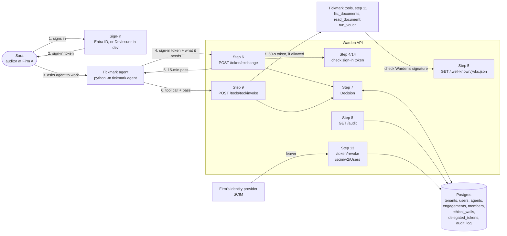

Everything in this picture is built. Only the real Entra app registration is a manual step
([entra.md](entra.md)).

---

## 2. The projects and files

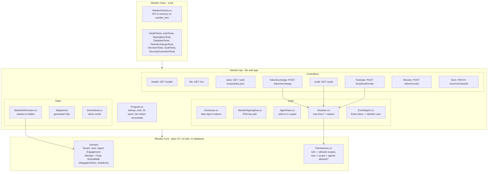

| Python world | .NET world here |
|---|---|
| `pyproject.toml` | `*.csproj` |
| FastAPI app in `main.py` | `Program.cs` |
| `APIRouter` | a `Controller` class |
| SQLAlchemy models | `Domain/*.cs` classes |
| SQLAlchemy session / Base | `WardenDbContext` |
| Alembic | `dotnet ef migrations add` / `database update` |
| `Depends(...)` | dependency injection (`builder.Services.Add...`) |
| pytest | xUnit (`[Fact]`) |
| `.env` | `appsettings.Development.json` / environment variables / User Secrets |

---

## 3. The data (Phase 1, steps 2–3)

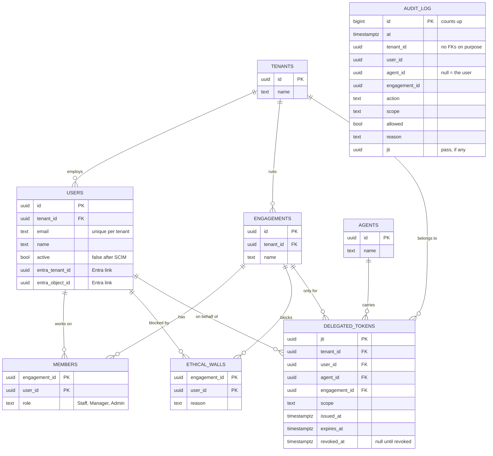

**What each table means**

| Table | Plain meaning |
|---|---|
| `tenants` | An audit firm. Nothing crosses between firms. |
| `users` | A person at a firm. |
| `agents` | A registered AI agent (Tickmark). Not tied to one firm. |
| `engagements` | One client audit, e.g. "Coke 2026". The unit of access. |
| `members` | "This user works on this engagement, with this role." No row = no access. |
| `ethical_walls` | "This user must NEVER touch this engagement." Beats membership and every role. |
| `delegated_tokens` | The **pass logbook**: one row per pass issued, so passes can be cancelled and audited. |
| `audit_log` | One row per decision, allowed or denied. **Append-only** (step 8). |

**Rules the database enforces**
- Every foreign key is `ON DELETE RESTRICT`: deleting a firm that still has users fails, nothing disappears silently.
- `members` and `ethical_walls` are keyed on `(engagement_id, user_id)`: one row per pair.
- `users` has a unique `(tenant_id, email)`.
- Names are snake_case (`tenant_id`), via `EFCore.NamingConventions`.

**How a class becomes a table**

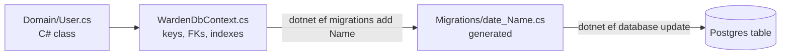

Migrations so far: `Initial` → `EthicalWalls` → `DelegatedTokens` → `AuditLog` → `UserActive` → `EntraLink`. To change the schema,
edit a class or `WardenDbContext`, then **add a new migration**; never edit an old one.

**The demo world** (`dotnet run --project src/Warden.Api -- seed`, fixed ids in `DemoSeed.cs`)

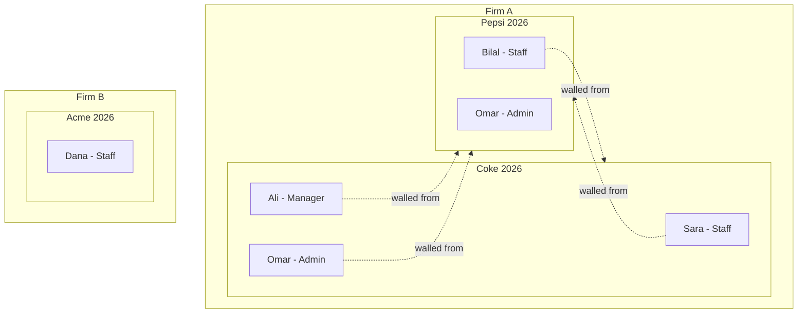

Omar is an **Admin member of Pepsi and walled from it**: the case that proves walls beat roles.
Dana is in another firm: the case that proves firms can't see each other.

---

## 4. Who are you? Sign-in tokens (step 4)

A token (JWT) is `header.payload.signature`. The payload is readable by anyone; the
**signature** proves who stamped it and that nothing was changed.

```
{ "oid": "<Sara's id>", "tid": "<Firm A's id>", "name": "Sara",
  "iss": "warden-dev", "aud": "warden", "exp": <in 1 hour> }
```

**Who stamps it:** now `DevIssuer` (`dotnet run -- dev-token sara`, HMAC with a dev key,
trusted **only in Development**). Later Microsoft Entra ID via OIDC; same claim names, so only
the trusted key changes.

**What happens on every request**

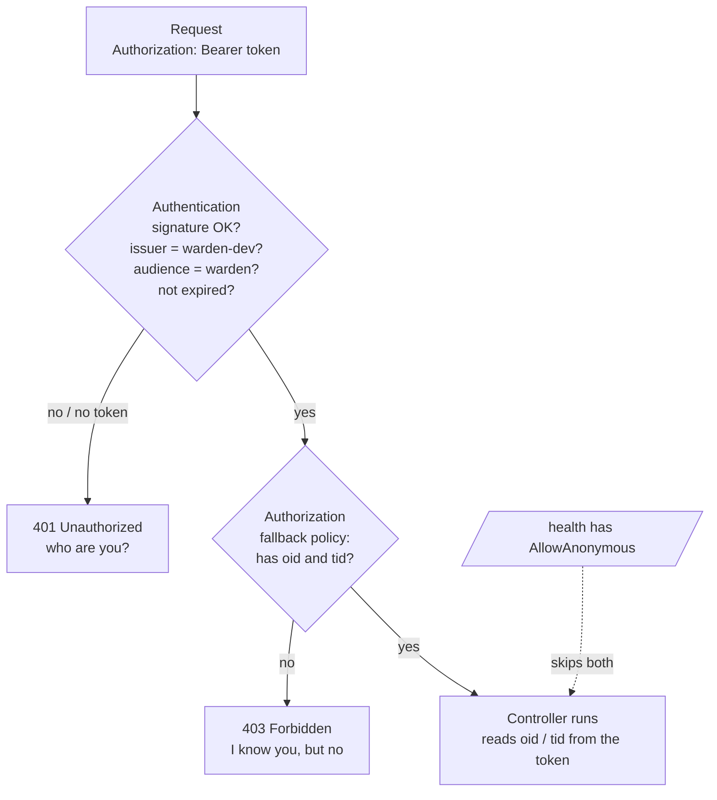

- **Locked by default:** every endpoint needs a valid token unless marked `[AllowAnonymous]`
  (only `/health` and the JWKS). A forgotten endpoint is still protected.
- **The firm comes only from the verified token**, never from the URL or body.
- **Production** has no dev key → every dev token gets 401 (fail closed).

---

## 5. Warden's own stamp (step 5)

Passes for agents are signed with an **RSA key pair**, not a shared secret:

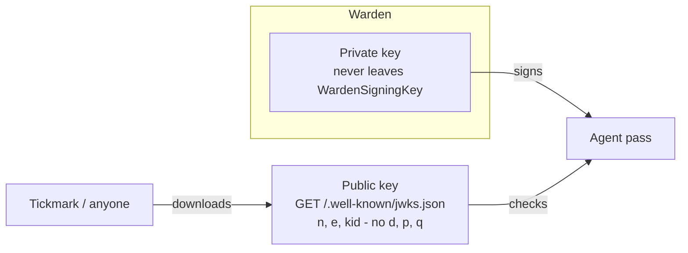

| | Can check a pass | Can create a pass |
|---|---|---|
| Holder of the public key (anyone) | yes | **no** |
| Warden (private key) | yes | yes |

So even if Tickmark were hacked, the attacker couldn't forge passes.

Where the private key comes from: config `Signing:PrivateKeyPem` (production, later from Key
Vault) → else in Development a fresh key at startup → else refuse to sign (fail closed).

---

## 6. Getting a pass: token exchange (step 6)

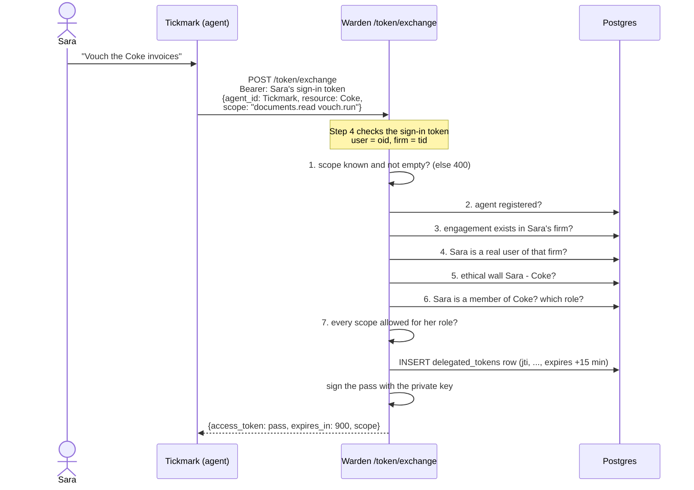

The first "no" stops everything with **403** and a reason:

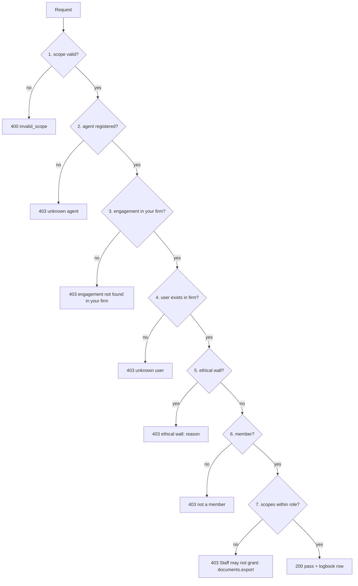

**Role → scopes** (`Warden.Core/Permissions.cs`)

| Role | documents.read | vouch.run | documents.export |
|---|---|---|---|
| Staff | ✅ | ✅ | ❌ |
| Manager | ✅ | ✅ | ✅ |
| Admin | ✅ | ✅ | ✅ |

**What's inside the pass** (`Auth/AgentPass.cs`)

| Claim | Example | Meaning |
|---|---|---|
| `iss` | `warden` | who stamped it |
| `aud` | `warden-tools` | where it may be used (the gate, step 9) |
| `sub` | Sara's id | on whose behalf |
| `act` | `{ "sub": Tickmark's id }` | who is actually acting (RFC 8693) |
| `tid` | Firm A's id | which firm |
| `eng` | Coke's id | the **only** engagement |
| `scope` | `documents.read vouch.run` | the **only** actions |
| `jti` | pass number | same as the logbook row |
| `exp` | +15 minutes | stops working by itself |

Checks 2–7 are the shared decision function (next section); the controller only adds check 1
and the stamping.

**Real results** (dev server, as Sara):

| Sara asks for | Answer |
|---|---|
| Coke, read + vouch | 200, pass, logbook row with lifetime `00:15:00` |
| Coke, export | 403 `Staff may not grant: documents.export` |
| Pepsi | 403 `ethical wall: Works on Coke 2026` |
| Acme (Firm B) | 403 `engagement not found in your firm` |

---

## 7. Checking a pass (step 6c) and why the logbook exists

A signed pass can't be taken back once handed out. The logbook fixes that, so checking a pass
(`AgentPass.Check`, what the gate will run on every tool call) has **two layers**:

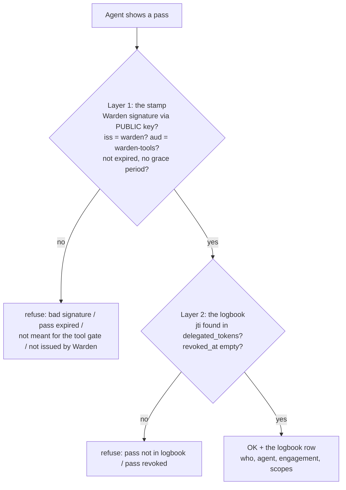

| Pass shown | Result |
|---|---|
| fresh pass from `/token/exchange` | OK, returns the row |
| one character changed | `bad signature` |
| signed by another key | `bad signature` |
| Sara's sign-in token | refused (not Warden's stamp) |
| Warden-signed but not in the logbook | `pass not in logbook` |
| in the logbook, `revoked_at` set | `pass revoked` |
| expired a minute ago | `pass expired` |

The logbook's whole life:

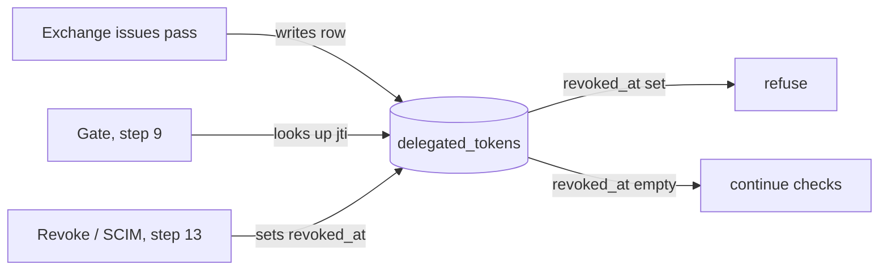

---

## 8. The decision function (step 7)

All "may they?" rules live in **one** place, `Auth/Decision.cs`, so the exchange and the tool
gate can never disagree. Every answer is a `Verdict(Allowed, Reason)`; the reason goes into the
audit log in step 8. The first "no" ends it.

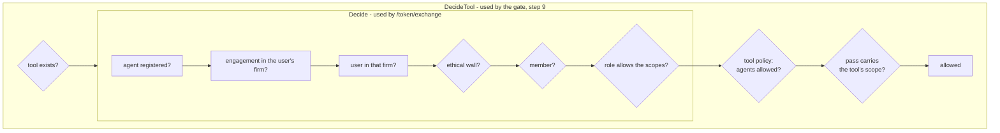

**Tool policy** (`Warden.Core/Permissions.cs`)

| Tool | Needs scope | Agents may call? |
|---|---|---|
| `list_documents` | documents.read | ✅ |
| `read_document` | documents.read | ✅ |
| `run_vouch` | vouch.run | ✅ |
| `export_documents` | documents.export | ❌ humans only |

Why `DecideTool` re-runs walls, membership and role instead of trusting the pass: a pass
lives 15 minutes. If a wall goes up or a role changes in that time, the **current** data wins.

| Ask | Verdict |
|---|---|
| Omar (Admin on Pepsi, walled) reads Pepsi | ❌ `ethical wall: Works on Coke 2026` |
| Sara (Firm A) reads Acme (Firm B), Dana (Firm B) reads Coke | ❌ `engagement not found in your firm` |
| Sara's pass (documents.read) → `read_document` on Coke | ✅ `allowed` |
| same pass → `run_vouch` | ❌ `pass does not include vouch.run` |
| Omar's agent → `export_documents` | ❌ `export_documents may not be called by an agent` |
| a pass naming Pepsi, held for Sara | ❌ `ethical wall: ...` |
| `delete_everything` | ❌ `unknown tool: delete_everything` |

---

## 9. The audit log (step 8)

Every decision is written to `audit_log`, **allowed and denied**. A token exchange writes its
audit row in the **same transaction** as the pass: if the audit write fails, no pass is issued.

**Append-only, enforced by Postgres** (hand-written SQL in the `AuditLog` migration):

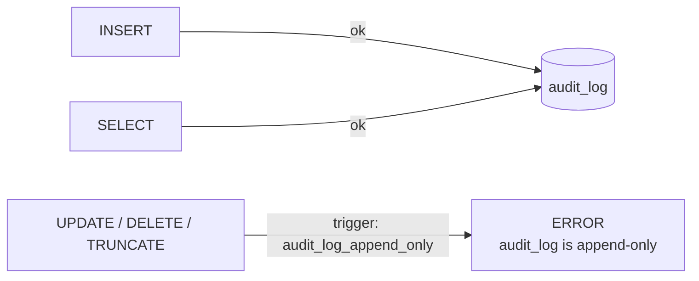

It holds even for code that skips Warden: try `delete from audit_log` in psql.
No foreign keys: a denied attempt may name an agent or engagement that doesn't exist.

**`GET /audit?engagement=<id>`**: the engagement's trail, oldest first.

| Who asks | Answer |
|---|---|
| Ali (Manager, Coke) for Coke | 200, Firm A's rows only (Dana's denied attempt on Coke belongs to Firm B's trail) |
| Sara for Pepsi (walled) | 403 `ethical wall: ...` (the trail would show who works on Pepsi) |
| Dana (Firm B) for Coke | 403 `engagement not found in your firm` |

Access uses `Decision.Decide` with **no agent** (`agentId: null`): the person asking for themselves.

**A real row** (Sara asks for Pepsi):

| action | scope | allowed | reason | jti |
|---|---|---|---|---|
| `token.exchange` | `documents.read` | false | `ethical wall: Works on Coke 2026` | null |

---

## 10. Configuration and secrets

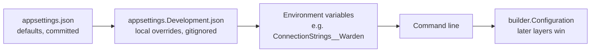

| Value | Now | Production (later) |
|---|---|---|
| DB connection | `appsettings.json` (local Docker password, not a secret) | env var / Key Vault, or managed identity |
| Dev sign-in key | `appsettings.json`, only trusted in Development | not used (Entra) |
| Entra `TenantId`, `ClientId` | empty = Entra off; set in `appsettings.Development.json` ([entra.md](entra.md)) | env vars |
| Tool server `Tools:BaseUrl`, `Tools:Audience` | `http://localhost:8000/`, `tickmark-tools` | the tool service's address |
| SCIM secret per firm `Scim:Tenants:<id>` | not set = SCIM refuses everything | Key Vault |
| Warden signing key | generated at startup in Development | `Signing:PrivateKeyPem` from Key Vault |

---

## 11. The tool gate (steps 9–10)

`POST /tools/{tool}/invoke` (`Controllers/ToolGateController.cs`) is the only way an agent reaches
a tool. It takes the agent's **pass**, not a sign-in token.

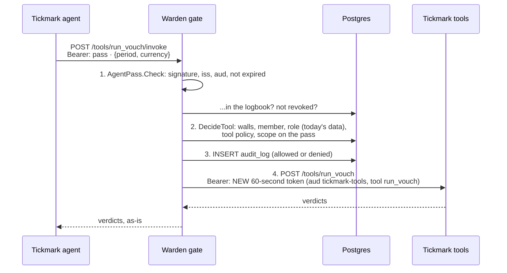

| What goes wrong | Answer | Forwarded? | In the audit log? |
|---|---|---|---|
| no pass / garbage / a sign-in token | 401 | no | no (no trusted firm), app log only |
| pass revoked | 401 `pass revoked` | no | yes |
| scope not on the pass | 403 `pass does not include vouch.run` | no | yes |
| `export_documents` by any agent | 403 `export_documents may not be called by an agent` | no | yes |
| audit write fails | 500 | no | — |
| tool server down | 502 | tried | yes (as allowed) |

**Why a second token to the tools?** If Warden forwarded the agent's own pass, the agent could skip
Warden and send that pass straight to Tickmark. The forwarded token has a different audience
(`tickmark-tools`), lives 60 seconds, and names one tool. The agent never sees it.

---

## 12. Tickmark behind Warden (steps 11–12)

**Tickmark's tools** (`tickmark/src/tickmark/api/tools.py`) accept only Warden's forwarded token:
Warden's signature (public key from the JWKS), `iss` = warden, `aud` = tickmark-tools, not expired,
`tool` = this tool. The engagement comes from the token's `eng`, never the body. Files live in
`tickmark/data/engagements/<engagement id>/` (`make warden-demo`).

**The agent** (`tickmark/src/tickmark/agent.py`) uses `WardenClient`: exchange → `list_documents` →
`run_vouch`. Any "no", or Warden being down, raises `WardenDenied` and the agent stops.

**Real run** (both servers up, `make agent TOKEN=<Sara's dev token>`):

```
5 documents: inv_101.pdf, inv_102.pdf, inv_103.pdf, inv_104.pdf, inv_105.pdf
   E-1 ✅  inv_101.pdf
   ...
   E-5 ⚠️  inv_105.pdf  (amount differs: row 432.26, PDF 423.26, +9.00 (row − PDF))
   E-6 ❓  -  (no PDF agrees on two or more fields)
```
Same for Pepsi: `Warden said no, stopping: 403 ... ethical wall: Works on Coke 2026`.
Calling Tickmark's tools directly: `{"detail":"only Warden may call Tickmark's tools"}`.
Coke's audit trail: `token.exchange ✅`, `list_documents ✅`, `run_vouch ✅`. Pepsi's: `token.exchange ❌ ethical wall`.

---

## 13. The off switch (step 13)

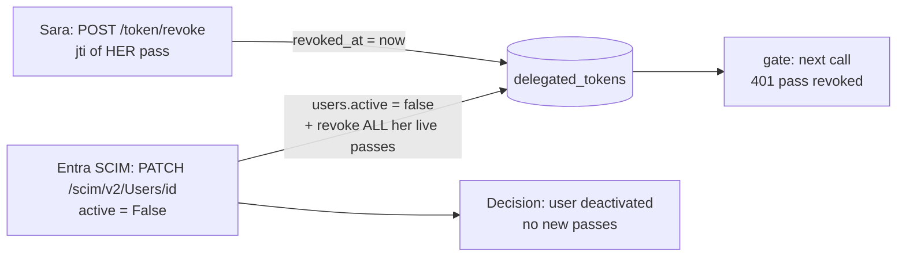

- **Revoke**: only the pass's own user; anyone else gets the same 404 as "doesn't exist".
- **SCIM**: the firm's identity provider authenticates with that firm's secret
  (`Scim:Tenants:<tenant id>`), and can only touch that firm's users. Entra sends `"False"` as a
  string; `false` and `{ "active": false }` work too. Deactivation and revocation are one
  transaction, with an audit row per revoked pass.
- **"Running work stops"**: the agent's very next tool call is refused. A call already in progress
  (one `run_vouch`) finishes.

---

## 14. Entra ID sign-in (step 14)

Set `Entra:TenantId` + `Entra:ClientId` and Warden also accepts Entra tokens
(`Auth/EntraSignIn.cs`). Entra's keys come from its metadata; issuer (your tenant) and audience
(Warden's app) are pinned. Then the token's `tid` + `oid` must be **linked** to a Warden user
(`dotnet run -- link-entra sara <tid> <oid>`); the request continues as that user, with Warden's
own ids, so nothing after sign-in knows or cares which kind of token it was.

Tests use a fake Entra (a key pair made in the test); the real setup is [entra.md](entra.md).

---

## 15. How it's tested

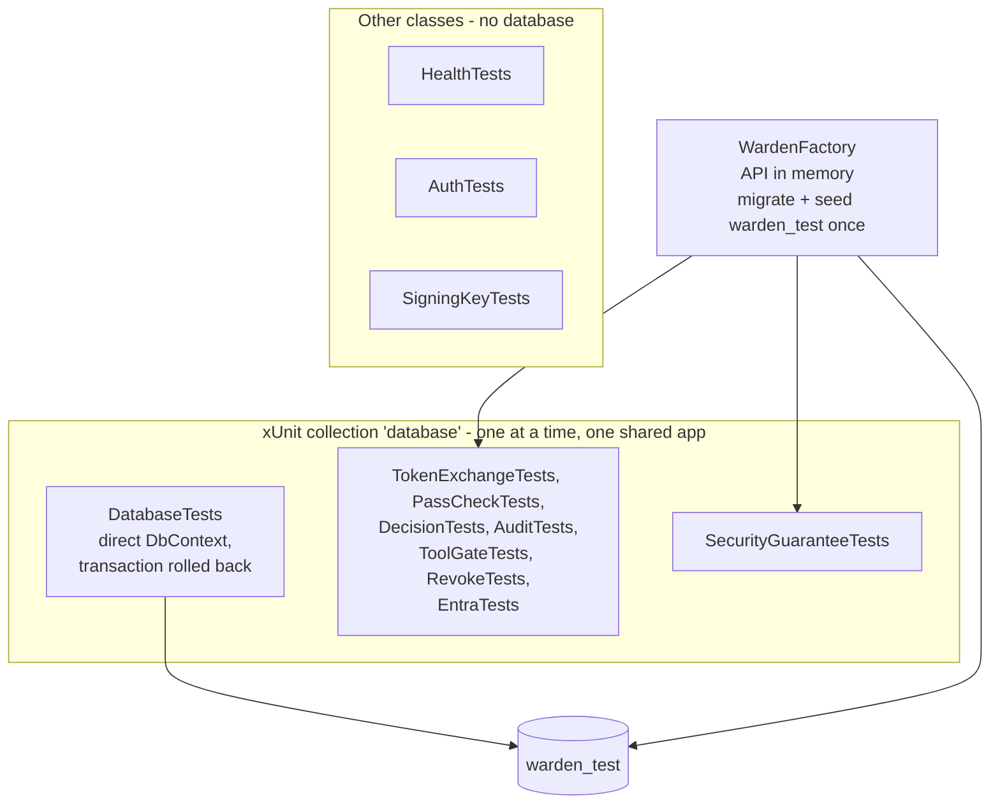

- Tests use the **`warden_test`** database; your dev database `warden` is never touched.
- Classes that use the database share one seeded app and take turns (running them in
  parallel caused duplicate-key errors when two seeded at once).
- Every new check was **broken on purpose once** to see its test fail.

| Test file | Proves |
|---|---|
| `HealthTests` | app starts, `/health` is public |
| `DatabaseTests` | classes ↔ tables round-trip; seed runs once |
| `AuthTests` | no / forged / expired / tenant-less tokens rejected; firm from token |
| `SigningKeyTests` | JWKS public, no private fields; Warden-signed pass verifies, forged doesn't |
| `TokenExchangeTests` | good pass; wall, other firm, unknown agent refused; bad scope 400 |
| `PassCheckTests` | real pass OK; tampered, forged, sign-in token, unlogged, revoked refused |
| `AuditTests` | UPDATE/DELETE/TRUNCATE refused; exchange logs allowed + denied; trail is per firm, walled readers refused |
| `DecisionTests` | tool calls: scope on the pass, agents can't export, walls beat the pass, unknown tool |
| `ToolGateTests` | allowed call forwarded with a 60-s tool token and logged; no/fake pass 401; missing scope 403; revoked 401; tool server down 502 |
| `RevokeTests` | revoke your own pass; nobody else can; SCIM needs the firm's secret, reaches only its users, only changes `active` |
| `EntraTests` | linked Entra account = its Warden user, gets a pass; unlinked / wrong app / other tenant / forged → 401 |
| `SecurityGuaranteeTests` | `agent_cannot_exceed_user_permissions`, `expired_delegated_token_is_rejected`, `ethical_wall_blocks_even_admin`, `tenant_a_cannot_read_tenant_b`, `prompt_injection_cannot_trigger_export`, `scim_deactivation_revokes_agent_tokens` ✅ (credits and human approval: later) |
| `tickmark/tests/test_warden.py` | tools refuse anything but a Warden-forwarded token for that tool; no path escape; client fails closed |

---

## 16. Handy commands

```bash
cd warden
docker compose up -d                               # Postgres on port 5433
dotnet build                                       # 0 warnings expected (warnings = errors)
dotnet test                                        # all tests
dotnet ef database update -p src/Warden.Api        # apply migrations to dev DB
dotnet ef migrations list -p src/Warden.Api
dotnet run --project src/Warden.Api -- seed        # demo data
dotnet run --project src/Warden.Api --no-launch-profile -- dev-token sara   # just the token
dotnet run --project src/Warden.Api -- link-entra sara <tid> <oid>
dotnet run --project src/Warden.Api --urls http://localhost:5000
cd ../tickmark && make warden-demo && make run      # Tickmark's tools on :8000
make agent TOKEN=<dev token>                       # vouch Coke through Warden (ENG=... for another)
docker compose exec postgres psql -U warden        # \dt, \d members, select ...
```

---

## 17. What's next

The MVP is built. Left: the real Entra app registration ([entra.md](entra.md)), then the
"Later" list in [MVP.md](../MVP.md): credits, human approval, Excel add-in sign-in, an
MCP-compatible proxy, deployment.

Known limits (also in [rfc.md](rfc.md) §9):
- The agent only *says* who it is (`agent_id`); proper agent authentication comes later.
- `GET /audit` returns the whole trail (no paging yet).
- Revocation stops the agent at its next call, not in the middle of one.
- One Entra tenant; SCIM secrets in config; only SCIM `active` is synced.
